# plotipus

<p align="center">
  <picture>
    <source media="(prefers-color-scheme: dark)" srcset="docs/images/mascot/mascot-dark.png">
    
  </picture>
</p>

Publication plots and tables from pickled pandas DataFrames, driven by plain
text command lists.

* **You are a scientist, not a designer.** One short command per figure, and
  every figure comes out clean and consistent, with a look of your own.
* **Produce the data once, plot it without limits.** A well-built DataFrame
  is all you ever need to save: it is your immutable source, and every
  figure and table is redrawn from it.
* **Strict format requirements, unlimited versatility.** Journal styles,
  experiment-wide conventions and collaboration rules are a style file or a
  plugin away, without touching your analysis.

Analysis code writes its results as `.pkl` DataFrames (one row per series,
with whole arrays in the cells); plotipus turns them into figures and LaTeX
tables with one command each:

```bash
plotipus line --datafile Distributions -x Bin -y Counts --hue Sample --data_hue Data --lower ratio
plotipus run paper          # every command in input/plots/paper_scripts.txt
```

## Install

```bash
# use the CLI
pipx install git+https://github.com/mantheys/plotipus.git

# development
git clone https://github.com/mantheys/plotipus.git && cd plotipus
python3 -m venv .venv && source .venv/bin/activate   # Debian/Ubuntu: apt install python3-venv
pip install -e ".[dev]"
pytest                                               # run the tests
```

Python ≥ 3.10; depends on numpy, pandas, matplotlib, scipy, rich and jinja2.

## Quick start

Your first plot is the mascot above. It is a DataFrame of 97 shapes, one row
each, drawn by `plotipus line`:

```bash
cd examples/mascot
python make_mascot.py        # input/data/Mascot.pkl
plotipus run mascot          # five figures in output/plots, from points to the finished mascot
```

The [tutorial](docs/tutorial.md) builds it up one command at a time. Then,
from the repository root, try the example project: common physics
distributions as histograms, fits, data/simulation comparisons and maps:

```bash
cd examples
python make_data.py          # toy pickles in input/data
plotipus run example         # figures in output/plots
plotipus run example --tables
```

To regenerate the examples from scratch after a change (`examples/Makefile`;
it uses `.venv/bin/python` when present):

```bash
make -C examples             # delete generated data and outputs, then rebuild all
make -C examples clean       # only delete them (input/data/*.pkl, output/)
make -C examples plots       # rebuild data and plots without deleting first
make -C examples docs        # re-render the figures of docs/options.md
make -C examples mascot      # re-render the mascot and the tutorial figures
```

`plotipus init my_project` creates an empty project (`plotipus.toml`,
`input/{data,plots,tables}`, `output/`).

## Your own data

plotipus reads pickled pandas DataFrames from `input/data/` (the project's
data root): `--datafile Spectrum` loads `input/data/Spectrum.pkl`. The
convention is one row per series, with binned quantities as arrays in the
cells:

```python
import numpy as np
import pandas as pd

x = np.arange(0.25, 10, 0.5)                     # bin centres (GeV)
expected = 200 * np.exp(-x / 3)                  # the simulation's prediction
observed = np.random.default_rng(1).poisson(expected)

pd.DataFrame([
    {"Sample": "Simulation", "Energy": x, "Counts": expected, "CountsError": 0.05 * expected},
    {"Sample": "Data",       "Energy": x, "Counts": observed},
]).to_pickle("input/data/Spectrum.pkl")
```

| Sample | Energy | Counts | CountsError |
|---|---|---|---|
| Simulation | [0.25, 0.75, …, 9.75] | [184.0, 155.8, …] | [9.2, 7.8, …] |
| Data | [0.25, 0.75, …, 9.75] | [184, 149, …] | — |

```bash
plotipus line --datafile Spectrum -x Energy -y Counts --hue Sample --data_hue Data --errory --lower ratio
```

- `-x`, `-y` name the columns to draw; `--hue` names the column that splits
  the rows into series (one colour each); `--data_hue Data` marks the data
  rows, drawn as points.
- Errors live next to the value: `{y}Error` (symmetric) or `{y}Error+` and
  `{y}Error-` (asymmetric). A row without them gets the standard interval
  where one applies: the data here are counts, so they get Poisson
  (Garwood) intervals.
- One value per row (scalars instead of arrays) works too, e.g. for `cat`
  and `table`; `hist` takes the raw values as arrays.
- Several files of one analysis are told apart by prefixes:
  `--configs A --names B --datafile Spectrum` loads `A_B_Spectrum.pkl`.

The pickle may also hold anything `pd.DataFrame` accepts (a list of row
dicts, a dict of columns, or a dict of DataFrames, which are concatenated
with a `Source` column). The rules for drawing them are in the
[style guide](docs/styleguide.md#f-data-conventions).

## Slides first, paper later

One command list renders for every medium, at the size it is shown at:
slides first (8 × 4.5 in), then a paper column (3.4 in) or the web, with no
change to the commands.

```toml
# plotipus.toml
[project]
medium = "slides"             # what plotipus run draws by default
media = ["slides", "paper"]   # what --medium all draws
```

```bash
plotipus run analysis                  # slides, in output/plots/
plotipus run analysis --medium paper   # the same figures for the paper, in output/plots/paper/
plotipus run analysis --medium all     # both in one run
plotipus run analysis --theme dark     # dark slides, in output/plots/slides-dark/
plotipus run analysis --medium paper --dry_run   # print each command's medium, size and style layers
```

File names stay the same in every folder, so a LaTeX `\includegraphics`
only changes its directory. Paper figures carry no title (the caption is the
title; `--keep_title` keeps an explicit `--title`). One command can choose
its own size with `--width single|onehalf|double|nature|slide|half-slide`
or inches, and `--aspect`; a row of panels shares the width, and a lower
panel adds 30% of the upper panel's height.

## Styles

A style is a visual language, a medium and a theme. Pick one by name:

| name | look | size and type |
|---|---|---|
| `slides` (default) | plotipus: ticks in on four sides, no grid, frameless legends, Petroff-10 colours | 8 × 4.5 in, 14 pt sans |
| `slides-dark` | the same on `#1b1d22`, with lightened twins of the darkest colours | 8 × 4.5 in, 14 pt sans |
| `paper`, `paper-dark` | plotipus, no titles (the caption is the title) | a 3.4 in column, 8 pt Computer Modern; save as PDF |
| `open`, `open-dark` | L-shaped frame, ticks out, a faint y grid, the same colours | 8 in at 96 dpi, 12 pt sans |
| `classic` | plotipus before the redesign | 8 × 6 in |

```toml
[project]
style = ["paper", "config/style.json"]   # a name, then your own style files on top
```

```bash
plotipus line ... --style_preset open-dark   # one command in another style
plotipus line ... --save_style               # also write <figure>.style.json: the layers and rcParams used
```

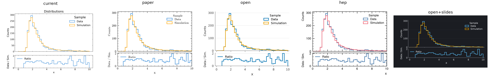

`--medium` and `--theme` change one part of the name (`--style_preset open
--theme dark` is `open-dark`). Styles are layered: the named style, then
what plugins set, then the project's style files, then `--width` and
`--aspect`. An experiment header and a status watermark go on top of any
style: `--experiment dune --label_status Preliminary --watermark wip`, or
`[header]` in `plotipus.toml` ([Projects](docs/projects.md#header-and-watermark)).
**Upgrading?** See the [changelog](CHANGELOG.md):
`style = ["classic"]` keeps the old look.

## Famous plots

Famous figures from particle physics, cosmology, astronomy and climate
science, redrawn by plotipus from datasets built to match the
originals: public data where it exists (Gaia, NOAA, SPARC, LIGO, Hubble's
table), values read back from the published figures' vector graphics for the
Higgs, KamLAND and LEP plots, and synthetic data only for the 1912-1913 tables. Each
one was compared with the published figure. The data generators, the
commands and what is still missing are in
[examples/famous](examples/famous/README.md); `make -C examples famous`
renders them all and refreshes these images. Each command aims at the
original's look (its colours, line styles, markers, legend and
annotations); the text is the paper style's serif at a 3.5 in column
width, one figure size for all.

<p align="center">
  <a href="https://arxiv.org/abs/1207.7214">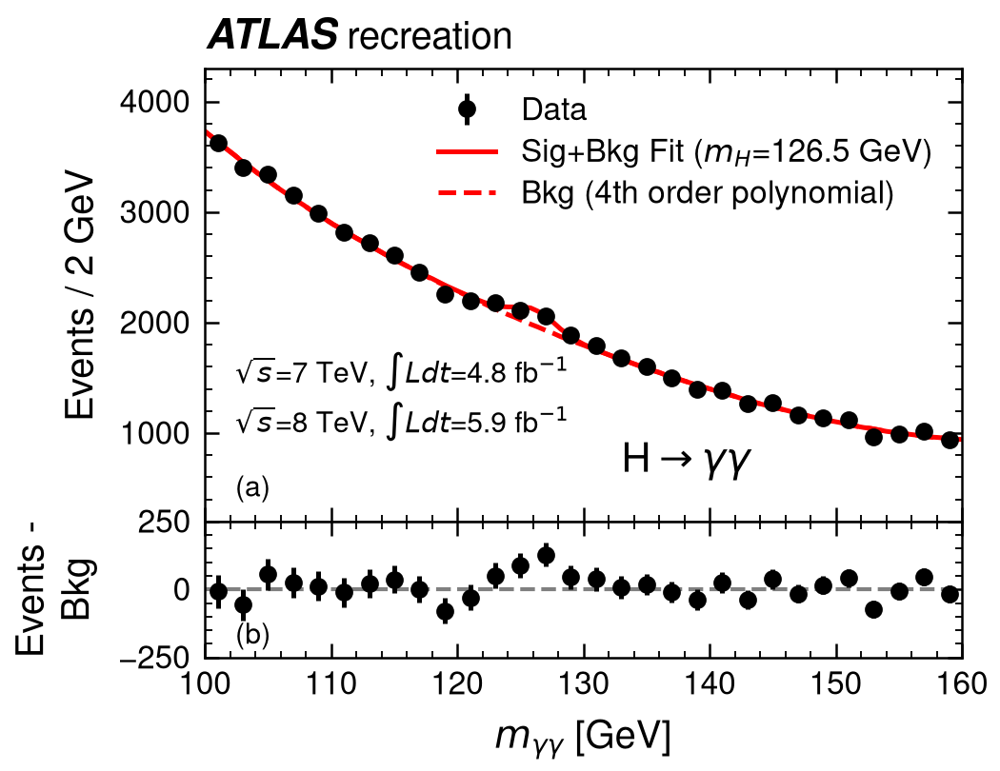</a>
  <a href="https://arxiv.org/abs/1207.7235">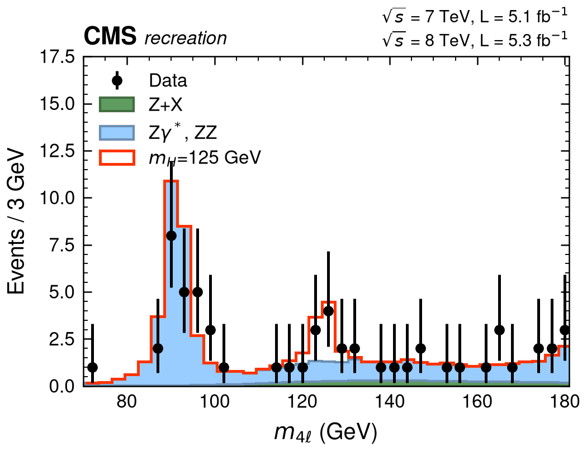</a>
  <a href="https://arxiv.org/abs/1207.7214">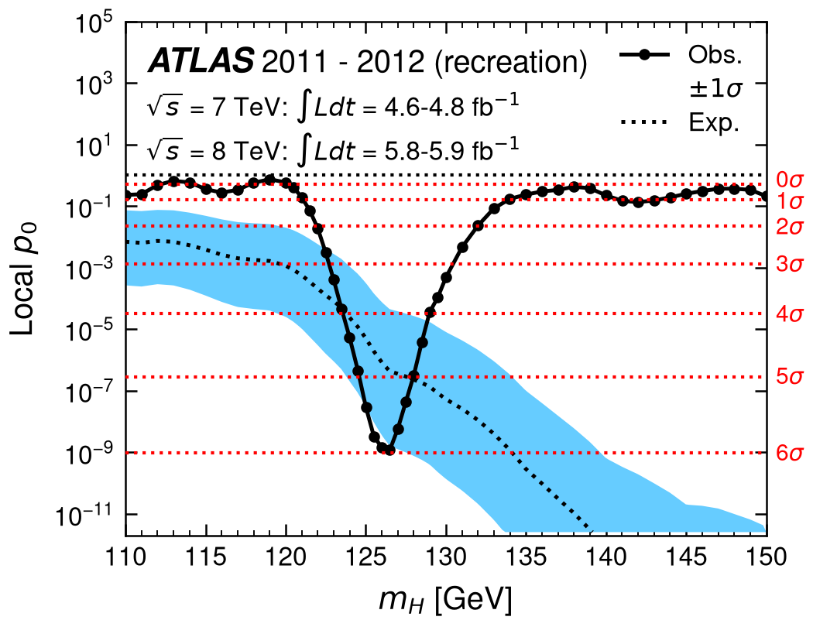</a>
  <br><sub><a href="https://arxiv.org/abs/1207.7214">H→γγ, ATLAS 2012</a> · <a href="https://arxiv.org/abs/1207.7235">H→ZZ*→4ℓ, CMS 2012</a> · <a href="https://arxiv.org/abs/1207.7214">local p₀, ATLAS 2012</a></sub><br><br>
  <a href="https://arxiv.org/abs/1207.7214"></a>
  <a href="https://arxiv.org/abs/hep-ex/0509008">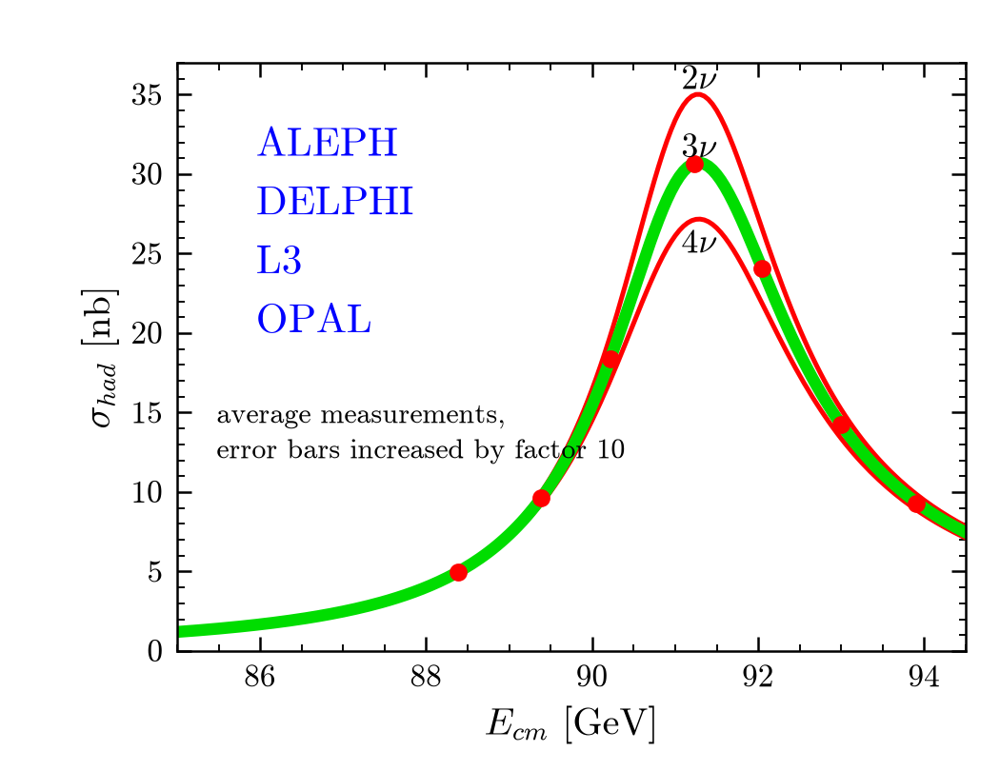</a>
  <a href="https://arxiv.org/abs/0801.4589">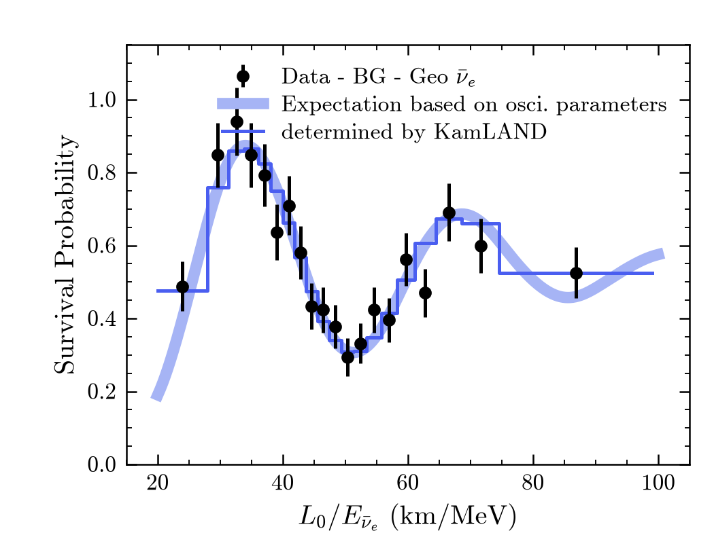</a>
  <br><sub><a href="https://arxiv.org/abs/1207.7214">Brazil band, ATLAS 2012</a> · <a href="https://arxiv.org/abs/hep-ex/0509008">Z lineshape, LEP 2006</a> · <a href="https://arxiv.org/abs/0801.4589">neutrino oscillation, KamLAND 2008</a></sub><br><br>
  <a href="https://arxiv.org/abs/astro-ph/9805201">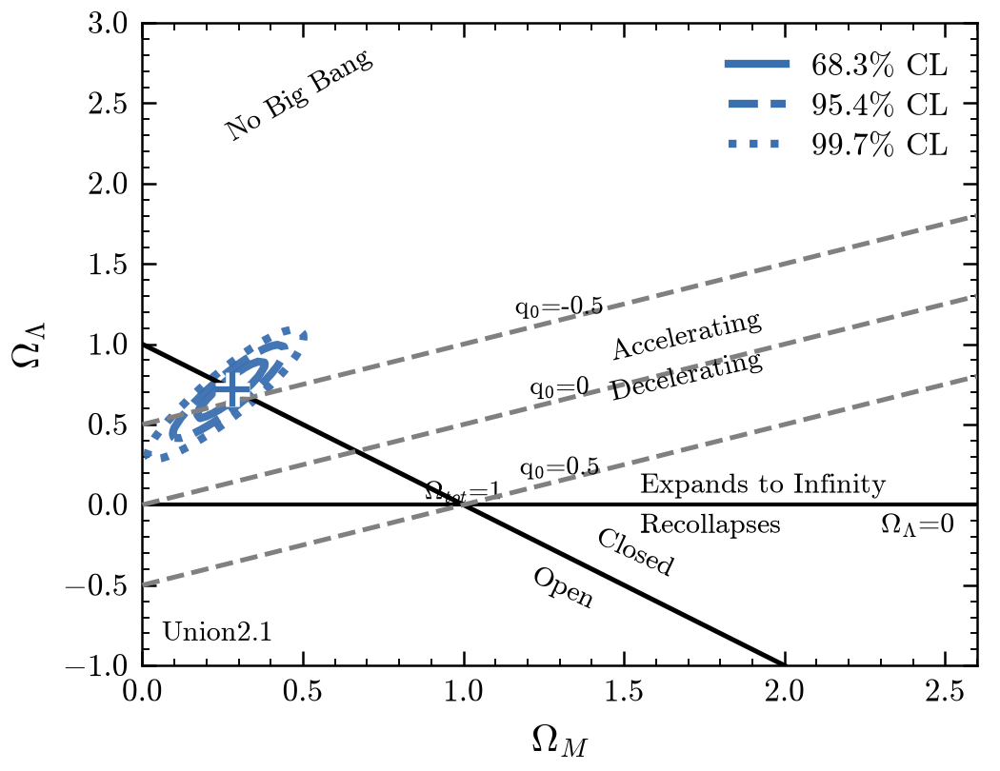</a>
  <a href="https://doi.org/10.1073/pnas.15.3.168">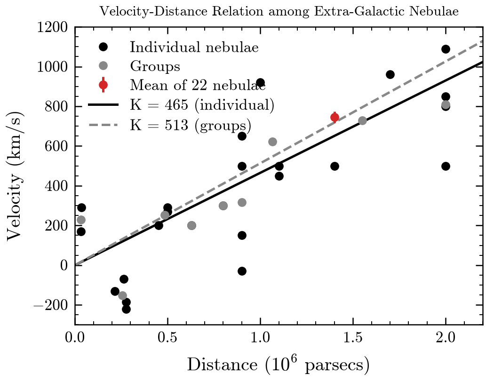</a>
  <a href="https://arxiv.org/abs/1804.09378">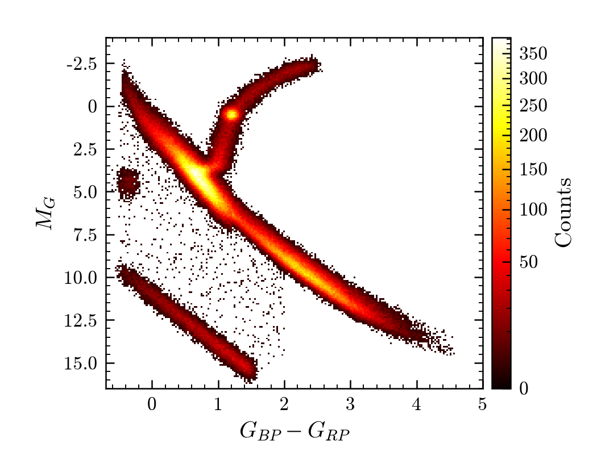</a>
  <br><sub><a href="https://arxiv.org/abs/astro-ph/9805201">Ω<sub>M</sub>–Ω<sub>Λ</sub>, Riess et al. 1998 (Union2.1 data)</a> · <a href="https://doi.org/10.1073/pnas.15.3.168">Hubble 1929 (real data)</a> · <a href="https://arxiv.org/abs/1804.09378">HR diagram, Gaia DR2 2018 (real data)</a></sub><br><br>
  <a href="https://gml.noaa.gov/ccgg/trends/">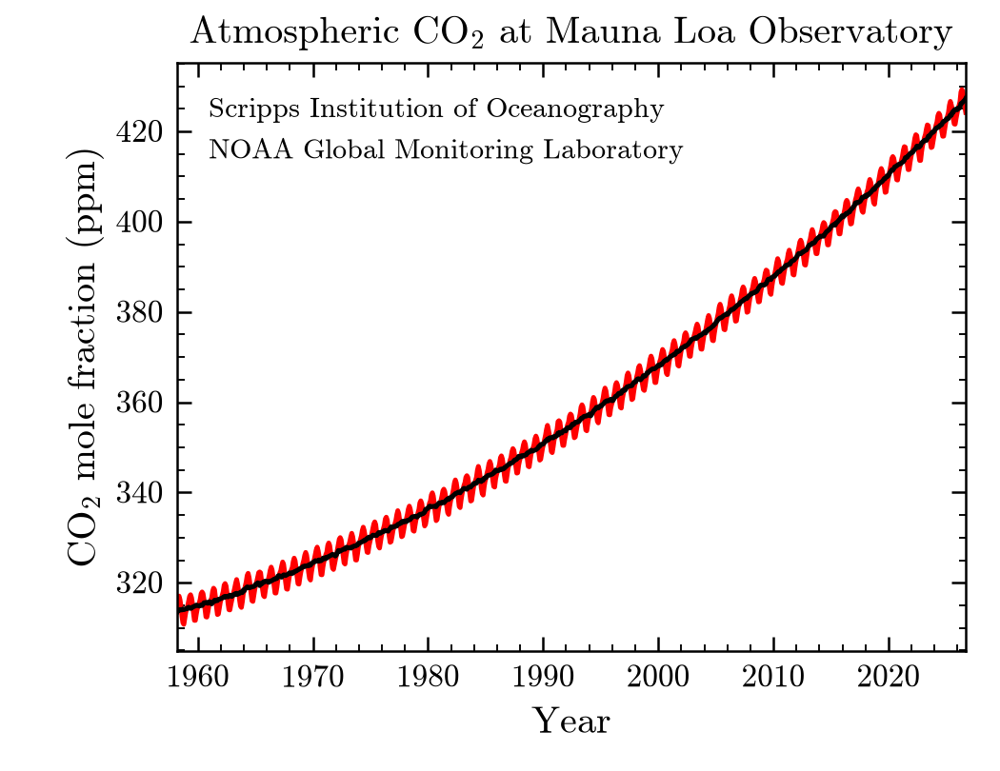</a>
  <a href="https://doi.org/10.1029/1999GL900070">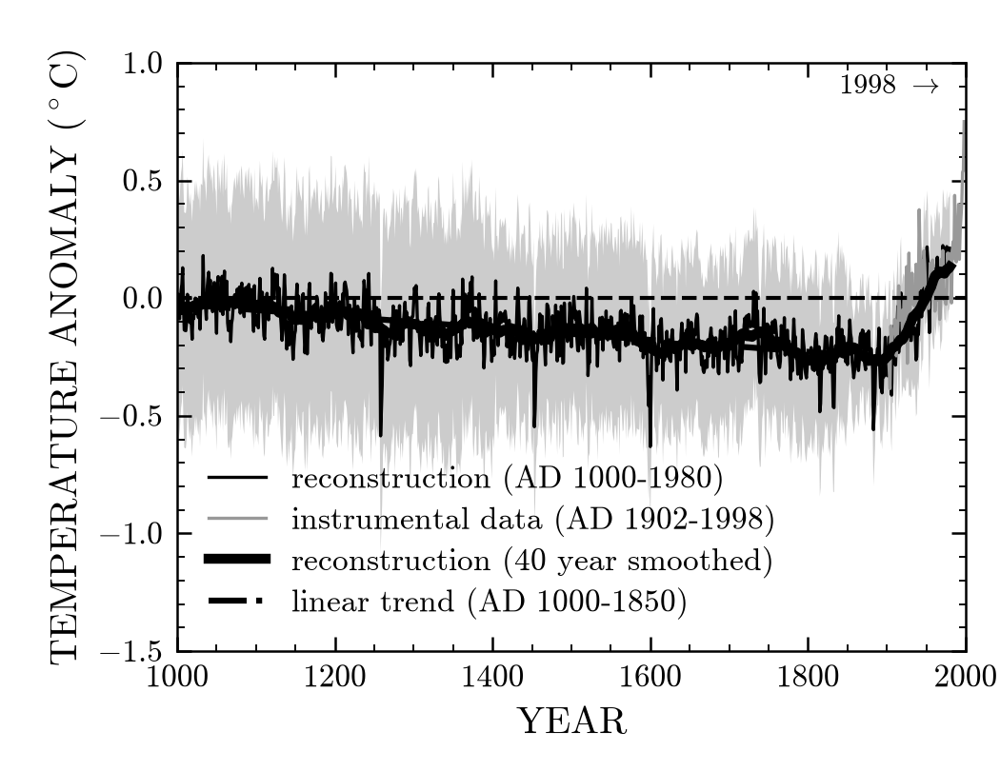</a>
  <a href="https://ui.adsabs.harvard.edu/abs/1985ApJ...295..305V">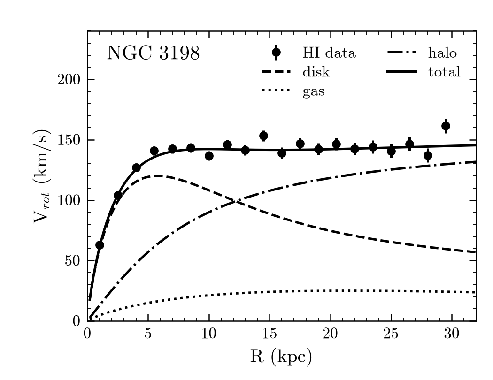</a>
  <br><sub><a href="https://gml.noaa.gov/ccgg/trends/">Keeling curve, NOAA (real data)</a> · <a href="https://doi.org/10.1029/1999GL900070">hockey stick, Mann et al. 1999 (real data)</a> · <a href="https://ui.adsabs.harvard.edu/abs/1985ApJ...295..305V">dark halo of NGC 3198, van Albada et al. 1985 (SPARC data)</a></sub><br><br>
</p>

> These figures are recreations made to demonstrate plotipus. They are not
> the original figures, nor official results of the ATLAS, CMS, LEP,
> KamLAND, LIGO/Virgo or Gaia collaborations or of the original authors,
> who do not endorse this project; the experiment headers say
> "recreation". Values come from public data releases or were read from
> the published figures, so small differences from the originals are
> expected: cite and use the original publications, linked from each
> image. Data sources, licences and credits are listed in
> [examples/famous/data](examples/famous/data/README.md); the HR diagram, made from Gaia
> data, is shared under CC BY-SA 3.0 IGO.

## Gallery

`examples/gallery` has one example for every working row of the
[chart catalogue](docs/design/catalogue.md): histograms, scatters, maps and
contours, fits with residual and pull panels, ratio and significance panels,
ROC and learning curves, error bars and bands, facets, annotations and
LaTeX/HTML tables. It mixes a toy calorimeter test beam and a toy classifier
(synthetic) with the famous-plot data, all in the default style. Build it
with

```bash
make -C examples gallery
```

and open `examples/gallery/output/gallery.md`: every figure for slides and
for paper side by side with its command below, the tables as LaTeX, and the
catalogue rows still waiting for a feature. The outputs are not committed. The command lists,
`examples/gallery/input/{plots,tables}/gallery_scripts.txt`, are also a test
(`tests/test_gallery.py`, marked `slow`).

## Plot kinds

Kinds follow the data relationship (as in seaborn/plotly), not the use case.

| Kind | Draws | Typical options |
|---|---|---|
| `line` | y against an ordered x, one series per `--hue` value, line style per `--style` value | `--plot_type step\|stepmid\|line\|errorbar\|plot\|bar\|barh\|box\|fill` (closed shapes, with `--color_column`, `--edgecolor_column`, `--linewidth_column`, `--plot_type_column`, `--axis equal off`; see the [tutorial](docs/tutorial.md)), `--errory_type poisson\|clopper_pearson`, `--lower`, `--stacked` (`--stack_total_error`), `--data_hue`/`--overlay`, `--series_type VALUE=TYPE`, `--series_marker VALUE=MARKER`, `--errorx_column LOW HIGH`, `--error_scale K` (see [Data and simulation](docs/options.md#data-and-simulation)), `--sum_iterables`, `--merge_iterables`, `--rebin`, `--by_config`, `--fit` (see [Fits](docs/options.md#fits)), `--binned --estimator mean\|median\|std\|rms\|sum\|max\|min` (see [Binned estimators](docs/options.md#binned-estimators)) |
| `scatter` | observations: exploded points with colour/size/marker encodings, or pairs of metrics (`--x_from Variable=Purity --y_from Variable=Completeness`) | `--colorby`, `--sizeby`, `--markerby`, `--aggregate` |
| `hist` | 1D histograms of per-event arrays | `--bins`, `--weight`, `--density`, `--hist_combine`, `--flow none\|hint\|show`, `--errory_type poisson` |
| `map` | 2D: histogram of point arrays, image of a grid (`-z`), contour layer (`--contour`) | `--norm`, `--diagonal`, `--logz`, `--colorbar`, `--contour_sigmas`, `--contour_dof`, `--contour_label`, `--fill_contours`, `--background`, `--no_best_fit` |
| `cat` | one value per category (integrated arrays, or one scalar per row) | `--integrate_over`, `--kind point\|line\|bar`, `--xtick_rotation` |
| `table` | aggregated values as LaTeX (and HTML) tables | `--variables`, `--agg`, `--error_band`, `--clopper_pearson`, `--siunitx`, `--caption_file` |

`plotipus <kind> --help` lists every option. Figures are saved as PNG at
300 dpi; for papers use `--format pdf` (vector, at the printed size).

## Further reading

* [Tutorial](docs/tutorial.md): draw the mascot, from its points to the
  finished figure, one command at a time.
* [Famous plots](examples/famous/README.md): the reproductions above, their
  data, commands and remaining gaps.
* [Style guide](docs/styleguide.md): the conventions plotipus applies by
  default (data, simulation, fits, sizes, uncertainties) and those it does
  not enforce yet.
* [Options](docs/options.md): shared options, lower panels, colorbars,
  contours and binned estimators.
* [Projects](docs/projects.md): `plotipus.toml`, style files, plugins and
  command lists.
* [Python](docs/python.md): using plotipus from Python code.

## License

MIT
