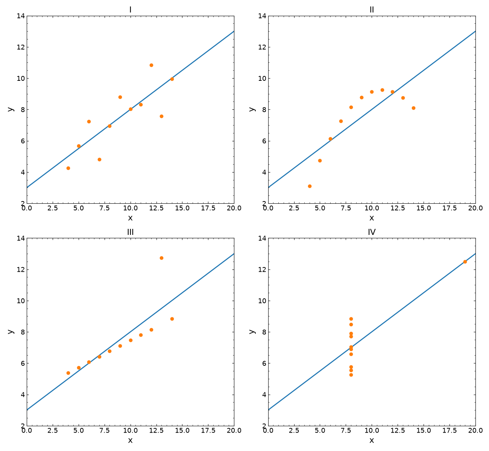

# plotipus

<p align="center">
  <picture>
    <source media="(prefers-color-scheme: dark)" srcset="docs/images/mascot/mascot-dark.png">
    
  </picture>
</p>

Publication plots and tables from pickled pandas DataFrames, driven by plain
text command lists.

* **You are a scientist, not a designer.** One short command per figure, and
  every figure comes out clean and consistent, with a look of your own.
* **Produce the data once, plot it without limits.** A well-built DataFrame
  is all you ever need to save: it is your immutable source, and every
  figure and table is redrawn from it.
* **Strict format requirements, unlimited versatility.** Journal styles,
  experiment-wide conventions and collaboration rules are a style file or a
  plugin away, without touching your analysis.

Analysis code writes its results as `.pkl` DataFrames (one row per series,
with whole arrays in the cells); plotipus turns them into figures and LaTeX
tables with one command each:

```bash
plotipus line --datafile Distributions -x Bin -y Counts --hue Sample --data_hue Data --lower ratio
plotipus run paper          # every command in input/plots/paper_scripts.txt
```

## Install

```bash
# use the CLI
pipx install git+https://github.com/mantheys/plotipus.git

# development
git clone https://github.com/mantheys/plotipus.git && cd plotipus
python3 -m venv .venv && source .venv/bin/activate   # Debian/Ubuntu: apt install python3-venv
pip install -e ".[dev]"
pytest                                               # run the tests
```

Python ≥ 3.10; depends on numpy, pandas, matplotlib, scipy, rich and jinja2.

## Quick start

Your first plot is the mascot above. It is a DataFrame of 97 shapes, one row
each, drawn by `plotipus line`:

```bash
cd examples/mascot
python make_mascot.py        # input/data/Mascot.pkl
plotipus run mascot          # five figures in output/plots, from points to the finished mascot
```

The [tutorial](docs/tutorial.md) builds it up one command at a time. Then,
from the repository root, try the example project: common physics
distributions as histograms, fits, data/simulation comparisons and maps:

```bash
cd examples
python make_data.py          # toy pickles in input/data
plotipus run example         # figures in output/plots
plotipus run example --tables
```

To regenerate the examples from scratch after a change (`examples/Makefile`;
it uses `.venv/bin/python` when present):

```bash
make -C examples             # delete generated data and outputs, then rebuild all
make -C examples clean       # only delete them (input/data/*.pkl, output/)
make -C examples plots       # rebuild data and plots without deleting first
make -C examples docs        # re-render the figures of docs/options.md
make -C examples mascot      # re-render the mascot and the tutorial figures
```

`plotipus init my_project` creates an empty project (`plotipus.toml`,
`input/{data,plots,tables}`, `output/`).

## Plot kinds

Kinds follow the data relationship (as in seaborn/plotly), not the use case.

| Kind | Draws | Typical options |
|---|---|---|
| `line` | y against an ordered x, one series per `--hue` value, line style per `--style` value | `--plot_type step\|stepmid\|line\|errorbar\|plot\|bar\|barh\|box\|fill` (closed shapes, with `--color_column`, `--edgecolor_column`, `--linewidth_column`, `--plot_type_column`, `--axis equal off`; see the [tutorial](docs/tutorial.md)), `--lower`, `--stacked`, `--data_hue` (see [Data and simulation](docs/options.md#data-and-simulation)), `--sum_iterables`, `--merge_iterables`, `--rebin`, `--by_config`, `--fit` (see [Fits](docs/options.md#fits)), `--binned --estimator mean\|median\|std\|rms\|sum\|max\|min` (see [Binned estimators](docs/options.md#binned-estimators)) |
| `scatter` | observations: exploded points with colour/size/marker encodings, or pairs of metrics (`--x_from Variable=Purity --y_from Variable=Completeness`) | `--colorby`, `--sizeby`, `--markerby`, `--aggregate` |
| `hist` | 1D histograms of per-event arrays | `--bins`, `--weight`, `--density`, `--hist_combine`, `--flow none\|hint\|show` |
| `map` | 2D: histogram of point arrays, image of a grid (`-z`), contour layer (`--contour`) | `--norm`, `--diagonal`, `--logz`, `--colorbar`, `--contour_sigmas`, `--contour_dof`, `--contour_label`, `--fill_contours`, `--background`, `--no_best_fit` |
| `cat` | one value per category (integrated arrays) | `--integrate_over`, `--kind point\|line\|bar` |
| `table` | aggregated values as LaTeX (and HTML) tables | `--variables`, `--agg`, `--error_band`, `--clopper_pearson`, `--siunitx`, `--caption_file` |

`plotipus <kind> --help` lists every option.

## Famous plots

Famous figures from particle physics, cosmology, astronomy, climate science
and statistics, redrawn by plotipus from datasets built to match the
originals (synthetic, except Hubble's and Anscombe's published tables). Each
one was compared with the published figure. The data generators, the
commands and what is still missing are in
[examples/famous](examples/famous/README.md); `make -C examples famous`
renders them all and refreshes these images.

<table>
  <tr>
    <td align="center"><br><a href="https://arxiv.org/abs/1207.7214">H→γγ, ATLAS 2012, Fig. 4</a></td>
    <td align="center"><br><a href="https://arxiv.org/abs/1207.7235">H→ZZ*→4ℓ, CMS 2012, Fig. 4</a></td>
    <td align="center"><br><a href="https://arxiv.org/abs/1207.7214">Local p₀, ATLAS 2012, Fig. 9</a></td>
  </tr>
  <tr>
    <td align="center"><br><a href="https://arxiv.org/abs/1207.7214">Brazil band, ATLAS 2012, Fig. 7(a)</a></td>
    <td align="center"><br><a href="https://arxiv.org/abs/hep-ex/0509008">Z lineshape, LEP 2006, Fig. 1.13</a></td>
    <td align="center"><br><a href="https://arxiv.org/abs/0801.4589">Neutrino oscillation, KamLAND 2008, Fig. 3</a></td>
  </tr>
  <tr>
    <td align="center"><br><a href="https://arxiv.org/abs/astro-ph/9805201">Ω<sub>M</sub>–Ω<sub>Λ</sub>, Riess et al. 1998, Fig. 6</a></td>
    <td align="center"><br><a href="https://doi.org/10.1073/pnas.15.3.168">Hubble 1929, Fig. 1 (real data)</a></td>
    <td align="center"><br><a href="https://arxiv.org/abs/1804.09378">HR diagram, Gaia DR2 2018, Fig. 1</a></td>
  </tr>
  <tr>
    <td align="center"><br><a href="https://gml.noaa.gov/ccgg/trends/">Keeling curve, NOAA GML</a></td>
    <td align="center"><br><a href="https://doi.org/10.1029/1999GL900070">Hockey stick, Mann et al. 1999, Fig. 3(a)</a></td>
    <td align="center"><br><a href="https://doi.org/10.1080/00031305.1973.10478966">Anscombe's quartet, 1973 (real data)</a></td>
  </tr>
</table>

## Further reading

* [Tutorial](docs/tutorial.md): draw the mascot, from its points to the
  finished figure, one command at a time.
* [Famous plots](examples/famous/README.md): the reproductions above, their
  data, commands and remaining gaps.
* [Options](docs/options.md): shared options, lower panels, colorbars,
  contours and binned estimators.
* [Projects](docs/projects.md): `plotipus.toml`, style files, plugins and
  command lists.
* [Python](docs/python.md): using plotipus from Python code.

## License

MIT
