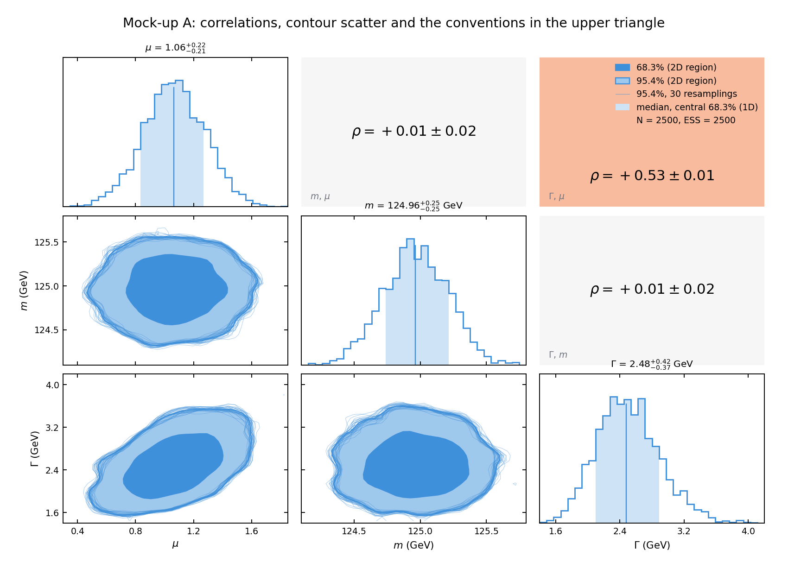
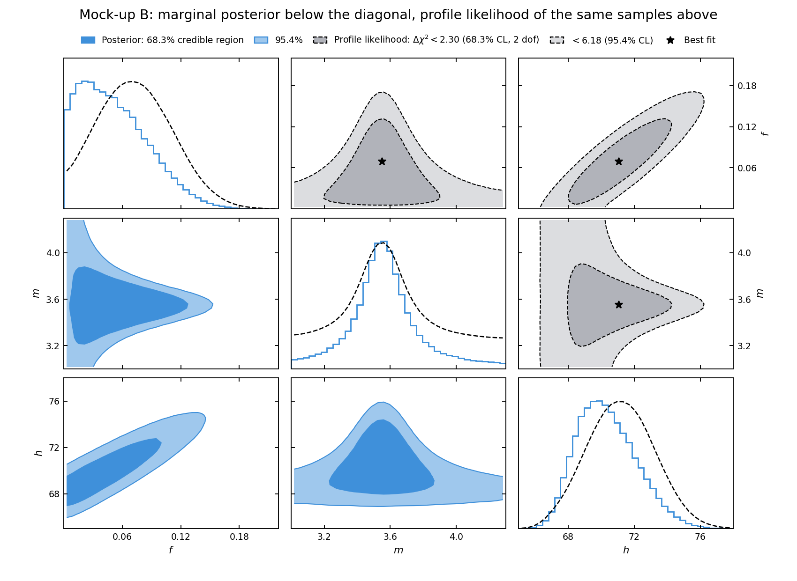
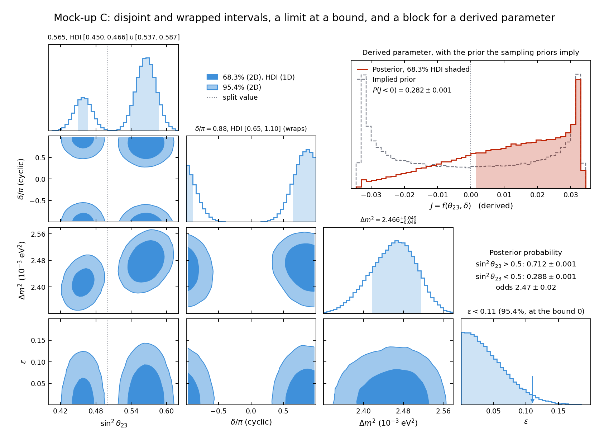

# Posterior corner plots: what plotipus could add

Research and design for `map --corner ... --contour` after T25.1. Nothing
here is implemented. The survey was done on 2026-11-14 from the tools'
documentation and source and from the captions and tables of the papers
cited; the figures themselves were not viewed, so statements about colour
and layout come from captions. Claims that could not be checked are marked
*unverified*.

**Result in one paragraph.** The existing tools draw the posterior well and
stop there. What authors add by hand afterwards is what tells the reader how
to *read* it: which convention the levels follow, how a cyclic, bounded or
two-peaked marginal was summarised, how probable each discrete hypothesis
is, whether the posterior is where the likelihood is, and whether the sample
is large enough for the outer contour. Those are the proposals ranked first
below. The upper triangle is the natural place for them, because each one is
a second view of the same pair of parameters or a number about it.

**Status (2026-11-15).** P1 to P7 and the band of P8 are implemented
(T25.21–T25.27; `docs/options.md`, "Hexbin and corner plots"). Open:
`--corner_truth_level` of P8, and the points listed under the Bayesian table
of T25. The split probabilities went into the legend, not an upper cell: it
moves with the layout and works for two parameters. The prior (P6) is a row
of draws named with `--corner_prior`, and the block takes its columns from
the same row of data; both follow the proposal. A posterior corner plot is
drawn at the double-column width on paper.

Contents: [where plotipus stands](#1-where-plotipus-stands) ·
[tools](#2-what-the-tools-draw-and-where-they-stop) ·
[papers](#3-how-the-figures-are-used-in-papers) ·
[layout](#4-the-upper-triangle-three-kinds-of-space) ·
[proposals](#5-proposals-ranked) ·
[not building](#6-what-i-would-not-build) ·
[mock-ups](#7-mock-ups) · [sources](#8-sources)

## 1. Where plotipus stands

`map --corner X1 ... XN --contour` draws the smallest regions holding 68.3
and 95.4% of the (weighted) points below the diagonal, step marginals with
the median and central 68.3% interval on it (written above each panel for a
single sample), `--contour_hue` samples overlaid, `--corner_truth` lines,
and a legend in the top-right cell. T25.2 already lists highest-density
intervals, a prior density over each marginal, KDE marginals, a second
sample in the upper triangle, the points outside the outer region and
per-parameter ranges. Everything below goes beyond that list or changes how
one of its items should be built.

Two defaults are already better than the most used tool: the 2D levels are
stated as content (68.3%, 95.4%) in the legend, and they are the levels
physics papers use (section 3). corner.py's defaults are 11.8, 39.3, 67.5
and 86.4%.

## 2. What the tools draw and where they stop

| | corner.py | GetDist | ChainConsumer 1.x | ArviZ | anesthetic | pygtc | dynesty | UltraNest |
|---|---|---|---|---|---|---|---|---|
| Upper triangle | no (`reverse` moves the whole plot) | second set of chains (`upper_roots`) | legend only | `triangle='both'`, same drawing twice | another plot kind (scatter above, KDE below) | *unverified* | no | no |
| Correlation in the figure | no | no (matrix and files) | no (LaTeX table) | no | no | no | no | no |
| Numbers | titles: median, 16/84% quantiles | title of the first chain; LaTeX table | title for one chain; LaTeX table | titles in `plot_posterior` | none | none | titles (95%) | titles |
| Interval definitions | equal-tailed | equal-tailed, equal-density, one-sided chosen automatically | max, central, cumulative, mean, HDI | HDI (94%), equal-tailed | quantiles | none | equal-tailed | equal-tailed |
| Default 2D levels | 11.8/39.3/67.5/86.4% | 68/95% | 68/95% (`sigma2d`: 39/86%) | 25/50/90% (new), 50/80/94% (old) | 68/95% | 68/95% (option: 39/86%) | as corner.py | 39.3/68.3/95.4/99.7% |
| Convention written on the figure | no | no | optional % labels on the contours | no | no | no | no | **yes**, a legend "credible prob level" |
| Prior | no | no | no | separate 1D plot | **yes**, the nested run reweighted to the prior | Gaussians on the diagonal | no | no |
| Bands for outside constraints | lines and points only | `add_x_bands`, markers | truth lines | reference value, ROPE | `axlines`, `axspans` | truth lines | truth lines | as corner.py |
| Likelihood next to the posterior | no | mean likelihood of the samples (not a profile) | no | no | no | no | no | no |
| Cyclic parameters | no | **yes**, periodic KDE | no | 1D only (`circular`) | no | no | no | no |
| Several modes | no | no | 1D HDI in pieces (`multimodal`) | 1D HDI in pieces | no | no | no | no |
| Sample size or convergence on the figure | a log message when contour levels coincide | no (text tests) | no | no (separate plots) | no | no | no | no |
| Pairs of choice, many parameters | no | rectangle, 2D, 3D plots | `plot_summary` | `plot_pair_focus`, forest | rectangle | no | no | no |
| Weights; smoothing | yes; smoothed histogram | yes; boundary-corrected KDE, automatic width | yes; histogram or KDE | no; KDE | yes; KDE | yes; smoothed histogram | yes; smoothed histogram | yes; as corner.py |

Notes on the cells that matter for the proposals:

- **GetDist** is the only tool that turns a marginal into a limit by itself:
  when the density at a hard bound of the `.ranges` file is high enough, the
  table says `< X` or `> X`, or `---` for no constraint
  ([types.py][gd-types], [analysis settings][gd-settings]; the exact branch
  that decides was not read). Its "mean likelihood" lines
  (`plot_meanlikes`, `shade_meanlikes`) are the weighted mean of the
  likelihood of the samples in each bin, not the maximum
  ([CosmoMC readme][cosmomc]).
- **Correlation numbers inside the panels** exist in two smaller tools,
  `cornerhex` (`show_correlations`) and PairPlots.jl (`PearsonCorrelation()`,
  or any function of the two columns) ([cornerhex][cornerhex],
  [PairPlots.jl][pairplots]). Neither gives the number an uncertainty.
- **bilby** draws any analytic prior on the diagonal (`priors=True`) and
  writes the evidences in the legend when several results are compared; its
  2D levels are 39, 86 and 99% ([result.py][bilby]). **PESummary** has
  bounded and periodic KDEs ([docs][pesummary]).
- **Requests the tools never answered.** corner.py: upper triangle
  ([#74][c74], [#75][c75]), priors ([#50][c50]), highest-density intervals
  ([#153][c153]), the confusion over its sigma note ([#123][c123]); all
  open. ChainConsumer closed one-sided limits ([#70][cc70]) and a prior
  overlay ([#74][cc74]) without adding them.

**What no surveyed tool does.**
1. Show the sample size, the effective sample size or the Monte Carlo
   uncertainty of a region on the corner plot.
2. Draw a profile likelihood or Δχ² contours from the same samples next to
   the marginal posterior.
3. Give the posterior probability of a discrete hypothesis (a mode, a sign,
   a side of a value) with the figure.
4. Report an interval that wraps around a cyclic axis as one interval.
5. Mark derived parameters, or give them room outside the grid.
6. Say on the figure which interval the marginal carries (only UltraNest
   states the levels).
7. Compare the posterior with the prior in numbers (shrinkage, shift).

## 3. How the figures are used in papers

**Neutrino oscillations.** These are the hardest posteriors for a corner
plot: one cyclic parameter, two discrete choices and a derived quantity.

- NOvA's Bayesian analysis ([2311.07835][nova]) draws each 2D posterior
  twice, once per mass ordering, with both normalised together; shades
  "1σ 2σ 3σ" credible regions; plots δCP on [0, 2π]; splits the marginal of
  sin²2θ13 into its upper- and lower-octant parts and lays the reactor
  interval over it as a hatched band; shows the Jarlskog invariant under two
  priors (flat in δCP, flat in sin δCP); and writes intervals as unions,
  including one that wraps: "[0.54π, 1.07π] ∪ [1.99π, 0.48π]". A 2×2 table
  beside the figures gives the Bayes factors and posterior probabilities of
  octant × ordering. A footnote warns that significances cannot be read off
  the marginal.
- T2K ([2303.03222][t2k]) has a four-parameter triangle with 68% (dashed)
  and 90% (solid) regions, three shaded intervals (68, 90, 95%) on each
  marginal and δCP on [−π, π]; overlays "T2K only" on "T2K + reactor";
  overlays the prior on the Jarlskog posterior; gives the octant × ordering
  table; and compares Bayesian with frequentist contours.
- The T2K+NOvA joint fit ([2510.19888][joint]) puts the orderings side by
  side, overlays the 1σ regions of each experiment alone, and draws the 1D
  posteriors on a log axis. It uses "1σ, 2σ, 3σ" in one figure and "68% and
  90%" in another.
- T2K's study of priors ([2507.02101][t2kprior]) draws corner plots of the
  prior alone, and a band over the spread of interval edges under ten
  priors.
- The global fits are frequentist: NuFIT 6.0 ([2410.05380][nufit]) draws a
  triangle of Δχ² regions at "1σ, 90%, 2σ, 99%, 3σ CL (2 dof)", filled for
  one variant and outlined for the other, with the 1D Δχ² curves of both
  orderings in a separate figure; Bari ([2503.07752][bari]) and Valencia
  ([2006.11237][valencia]) do the same, and Valencia overlays Bayesian and
  frequentist 1D results.

**Global and EFT fits.** With 20 to 50 parameters nobody draws the full
triangle. SMEFiT ([2105.00006][smefit], [2404.12809][smefit3]) shows a grid
of 1D posteriors, bars with thick 68% and thin 95% intervals, and a
correlation heatmap with |ρ| < 0.2 removed; Fitmaker ([2012.02779][fitmaker])
shows individual against marginalised bounds and selected pairs. GAMBIT's
flavour fit ([2006.03489][gambit-flav]) draws a *profile-likelihood*
triangle; GAMBIT's plotting tool pippi produces profile likelihoods and
marginal posteriors of the same scan with a best-fit star and a
posterior-mean dot ([1705.07908][gambit]; the side-by-side layout is
*unverified* here). No paper was found with correlation numbers in the
upper triangle.

**Collider measurements.** The corner plot's place is taken by three
figures: pulls and constraints of the nuisance parameters, their impacts,
and a correlation heatmap (T25.9, T25.11). ATLAS's fully Bayesian unfolding
([2208.12095][atlas-fbu]) tabulates impacts before and after
marginalisation. What a corner plot can borrow is the comparison with the
prior: the shift in units of the prior width and the ratio of posterior to
prior width.

**Cosmology.** GetDist triangles with 68 and 95% regions everywhere.
Planck 2018 ([1807.06209][planck]) uses the upper triangle for a second data
combination. One-sided 95% limits are routine. The recent change is the
profile likelihood shown next to the posterior to expose prior-volume
effects: Herold et al. ([2112.12140][herold]) find a posterior limit
f_EDE < 0.072 where the profile has its best fit at 0.072 ± 0.036; the
PROSPECT code ([2312.02972][prospect]) draws profiles in one row and
posteriors in the next; a community review calls full profile triangles
computationally unfeasible when each point is a minimisation
([2504.01669][cosmoverse]). KiDS-1000 ([2007.15632][kids]) and DES Y3
([2105.13549][des]) mark two point estimates (the maximum and the marginal
one) for the same reason.

**Gravitational waves.** One level, 90%. The prior is shown with every
marginal, as the lower half of a split violin in the catalogues
([2111.03606][gwtc3], [2508.18082][gwtc4]), including the *effective* prior
of derived quantities such as χ_p. Waveform models are overlaid
([2009.01190][gw190521]). Reporting of effective sample sizes and of
divergences between prior and posterior is common practice but was not
verified in this survey.

**Conventions.** Every Bayesian paper above uses regions of 68.3% (or 90%)
content in 2D; none uses 39.3%. Frequentist figures say "2 dof". The one
place the 39% convention survives in HEP is EFTfitter's documentation
([1605.05585][eftfitter]). So the convention is settled in the papers and
unsettled in the tools, and a reader of a figure made with corner.py's or
bilby's defaults cannot tell which they are looking at.

**What authors add by hand**, in the order of how often it appeared:

1. the probabilities of discrete hypotheses, and marginals split by them;
2. intervals for cyclic and two-peaked marginals;
3. the level convention, in the legend;
4. the prior, on the marginals or as a figure of its own;
5. the profile likelihood, or frequentist contours over the Bayesian ones;
6. bands for outside constraints, and fits with and without them;
7. other experiments or data combinations in the same panels;
8. the best fit next to the marginal estimate;
9. a reference point (Standard Model, CP conservation) with its pull.

Nobody shows the Monte Carlo uncertainty of a contour. That is a gap in the
papers as well as in the tools.

## 4. The upper triangle: three kinds of space

The upper triangle is not one empty space but three, and the proposals use
them differently.

```
N = 4            c0      c1      c2      c3
        r0     [ d0 ]  ( m01 ) [  block      ]      d   diagonal (marginal)
        r1     [ p  ]  [ d1 ]  [  2 × 2      ]      p   pair (credible regions)
        r2     [ p  ]  [ p  ]  [ d2 ]  ( m23 )      m   mirrored cell of a pair
        r3     [ p  ]  [ p  ]  [ p  ]  [ d3 ]       block: the top-right ⌊N/2⌋ × ⌊N/2⌋ cells
```

- **Mirrored cells.** The cell above the diagonal at (r, c) belongs to the
  same pair as the panel at (c, r), with the axes exchanged, so it shares x
  with its column and y with its row. It suits a second view of *that pair*:
  another sample, the profile likelihood, or its correlation coefficient.
- **The block.** The top-right ⌊N/2⌋ × ⌊N/2⌋ cells touch no diagonal panel,
  so they can hold one larger panel with axes of its own: a derived
  parameter, or an enlarged pair. It exists from N = 4 (four cells; at N = 3
  it is the single legend cell).
- **The legend cell.** Top right, used today. When the mirrored cells are
  all drawn, the legend moves above the grid, where plotipus already
  reserves room (style guide G1).

One option should choose the mirrored view, because the views exclude each
other: `--corner_upper sample VALUE | profile | corr`. This replaces the
`--corner_upper VALUE` sketched in T25.2. The block is a separate option
and can be combined with `corr`, which then fills only the cells outside
it.

The fixed figure size (L1) limits all of this. The figure is two facets
wide whatever N is, so the panels and the text inside them shrink as N
grows; numbers in cells are readable up to about N = 6 on slides and N = 4
on a paper column, and plotipus should say so rather than shrink the type
(see P7).

## 5. Proposals, ranked

Ranking is by how much a reader gains, weighted by how many of the surveyed
fields need it, against the work. Effort: S is a session, M is two or three.
"DataFrame" lists what is needed beyond the T25 convention (one row per
chain or experiment, one array column per parameter, optional `Weight`).

| rank | proposal | exists in a tool? | who needs it | effort |
|---|---|---|---|---|
| 1 | P1 Conventions and sample size on the figure | levels: UltraNest only; sample size: no | everyone | S |
| 2 | P2 Intervals that follow the marginal: cyclic, bounded, in pieces | pieces: ChainConsumer, ArviZ; limits and periodic KDE: GetDist; a wrapped interval: no | neutrinos, GW, cosmology limits | M |
| 3 | P3 Probabilities of discrete hypotheses | no | neutrinos (ordering, octant), sign and mode questions anywhere | M |
| 4 | P4 Profile likelihood above, posterior below | no (GetDist: mean likelihood) | cosmology, global and EFT fits, any fit with flat directions | M |
| 5 | P5 Monte Carlo uncertainty of the regions | no | everyone with a short or weighted chain | M |
| 6 | P6 The prior as a sample: shrinkage, and a block for derived parameters | prior overlay: anesthetic, bilby; the rest: no | collider nuisances, GW, neutrinos (Jarlskog) | M |
| 7 | P7 Correlation coefficients in the mirrored cells | in the panels: cornerhex, PairPlots.jl; with an uncertainty: no | global and EFT fits, nuisance studies | S |
| 8 | P8 Outside constraints and the reference point's tension | bands: GetDist, anesthetic; tension: ArviZ in 1D | neutrinos (reactor), EFT (SM point) | S |

### P1. Conventions and sample size on the figure

*Need.* A corner plot carries two conventions that the figure itself rarely
states: what the 2D regions contain, and which interval the marginal and
its title carry. The style guide asks that every number says which method
produced it (principle 3); plotipus's corner titles do not yet.

*Proposal.* No new option for the default behaviour:

- The legend entries become "68.3% (2D region)" and "95.4% (2D region)",
  and gain one entry for the marginal's shading: "median, central 68.3%"
  (or "mode, 68.3% HDI" with T25.2).
- A last legend line gives the sample: "N = 40 000" for unit weights,
  "N = 40 000, ESS = 3 100" when it can be computed (below).
- `--contour_dof 1` on a posterior prints a warning that the regions then
  hold 39.3 and 86.5%, and the legend says so.
- New: `--corner_levels 68 90` gives the content directly, for the fields
  that do not use σ (T2K: 68/90%; GW: 90%). `--contour_sigmas` stays.
- A warning when a region is not supported by the sample: fewer than about
  25 effective draws outside it (the tail of a 99.7% region needs an ESS of
  roughly 10 000). The number is a starting point to tune.

One fact for the documentation rather than the figure: the 68.3% region of
a pair is wider than the 68.3% intervals of its two marginals (for a
Gaussian it projects to ±1.52σ), so shaded marginals and regions are not
expected to line up.

*ESS.* For weighted draws, Kish's (Σw)²/Σw². For chains stored as separate
rows in draw order (the `Chain` convention T25 leaves open), the
rank-normalised bulk ESS of T25.4, the smallest over the parameters drawn.
When neither applies (one row, unit weights, order unknown) the figure says
N only, and the warning names the assumption that the draws are
independent.

*Command.*
```bash
plotipus map --datafile Posterior --corner Strength Mass Width --contour --contour_hue Chain --corner_levels 68 90
```
*DataFrame.* Nothing new; ESS wants `Weight` or one row per chain.

### P2. Intervals that follow the marginal

*Need.* T25.2 adds the highest-density interval. Three cases remain where a
single interval is wrong whichever definition is used: the HDI of a
two-peaked marginal is a union (octant of θ23); the interval of a cyclic
parameter can cross the end of the axis (δCP); and a marginal that is
highest at a physical bound has a limit, not an interval (Σm_ν, f_EDE, a
signal strength). Authors write the first two by hand; GetDist does the
third.

*Proposal.*
- `--corner_cyclic VAR [LOW HIGH]`: the variable is periodic (default range
  −π to π when the data fit, else the given one). The 1D and 2D smoothing
  wraps, so a region that crosses the edge is one region and its content is
  right; the interval is searched on the circle and written as one interval
  whose upper end is past the edge ("[0.65π, 1.10π]"); the correlation of
  P7 is not written for it. A warning if draws fall outside the range.
- `--corner_bound VAR LOW HIGH` (`nan` for none): a hard bound. Binning and
  smoothing stop at it (no leak across, T25.2's KDE reflects there). When
  the density at the bound is above the density at the interval's other
  end, plotipus writes a one-sided limit at the outer level, "ε < 0.11
  (95.4%)", shades up to it, and prints a warning that it replaced the
  interval and how to force either (`--corner_interval limit|hdi|quantile`).
- With `--corner_interval hdi`, disjoint pieces are drawn and written as a
  union and never merged, the same rule T25.10 sets for profile scans.

*Command.*
```bash
plotipus map --datafile Oscillation --corner S23 DeltaCP Dm32 --contour --corner_interval hdi --corner_cyclic DeltaCP --corner_bound S23 0 1
```
*DataFrame.* Nothing new. The bounds could later come from a `Prior` row
(P6) instead of the command.

*Mock-up C* shows the three cases.

### P3. Probabilities of discrete hypotheses

*Need.* The most frequent hand-made addition in the neutrino papers: the
posterior probability of each mass ordering and octant, as a table beside
the corner plot, and the marginal split into the parts each hypothesis
contributes. The same question appears whenever a posterior has modes or a
parameter has a meaningful sign (Jarlskog below or above 0, a Wilson
coefficient's sign-flipped solution).

*Proposal.* `--corner_split`, in two forms:

- `--corner_split VAR VALUE`: the two sides of a value of a drawn parameter
  ("sin²θ23 above and below 0.5");
- `--corner_split COLUMN`: a per-draw label column that is not drawn (the
  ordering sampled as a discrete parameter).

It draws a dotted line at the value, and writes in an upper cell the
probability of each side with its binomial uncertainty at the effective
sample size, and the posterior odds. A Bayes factor is written only with
`--prior_odds`, because the odds are the Bayes factor only for equal prior
probabilities: no silent guess. `--corner_split_marginals` stacks the parts
in each diagonal panel, as NOvA does for θ13. Two splits give the 2×2 table
of the oscillation papers.

Drawing each hypothesis in panels of its own is not part of this: that is a
`--contour_hue` over the label, which works today once the label is a row
key. What is missing there is the joint normalisation of the marginals,
which `--corner_split_marginals` provides.

*Command.*
```bash
plotipus map --datafile Oscillation --corner S23 DeltaCP Dm32 --contour --corner_split S23 0.5 --corner_split Ordering --prior_odds 1
```
*DataFrame.* For the second form, an array column of labels as long as the
parameter arrays.

### P4. Profile likelihood above, posterior below

*Need.* When the two disagree, the posterior is shaped by the prior volume
and not by the data, and the reader should know. Cosmology now publishes
the two side by side, GAMBIT always has, and the neutrino experiments
overlay frequentist contours on Bayesian ones. No corner tool draws it,
because the tools take samples without their likelihood.

*Proposal.* `--corner_upper profile --loglike LogLike`:

- mirrored cells: the regions where −2Δln L, maximised over the draws in
  each bin, is below 2.30 and 6.18 (2 dof, the levels of `map --contour -z`),
  dashed and in the neutral colour so that they are not read as a second
  sample, with the best-fit draw as a marker;
- diagonal: the 1D profile exp(−Δχ²/2) scaled to the marginal's peak, as a
  dashed line over the step;
- legend above the grid, with both conventions written out.

*What it is not.* The maximum over the draws in a bin is below the true
maximum, the more so the fewer draws the bin holds, so the profile of a
chain is conservative in the tails and noisy at the edge. The option
therefore blanks bins with fewer than a minimum number of draws, warns with
the fraction blanked, and the documentation says that a profile for
publication comes from a minimiser, drawn with `map --contour -z` (G8) or
`line --scan_interval` (T25.10). Its purpose in the corner plot is the
comparison. It must be the likelihood and not the posterior density: the
column is named by the user, and the legend repeats the name.

*Command.*
```bash
plotipus map --datafile Posterior --corner F M H --contour --weight Weight --corner_upper profile --loglike LogLike
```
*DataFrame.* A `LogLike` array column (already named in T25's convention).

*Mock-up B* shows it on a toy where the marginal posterior of f is highest
near 0 and the likelihood peaks at 0.07.

### P5. Monte Carlo uncertainty of the regions

*Need.* A 95% contour from 2 000 effective draws is uncertain by a visible
amount, and a 99.7% one is mostly noise; nothing on a corner plot says so,
in any tool or paper surveyed. For plotipus this is the corner plot's
version of "every number carries its uncertainty".

*Proposal.* `--corner_mc_error [N]`: the outermost contour of each pair
redrawn for N (default 30) resamplings of the draws, as hairlines under the
region; and the titles rounded to the Monte Carlo error of the median or
interval end instead of to the interval's width (today's rule), with a
warning when that removes a digit. Resampling must respect the
autocorrelation: whole chains when there are ten or more rows, blocks of
N/ESS draws otherwise, weighted draws by multinomial resampling.

It is an option because it adds ink; P1's warning is the default that tells
the user when to turn it on.

*Command.*
```bash
plotipus map --datafile Posterior --corner Strength Mass Width --contour --contour_hue Chain --corner_mc_error
```
*DataFrame.* As P1's ESS.

*Mock-up A* shows the hairlines for 2 500 independent draws.

### P6. The prior as a sample, and a block for derived parameters

*Need.* T25.2 draws a prior *density* per parameter. Gravitational-wave and
neutrino papers need more: the prior of a derived quantity (χ_p, the
Jarlskog invariant) has no simple density, and it is exactly the one that
misleads. Collider analyses want the comparison in numbers.

*Proposal.*
- `--corner_prior VALUE`: one value of `--contour_hue` holds draws from the
  prior. It is drawn as a dashed outline in the neutral colour on the
  diagonal (and optionally its outer region in the pairs), never filled,
  and named "Prior" in the legend. Because it is a sample, the prior of
  every derived column comes for free. This replaces the
  `--corner_prior COLUMN-SUFFIX` of T25.2, which needed a density per
  parameter in the frame.
- With a prior, `--corner_shrinkage` adds to each title the ratio of
  posterior to prior width and the shift in prior widths, the corner plot's
  version of the pull and constraint of a nuisance parameter. A ratio above
  about 0.9 means the data did not constrain the parameter.
- `--corner_block VAR ...`: columns that are *not* in the grid, drawn as
  marginals in the block (one panel, or one per variable side by side),
  each with its interval and, when a prior sample is given, its prior. A
  derived parameter should not take a row and a column of the grid: it is a
  function of the others, so its pair panels show curves, not constraints.
  From N = 4; with fewer parameters plotipus says that there is no block
  and draws the grid.

*Command.*
```bash
plotipus map --datafile Oscillation --corner S23 DeltaCP Dm32 S13 --contour --contour_hue Sample --corner_prior Prior --corner_block Jarlskog
```
*DataFrame.* A row of prior draws with the same columns; derived quantities
as columns computed by the user for both rows.

*Mock-up C* shows the block.

### P7. Correlation coefficients in the mirrored cells

*Need.* The first thing read off a pair panel is the direction and strength
of the correlation, and it is read by eye. Global and EFT fits publish the
matrix as a separate heatmap.

*Proposal.* `--corner_upper corr`: in each mirrored cell, the Pearson
coefficient of the (weighted) draws with its Monte Carlo uncertainty, on a
tint of the diverging map (C4), frameless. For a pair with a cyclic
parameter or with a split (P2, P3) the cell is left empty with a note in
the terminal, because a linear coefficient does not describe it. Past the
number of parameters where the text no longer fits at the medium's type
size, plotipus draws the tint alone and warns.

It ranks below P1 to P6 because it is the only one that shows nothing the
panel below does not already show, and because two small tools have a
version of it. It is cheap, though, and it is the best use of the mirrored
cells for a plain, single-peaked posterior.

*Command.*
```bash
plotipus map --datafile Posterior --corner Strength Mass Width --contour --corner_upper corr
```
*DataFrame.* Nothing new. *Mock-up A.*

### P8. Outside constraints and the tension of the reference point

*Proposal.*
- `--corner_band VAR LOW HIGH [LABEL]`: an outside measurement of one
  parameter (the reactor value of θ13) as a hatched band across that
  parameter's panels, with a legend entry. GetDist and anesthetic have
  this.
- With `--corner_truth`, `--corner_truth_level` writes where the reference
  lies: in each title the posterior probability below the value, and in
  each pair panel the content of the smallest region that reaches the point
  ("on the 91% region"). The level in the full N-dimensional space is not
  attempted: a histogram cannot estimate it. The Standard Model point
  of an EFT fit and the CP-conserving values of δCP are the uses. The
  documentation repeats NOvA's caution that this is not a significance.

*Command.*
```bash
plotipus map --datafile Oscillation --corner S13 S23 DeltaCP --contour --corner_band S13 0.0215 0.0225 'Reactor' --corner_truth nan 0.5 0 --corner_truth_level
```
*DataFrame.* Nothing new.

### The ideas the brief asked to judge

| idea | verdict |
|---|---|
| A second dataset or the prior mirrored | Keep as T25.2 has it, as `--corner_upper sample VALUE`. Worth it for two samples that hide each other when overlaid; GetDist has it and Planck uses it. The prior is better on the diagonal (P6) than mirrored: a prior region in 2D is usually the whole panel. |
| Correlation coefficients | P7. |
| A summary table of medians and intervals | Not in the figure (section 6). The titles are the table; make them work for up to three overlaid samples (one line each in the sample's colour, part of P1's legend work) and leave the rest to `table --stats` (T25.4). |
| A zoom of one pair | Not built (section 6). |
| Frequentist Δχ² contours or profiles over the posterior | P4. |
| One-sided limits at a physical boundary | P2. |
| Derived parameters | P6, in the block. |
| The 39.3% against 68.3% convention on the figure | P1. |
| Convergence or sample-size information | P1 (stated, with a warning) and P5 (drawn). R-hat stays in the table of T25.4: on the figure it would be a number the reader cannot act on. |

## 6. What I would not build

- **A zoom or inset of one pair.** The enlarged pair is the paper's main
  figure and is drawn on its own, at full size, with its own annotations. In
  the block it would be larger than its panel by a factor of two at most,
  with a second set of axes to read. The block is better spent on something
  the grid does not show (P6).
- **A summary table inside the figure.** At a fixed figure size a table of
  N rows competes with the panels for the same type size, repeats the
  titles, and cannot be copied into the text. `table --stats` on the same
  DataFrame gives the same numbers as LaTeX (T25.4), computed the same way
  (U10).
- **Points coloured by a third parameter** (GetDist's 3D plots). One
  encoding per channel (C5): colour already means the sample.
- **Per-mode evidences and mode finding.** They come from the sampler
  (MultiNest's separated modes), not from the draws. P3 covers what can be
  computed honestly from a sample; evidences belong to T25.8.
- **GetDist's automatic KDE bandwidth with bias correction.** Good, large,
  and already available by passing GetDist's output through T25.20. T25.2's
  plain KDE with reflection at the bounds of P2 is enough.
- **Tension metrics between two samples** (a number of σ between
  experiments). Several definitions exist and each needs assumptions the
  figure cannot state in a legend line.
- **Rectangle plots and automatic choice of pairs for many parameters.**
  Useful (GetDist and anesthetic have rectangles), but nobody has yet asked
  plotipus for a 20-parameter corner. When they do, the answer is
  `--corner X ... --corner_rows Y ...` and the correlation map of T25.11
  from the samples, not a smaller font.

## 7. Mock-ups

Drawn by [corner_mockups.py](corner_mockups.py) with plain matplotlib on
toy samples. They show where things go, not plotipus's styling.

**A. Reading aids (P1, P5, P7).** Correlations with their uncertainty in the
mirrored cells, the outer contour of 30 resamplings, and a legend that
states both conventions and the sample size.



**B. Posterior below, profile likelihood above (P4).** The marginal
posterior of f peaks near 0 because m is unconstrained there; the profile
of the same draws peaks at 0.07. The legend is above the grid because every
cell is used; the mirrored panels carry their y ticks on the right.



**C. A cyclic, two-peaked and bounded posterior (P2, P3, P6).** A highest
density interval in two pieces, one that wraps, a limit at a bound, the
probabilities of the two sides of a split, and a derived parameter with its
implied prior in the block.



## 8. Sources

Tools: corner.py [API](https://corner.readthedocs.io/en/latest/api/) and
["A note about sigmas"](https://corner.readthedocs.io/en/latest/pages/sigmas/);
GetDist [plots](https://getdist.readthedocs.io/en/latest/plots.html),
[analysis settings][gd-settings], [types.py][gd-types] and
[arXiv:1910.13970](https://arxiv.org/abs/1910.13970);
ChainConsumer [plotter.py](https://github.com/Samreay/ChainConsumer/blob/master/src/chainconsumer/plotter.py),
[statistics.py](https://github.com/Samreay/ChainConsumer/blob/master/src/chainconsumer/statistics.py),
[contours.py](https://github.com/Samreay/ChainConsumer/blob/master/src/chainconsumer/plotting/contours.py);
ArviZ [plot_pair](https://python.arviz.org/projects/plots/en/latest/api/generated/arviz_plots.plot_pair.html)
and [plot list](https://python.arviz.org/projects/plots/en/latest/api/plots.html);
anesthetic [plotting](https://anesthetic.readthedocs.io/en/latest/plotting.html);
pygtc [API](https://pygtc.readthedocs.io/en/latest/api.html);
dynesty [plotting.py](https://github.com/joshspeagle/dynesty/blob/master/py/dynesty/plotting.py);
UltraNest [plot.py](https://github.com/JohannesBuchner/UltraNest/blob/master/ultranest/plot.py);
bilby [result.py][bilby]; PESummary [bounded KDEs][pesummary];
[cornerhex][cornerhex]; [PairPlots.jl][pairplots].

Not checked: ChainConsumer 0.x, PyMultiNest's plotting, zeus, emcee and
cobaya (which hands its chains to GetDist); pygtc's use of the upper
triangle; the JUNO, KM3NeT, DUNE, CMS Higgs and DESI DR2 figures; the
pippi layout; Jensen–Shannon and effective-sample-size reporting in the
gravitational-wave catalogues.

[gd-types]: https://github.com/cmbant/getdist/blob/master/getdist/types.py
[gd-settings]: https://getdist.readthedocs.io/en/latest/analysis_settings.html
[cosmomc]: https://cosmologist.info/cosmomc/readme.html
[cornerhex]: https://cornerhex.readthedocs.io/en/latest/api/cornerhex.cornerplot.html
[pairplots]: https://github.com/sefffal/PairPlots.jl/blob/master/docs/src/guide.md
[bilby]: https://github.com/bilby-dev/bilby/blob/main/bilby/core/result.py
[pesummary]: https://pesummary.readthedocs.io/en/latest/core/bounded_kdes.html
[c74]: https://github.com/dfm/corner.py/issues/74
[c75]: https://github.com/dfm/corner.py/issues/75
[c50]: https://github.com/dfm/corner.py/issues/50
[c153]: https://github.com/dfm/corner.py/issues/153
[c123]: https://github.com/dfm/corner.py/issues/123
[cc70]: https://github.com/Samreay/ChainConsumer/issues/70
[cc74]: https://github.com/Samreay/ChainConsumer/issues/74
[nova]: https://arxiv.org/abs/2311.07835
[t2k]: https://arxiv.org/abs/2303.03222
[joint]: https://arxiv.org/abs/2510.19888
[t2kprior]: https://arxiv.org/abs/2507.02101
[nufit]: https://arxiv.org/abs/2410.05380
[bari]: https://arxiv.org/abs/2503.07752
[valencia]: https://arxiv.org/abs/2006.11237
[smefit]: https://arxiv.org/abs/2105.00006
[smefit3]: https://arxiv.org/abs/2404.12809
[fitmaker]: https://arxiv.org/abs/2012.02779
[gambit-flav]: https://arxiv.org/abs/2006.03489
[gambit]: https://arxiv.org/abs/1705.07908
[eftfitter]: https://arxiv.org/abs/1605.05585
[atlas-fbu]: https://arxiv.org/abs/2208.12095
[planck]: https://arxiv.org/abs/1807.06209
[herold]: https://arxiv.org/abs/2112.12140
[prospect]: https://arxiv.org/abs/2312.02972
[cosmoverse]: https://arxiv.org/abs/2504.01669
[kids]: https://arxiv.org/abs/2007.15632
[des]: https://arxiv.org/abs/2105.13549
[gwtc3]: https://arxiv.org/abs/2111.03606
[gwtc4]: https://arxiv.org/abs/2508.18082
[gw190521]: https://arxiv.org/abs/2009.01190
