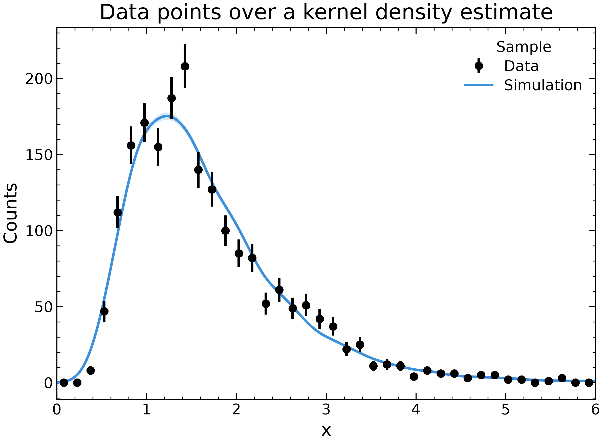
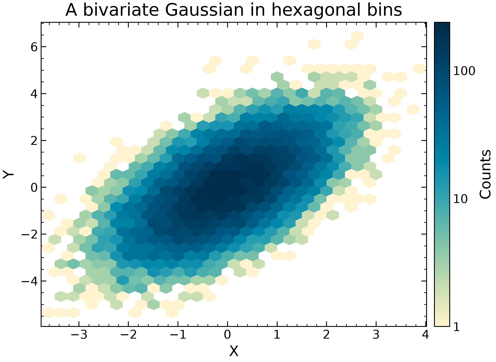
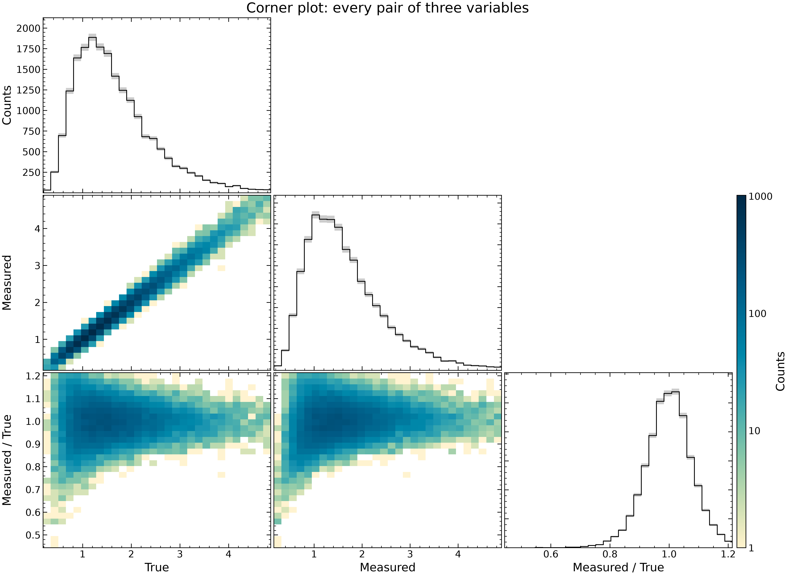
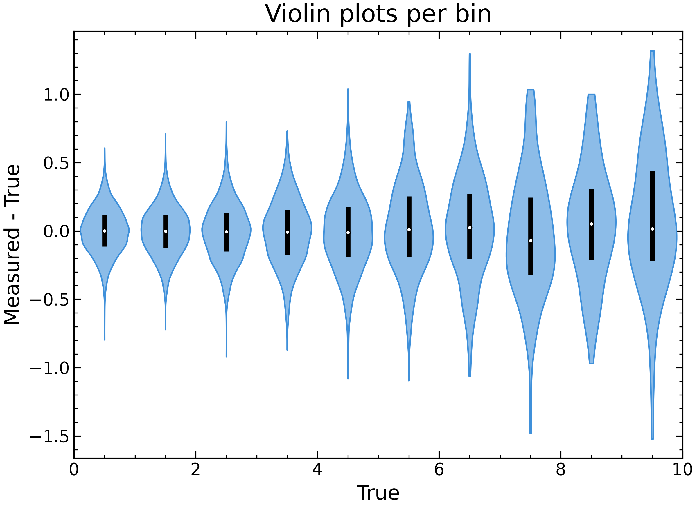
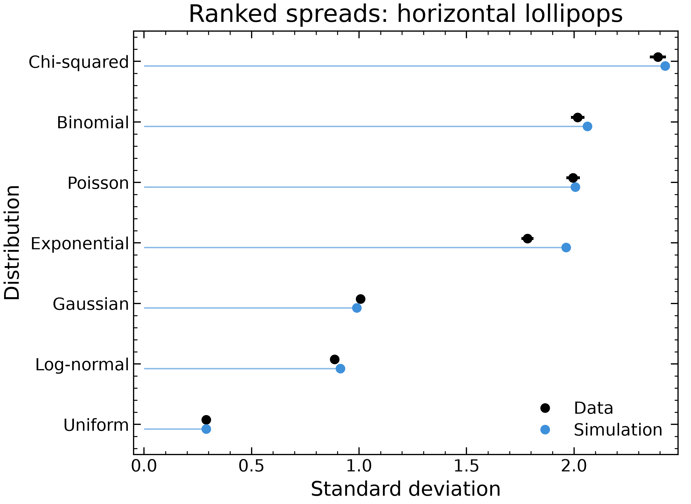
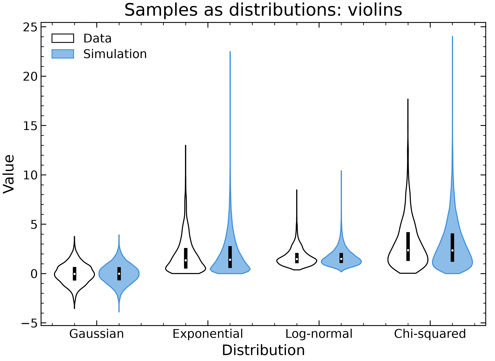

# Options

Options shared by the plot kinds, and the features behind the bigger ones. `plotipus <kind> --help` lists every option of a kind.

## Example data

Every figure on this page is drawn from one pickle,
`examples/input/data/Distributions.pkl`, written by `examples/make_data.py`.
It holds nine distributions common in physics (Gaussian, Poisson, Binomial,
Exponential, Uniform, Breit-Wigner, Landau, Log-normal, Chi-squared), one row
per distribution and sample (`Data`: 2000 events, `Simulation`: 20000 events
weighted down to the same total), in two forms:

* **samples**: per-event arrays `Value`, `Smeared` (Value with a detector-like
  resolution), `Residual` (Smeared - Value) and `Weight`, for `hist`, `map`
  and `line --binned`;
* **prebinned**: `Bin` (bin centres), `Counts`, `CountsError`, the true
  expectation `Expected` and `Pull` = (Counts - Expected) / CountsError, for
  `line` and `cat`. Exponential, Landau, Log-normal and Chi-squared share one
  binning (0 to 12 in steps of 0.25), so they overlay bin by bin.

The figures follow one convention: data are points with error bars,
simulation is a step histogram and a fit is a line; lower panels of data
(ratios, pulls, significances) are points too. Series compared among
themselves, without data, are steps: without `--plot_type`, binned series
(evenly spaced x) are drawn as steps, and points are kept for data and for
lower panels around a reference line. Different distributions compared as
shapes are normalised to unit area (`--density`) or to their peaks
(`--peak`) on the same binning.

`Bivariate Gaussian` rows hold correlated `X`, `Y` samples instead.
The Gaussian rows also store a Gaussian fit (`FitFunctionLabel`, `Params`,
`ParamsError`, `ParamsLabel`) and a χ² scan of its mean and width
(`MeanScan`, `SigmaScan`, `Chi2Scan`). The `Resonance` rows hold a peak over
a falling background as `Data`, `Background` and `Signal` (see
[Data and simulation](#data-and-simulation)); their `Data` row also stores a
signal + background fit with its two components (see [Fits](#fits)). Three files are derived from it: `{config}_landau_Histogram.pkl` (the
Landau histograms, one file per sample, for `--configs`), `Moments.pkl`
(mean and standard deviation of every sample, for `table` and `cat`) and
`Yields.pkl` (the `Resonance` counts of each sample summed in the two
sidebands and the signal region, with errors, for `cat --stacked`). The commands
are the example list, `examples/input/plots/example_scripts.txt`;
`make -C examples docs` renders them again into `docs/images/options`.

## Shared options

* **Data**: `--datafile` (files `{config}_{name}_{datafile}.pkl` when
  `--configs`/`--names` are given, else `{datafile}.pkl`), `--path` (relative
  to the data root), `--select COL -s VALUE` / `--remove_value`,
  `--variables` (values of the `Variable` column, one panel each).
  `--variable_column COL` takes the panels from another column. Panels side
  by side are facets: the figure widens by one plot with each one, wrapping
  at two columns on slides and paper (`--layout panels`, the paper default,
  keeps one plot's size, split in touching panels). They share their y range
  and only the first shows the y label and tick labels (`--no-compact` gives
  each its own axis).
* **Panel grids** (`line`): more than three `--variables` make a near-square
  grid (`--panel_grid ROWS COLS` fixes it); `--facet_row COL` and
  `--facet_col COL` give one row or column of panels per value of a column
  (with `--variables`, the variables take the other dimension), each with its
  own `--lower` panels. A wrapped row of panels shares one y range and keeps
  each panel's x axis and title. Compact grids share y along each row and x down each
  column, with tick labels and axis labels on the outer panels only;
  `--sharex none|col|all` and `--sharey none|row|all` choose. Column values
  title the top row and row values are written right of the last column
  (`--variable_label_map` renames them, `--panel_title` replaces the titles).
  `--panel_labely`, `--panel_rangey`, `--panel_lower_labely` and
  `--panel_lower_rangey` take one label or min max pair per row; colours and
  legend entries follow the hue values, so rows that need their own give
  them their own values (with `--legend_panel all`).

```bash
plotipus line --datafile Fit -x Mass -y Events --hue Component --facet_row Weighting --lower column:Residual --panel_labely 'Events' 'Weights'
```

* **Insets** (`line`): `--inset X0 X1 [Y0 Y1]` redraws the panel zoomed into
  that range in a box, with a frame and connectors on the zoomed region;
  `--inset_args 'OPTIONS'` draws a variation of the command instead, these
  options on top of it: another selection (`--select Selection -s 'KD > 0.5'`,
  replacing the main one), other `-x`/`-y`, even `--binned --estimator mean`
  (a seasonal cycle). Lower panels, ranges, axis labels, reference lines,
  the title and the legend do not carry into an inset (a zoom keeps the axis
  labels). `--inset_pos X Y W H` places it in fractions of the panel
  (default the upper right), `--inset_panel` picks the panel.

```bash
plotipus line --datafile Keeling -x DecimalDate -y CO2 --hue Series --plot_type line --inset_args "-x MonthOfYear -y Detrended --binned --estimator mean --bins 13" --inset_pos 0.15 0.45 0.35 0.3
```
  Values beyond the last key belong to it, so
  `--select Distribution -s Gaussian Poisson` keeps both distributions.
* **Encodings**: `--hue` (alias `--iterable`), `--style` (alias
  `--comparable`), `--iterable_mapping`/`--iterable_color_mapping` and
  `--comparable_mapping` (named mappings from the style file),
  `--invert_style`, `--comparable_fill_strength`. `--hue X --style X` draws
  one legend whose entries carry both the colour and the line style.
* **Legends** never cover data. Each goes to the emptiest corner (or free
  spot) of the finished axes, with bars, bands and images counted whole;
  if none is free the y range gets headroom (not with `--rangey`), else the
  legend goes above the axes in as many columns as fit, as it does past
  6 entries. `--legend_loc` pins a matplotlib location, `above` (or
  `outside`), `below` (under the lowest panel and its axis label) or `right`
  of the axes (the layout makes room), or `none`; `--legend_free` treats any
  free spot like a corner; `--legend_inside` keeps automatic legends inside
  the axes (the emptiest place, over the data if nothing is free, also past
  6 entries). `--legend_panel all` gives every panel a legend of
  its own entries. With `--style` on another column, `--legend_loc` alone
  places both legends together (the style legend follows the colour legend),
  and the style legend alone; `--comparable_legend_loc` still places it
  separately. An axis label longer than its axes breaks onto two lines.
  Entries follow the data: a stack top first, lines by their right-hand
  ends (`--legend_order data` keeps the drawing order). A lower panel whose
  series keep the upper colours draws no legend; otherwise each entry
  reads "X / reference".
* **Colours**: `--palette NAME` picks the categorical palette (default
  `petroff10`; also `petroff6`, `petroff8`, `okabe-ito`, `tol-bright`,
  `tol-muted`, `tab10` (matplotlib's default, the colours before this
  change), `seaborn-colorblind`, `tableau-colorblind10`, `root`). A value
  keeps its colour in every panel and lower panel, a mapped colour is never
  given to another value, and the combined/sum series (`--combined_color`,
  `--sum_color`, `--reference_sum_color`, default: a free colour) never
  share one. With more values than colours, colours repeat and a warning
  is printed.
* **Time series**: an x column of dates (datetime64, Timestamps) is drawn on a
  date axis with concise tick labels (2023, Mar, May, ...). `--smooth N`
  draws each line smoothed over N points (`--smooth_kind rolling`, a centred
  mean, or `savgol`, a quadratic Savitzky-Golay filter) over its raw series,
  which turns thin and translucent and keeps its errors (`--smooth_only`
  leaves it out); lower panels still compare the raw values.
* **Ordered hues** (runs, energies, galaxies by size): `--hue_cmap viridis`
  (`line`, `hist`) takes the colours from a matplotlib colour map instead:
  numeric hue values by value (`--hue_cmap_range MIN MAX` fixes the ends),
  others in their draw order (set by `--iterable_mapping`). A colorbar
  labelled with the hue column (`--labelz`) replaces the colour legend
  (`--no_hue_colorbar` drops it); values with an `--iterable_color_mapping`
  colour keep it and stay off the colour map, and the `--style` legend is
  still drawn.
* **Errors** (style guide U1): every series is drawn with its uncertainty.
  The `{y}Error` (or `{y}Error+/-`) column is drawn without asking, as a
  band for `--plot_type line|step` and as bars on points;
  `--errory_type bars|bands` picks either for any plot type. The band takes
  the series colour at `plot_settings.band_alpha` (default 0.2). Points
  with error bars are not joined unless `--connect` is given. A series
  without an error column gets the standard interval of its quantity, and a
  warning naming it ("mc: Counts has no error column; drawing Garwood
  (Poisson) 68% intervals."): the exact (Garwood) Poisson interval when y are
  counts (non-negative integers), asymmetric and never below 0, or the
  Clopper–Pearson interval of an efficiency with `--count_column N`
  (below). Any other series is drawn without errors and warns that it has
  no uncertainty.
  - `--exact VALUE...` marks hue values as exact (a model, fit or theory
    curve): drawn without errors and without the warning. `--exact` alone
    marks every series. Closed shapes (`--plot_type fill`) are exempt.
  - `--no_error` draws no errors at all and prints none of these warnings.
  - `--errory` is no longer needed. It is still accepted, and still adds
    `error` to the file name, so old command lists keep their file names.
  - Stored errors that cross a physical bound are drawn as given, with one
    warning per series (U4): below 0 for a quantity that is never negative,
    above 1 (`--efficiency_scale`) for an efficiency, i.e. with
    `--count_column` or every value between 0 and 1.
  - `--errory_type poisson` forces the Garwood interval, even over a stored
    column (in `hist`, of the bin counts, or √Σw² with `--weight`).
    `--errory_type clopper_pearson --count_column N` forces the
    Clopper–Pearson interval of y as an efficiency of N trials
    (`--efficiency_scale 100` for percent), which never crosses 0 or 100%,
    as in `table --clopper_pearson`. Both use `--confidence_level` (default
    0.6827) and are drawn as bars or bands by the plot type's default;
    `--error_label` names the interval in the y label ("Counts, 68% CL
    (Poisson)"; on by default in the slides style,
    `plot_settings.error_label`).
* **Nested bands** (expected limits, "Brazil" plots): `--errory_column C1
  C2 ...` draws one band per column around the line, innermost first (a
  column `C`, or a `C+`/`C-` pair of upper/lower sizes). The bands are
  opaque, the innermost on top and all under the lines. `--band_colors
  graded` (default) uses lighter steps of the series colour (of the muted
  role for a series named "expected"), `brazil` the green and yellow of
  ATLAS and CMS limit plots, or give colours (`'#66ccff'`, `c1,c2`). The
  legend lists "<series> ±1σ", "±2σ", ...; `--band_labels` renames them. A
  single `--errory_column` keeps the translucent band in the series colour
  unless `--band_colors` is given, and a band-only series (line width 0
  from `--linewidth_column`) shows its band in the legend. See the famous
  [Brazil band](images/famous/brazil-band.png) (F05) and [local
  p₀](images/famous/local-p0.png) (F04) plots.
* **Line styles** (`--plot_style`, `--comparable_linestyles`,
  `--line_style`, `--horizontal_style`, ...): the names `solid`, `dashed`,
  `dotted`, `dashdot` or the codes `-`, `--`, `:`, `-.`; a lone `--` or
  `-.` after a style option is read as a value (dashed, dashdot), not as
  the end of the options. With `--hue X --style X`, `--comparable_linestyles`
  and `--comparable_linewidths` follow the hue order.
* **Axes and overlays**: `--labelx/--labely/--labelz`, `--rangex/--rangey`,
  `--logx/--logy`, `--horizontal`, `--vertical`, `--point`, `--square`,
  `--line`, `--xtick`, `--note`, `--title`.
* **Tick labels**: plain numbers ("0.04", never "4e-2"); when the style's
  `axes.formatter.limits` call for a common power of ten, it goes into the
  axis label, "Density (×10⁻²)", inside the unit when there is one: "Rate
  (×10⁻⁵ Hz)". `--no-sci_in_label` keeps matplotlib's
  offset text at the end of the axis instead. `--log_labels [AXIS=]MODE ...`
  writes log-axis tick labels as `plain` numbers (200, 0.01), as `sci`
  powers (10ⁿ) or `auto` (default: plain when every label lies in
  10⁻³–10⁴, else 10ⁿ); AXIS is `x`, `y` or `z` (the colorbar), e.g.
  `--log_labels x=plain z=sci`. Short ranges label the ticks between decades
  too, always as plain numbers.
* **Medium and size**: `--medium slides|paper|web|all`, `--theme
  light|dark`, `--width single|onehalf|double|nature|slide|half-slide|INCHES`,
  `--aspect H/W`, `--single_panel_size` (a grid of panels or a figure with
  lower panels gets the size of one panel, for a gallery of equal images),
  `--keep_title` (see [Projects](projects.md#styles-media-and-themes)).
* **Header and watermark**: `--experiment atlas|cms|lhcb|alice|dune` (the
  experiment's label, its typography, and its fonts and palette where its
  guidelines or mplhep set them), `--label TEXT` (bold, above the axes on
  the left), `--label_status TEXT` ("Preliminary"), `--label_right TEXT [TEXT ...]`
  ("13.6 TeV, 140 fb$^{-1}$", on the right; one line per value), `--label_position above|inside`,
  `--watermark wip|preliminary|internal|simulation|draft|TEXT|none` and
  `--watermark_style corner|diagonal` (see [Projects](projects.md#header-and-watermark)).
  Text only: add logos with a figure hook.
* **Output**: `-o DIR [DIR ...]`, `--subfolder`, `--output_suffix`,
  `--filename_select` (keys that must stay in the generated file name),
  `--format` (`png` by default, written at 300 dpi). For papers use
  `--format pdf`: vector output at the printed size, sharp at any zoom.


```bash
plotipus line --datafile Histogram --configs data simulation --names landau -x Bin -y Counts --by_config --data_hue data --errory --labelx x --title 'One file per config'
```


```bash
plotipus line --datafile Distributions -x Bin -y Counts --hue Distribution --select Sample Distribution -s Data Exponential Landau Chi-squared Log-normal --errory --density --palette okabe-ito --labelx x --title 'The okabe-ito palette'
```


```bash
plotipus line --datafile Distributions -x Bin -y Counts --hue Sample --variable_column Distribution --variables Gaussian Poisson Exponential --data_hue Data --errory --labelx x --title 'Prebinned counts, one panel per distribution'
```


```bash
plotipus line --datafile Distributions -x Bin -y Counts --hue Distribution --style Sample --data_hue Data --select Distribution -s Exponential Landau Chi-squared --errory --density --labelx x --title 'Colour by --hue, data and simulation by --style'
```


```bash
plotipus line --datafile Distributions -x Bin -y Counts --hue Sample --select Distribution -s Gaussian --data_hue Data --errory --labelx x --title 'Error bars from the CountsError column'
```


```bash
plotipus line --datafile Distributions -x Bin -y Counts --hue Sample --select Distribution -s Exponential --data_hue Data --errory --errory_type bands --logy --labelx x --title 'Error bands on a log scale'
```


```bash
plotipus line --datafile Distributions -x Bin -y Counts --hue Sample --select Distribution -s Exponential --data_hue Data --errory --multiply 1e-7 --labelx x --labely 'Rate per bin (Hz)' --title 'A rate: the power of ten in the label'
```

`--horizontal_label` writes a label just above its line at the right end
(below it when above leaves the axes); `--horizontal_label_pos left` moves
the labels to the left end, and `auto` puts each one wherever it covers the
least data (right end, left end or along the line, as `--vertical_label`
does). `line --sigma_lines 1 2 3 4 5` draws dashed lines at the one-sided
p-values of nσ (1 − Φ(n): 0.1587, 0.02275, ...) labelled "1σ" ... for log-y
local p₀ scans; `--delta_chi2_lines 1 4` draws Δχ² levels of likelihood scans
(labelled 1σ, 2σ), and `--cl_lines 68.27 95.45` the Δχ² of confidence
levels for `--cl_dof` degrees of freedom (labelled "68.27% CL"). They are
muted and dashed unless `--sigma_line_color` and `--sigma_line_style` are
given; `--horizontal_label_pos outside` writes the labels in the right
margin, level with their lines, as in ATLAS and CMS p₀ plots. Labels and `--note` boxes get a
translucent background only where they sit on data. `--vertical_band X1 X2
[X1 X2 ...]` (`--horizontal_band Y1 Y2 ...`) shades ranges behind the data,
in the style's muted colour (`--vertical_band_color`), with an optional
`--vertical_band_label` written in the band like a line label.


```bash
plotipus line --datafile Distributions -x Bin -y Counts --hue Sample --select Distribution -s Breit-Wigner --data_hue Data --errory --vertical_band 89.94 92.44 --horizontal 128 --horizontal_label 'FWHM = 2.50 GeV' --labelx 'Mass (GeV)' --title 'A shaded region and a line label'
```

Free annotations work in every kind and are drawn after the axis ranges are
set:

* `--text X Y 'TEXT'` (repeatable) writes a text at axes fractions, or in
  data coordinates with `--text_coords data`; `--text_axes`, `--text_color`,
  `--text_size` (default x-large, scaled by the medium), `--text_rotation`,
  `--text_weight`, `--text_style` and `--text_ha` take one value per text
  (the last repeats). `--arrow X2 Y2` (repeatable, matched to the texts in
  order, `nan nan` to skip one) draws an arrow from the text to (X2, Y2).
* `--region 'x,y x,y ...'` (repeatable) shades a polygon in data
  coordinates under the data without widening the axes, in `--region_color`
  (muted) at `--region_alpha` (0.3), with an optional `--region_hatch` and a
  `--region_label` written inside its visible part.
* `line --direct_labels` names each line series at its last point, in its
  colour, instead of a legend (`--direct_labels max` centres the names just
  above each curve's maximum, `--direct_labels X` above its value at x = X);
  `map --contour --contour_labels` writes each level's label on its contour
  line, and `--contour_label_pos X1 Y1 X2 Y2 ...` places them at those points
  instead (innermost level first; `--contour_label_leader` draws a thin line
  to each contour), for contours too small to carry their labels.

## Histograms

`hist` bins per-event arrays, every hue over the same edges. Each step
histogram carries its statistical error as a band, from its first to its
last filled bin: the Garwood (Poisson) interval of the counts, or √Σw² with
`--weight COL`, which weights the entries (here the simulation down to the
data total). `--data_hue` values are points with error bars instead;
`--errory_type poisson` puts bars on the steps too, in place of the band,
and `--no_error` draws neither. `--density`
normalises each histogram to unit area, and `--flow` handles the entries
outside the range: `none` drops them, `hint` marks them beyond the outer
edge, `show` adds them to the first/last bin. Their number is printed in
every mode. `--overlay_gaussian` draws the unit normal (or `--overlay_gaussian
MU SIGMA`) over the histogram, scaled to the first series' entries in range,
to judge a pull distribution; `--hue_cmap` colours ordered hues from a colour
map (see [Shared options](#shared-options)).


```bash
plotipus hist --datafile Distributions -x Value --hue Sample --weight Weight --select Distribution -s Breit-Wigner --data_hue Data --bins 40 --rangex 81 101 --flow show --labelx 'Mass (GeV)' --title 'Histogram of samples with under/overflow'
```

Other estimates of the same distribution (`--hist_type`):

* `kde`: a Gaussian kernel density estimate, a smooth line with a band of
  its pointwise standard error, √(f·R(K)/(n·h)) with R(K) = 1/(2√π), n the
  effective number of entries (Σw)²/Σw² and h the kernel width (`--bw`:
  a width in x units, or `scott`, the default, or `silverman`). It has unit
  area ("Density"), unless `--data_hue` values share the axes: those stay
  histogram points with their Poisson errors, and the KDE is scaled to
  counts per bin to be read against them. A KDE spills past hard edges
  (a score in [0, 1]): read it as a shape there.
* `ecdf`: the empirical cumulative distribution, a step from 0 to 1 at every
  value (on a 2000-point grid past 2000 values) with the binomial band
  √(F(1−F)/n), for quantiles and tails.

`--cumulative` accumulates a histogram (`reverse`: from each bin up, the
fraction above a cut), with the Garwood interval of the accumulated counts
(√ of the accumulated Σw² with weights); with `--density` it ends at 1.
`--rug` marks every value with a short tick along the x axis, fainter the
more there are (a random 5000 past that), for small samples under a KDE.
`--ridge [OVERLAP]` puts each hue value on its own baseline, the first on
top, its name as the y tick label instead of a legend, the curves filled
and scaled to reach OVERLAP (0.5) into the row above.



```bash
plotipus hist --datafile Distributions -x Value --hue Sample --weight Weight --select Distribution -s Log-normal --data_hue Data --hist_type kde --bins 40 --rangex 0 6 --labelx x --title 'Data points over a kernel density estimate'
```

## Lower panels

A lower panel is the same kind of panel as the upper one; it plots a column
derived from (or stored in) the same DataFrame. Each `--lower` adds one:

```bash
--lower ratio                 # every series / the reference series (--reference INDEX|VALUE, --reference_value):
                              # the reference is a line at 1 in its colour, the others points with
                              # both series' errors (with --errory)
--lower relative_difference   # also subtract, asymmetry, excess, excess_probability, sum, mean, rms
--lower group --reference_group S --other_group B1 B2 --group_significance   # S/sqrt(B): a step with the
                              # band a measured significance spreads over, sqrt(1 + S/B) and the simulation's error
--lower residual              # (data - fit) / fit of the stored model (with --fit: masked where fit < 1e-3 of its peak)
--lower pull                  # (data - fit) / error, at least +-3 with +-1 and +-2 bands (with --fit)
--lower column:Significance   # a series stored in the pickle (with SignificanceError), over a dashed
                              # line at 0 (1 for a column named like a ratio; --no_lower_reference)
--lower events:OpHit          # event markers read from OpHit* columns
--lower column:Count --lower_plot_type bar   # stored counts as bars (80% of the x spacing), e.g. under a calibration curve
--lower column:DeltaMu --lower_column_models   # with --data_hue: the data's column as points and the model rows' own column as lines
```


```bash
plotipus line --datafile Distributions -x Bin -y Counts --hue Sample --select Distribution Sample -s Resonance Background Signal --stacked --errory --lower group --reference_group Signal --other_group Background --group_significance --lower_labely '$S/\sqrt{B}$' --labelx 'Mass (GeV)' --labely 'Events / 2 GeV' --title 'Stacked simulation and the signal significance'
```


```bash
plotipus line --datafile Distributions -x Bin -y Counts --hue Distribution --select Sample Distribution -s Simulation Exponential Landau Log-normal --errory --peak --shift peak --lower ratio --reference_value Landau --labelx x --lower_labely 'Ratio to Landau' --title 'Peak-aligned shapes and their ratio'
```


```bash
plotipus line --datafile Distributions -x Bin -y Counts --select Distribution Sample -s Gaussian Data --plot_type errorbar --errory --fit --lower pull --labelx x --title 'Stored fit with pulls'
```


```bash
plotipus line --datafile Distributions -x Bin -y Counts --hue Sample --select Distribution -s Poisson --data_hue Data --errory --lower column:Pull --labelx k --lower_labely Pull --title 'Lower panel from a stored column'
```

The lower panel is styled with the upper-panel options prefixed by `lower_`:
`--lower_plot_type errorbar`, `--lower_labely`, `--lower_rangey`,
`--lower_logy`, `--lower_horizontal`, ... `--lower_zero_line` draws a
dashed y = 0 line in the style's `muted` colour (`--lower_zero_color red`
for the old red line); `--fit_color` sets the fit line (default `ink`).

## Data and simulation

`--data_hue VALUE [VALUE ...]` (alias `--overlay`) draws those hue values as data, the usual
HEP comparison: points with error bars in the style's `ink` colour, first
in the legend and above the rest, never stacked and not taking a palette
colour. The other series are the simulation: steps (filled and stacked
with `--stacked`), with their error bands. `--stacked` stacks in
data space, each series from the running total up: filled steps by default,
outlines with `--plot_type step`, filled steps with a darker edge with
`fill`, a stacked area with `line`, bars with `bar` (`--stack_reverse` puts
the first series on top). Stacked with data, or with
`--stack_total_error`, it draws a hatched band of the total's error (the
stacked errors in quadrature, or a precomputed array column with
`--stack_total_error_column COL`, e.g. with systematics); its label, hatch
and colour come from the style file's `plot_settings.stack_error`, default
`{"label": "Sim. unc.", "hatch": "////", "color": "role:muted"}`. The
legend lists the data first (`--overlay_legend last` moves them to the
end), then the stack from the top down, then the band. With
`--by_config`, the `--data_hue` values name configs, names or hue values.
They may also be values of the `--style` column: with `--hue Distribution
--style Sample --data_hue Data`, each distribution's data are points in its
hue colour and its simulation a solid step, and the style legend shows a
point for the data. A `--lower column:NAME` panel of a data series is drawn
as points. `line --density` normalises every series to unit area (y divided
by the sum of y times the bin width, errors alike), to compare shapes of
samples of different sizes; the y label becomes "Density". `--peak`
divides every series by its maximum instead (y label "Normalised to 1"), so
shapes compare at their heights. `--shift peak` also moves every series by
whole bins so its maximum sits at the reference's (`--reference_value`, else
the first series), and lower panels compare the aligned shapes. `--lower ratio`
(also `subtract`, `relative_difference`) then compares the data with the
total of the simulation: data points with their own errors over a band of
the simulation's error, around a dashed line at 1 (0). Bins where both are
empty (0/0) agree: an open point at 1 without an error; data over an empty
prediction is an arrow at the top of the panel; no data over a non-empty
prediction is 0 with the upper error of observing nothing (1.84 counts,
Garwood). `--reference_value` or `--reference_sum` restore the
series-by-series comparison.

`--series_type VALUE=TYPE [VALUE=TYPE ...]` gives single hue values their
own plot type (any `--plot_type` value); the others keep `--plot_type`.
With `--plot_type line --series_type data=errorbar`, measurements are
points with error bars over model curves: drawn
on top, in their palette colour, or in `ink` when the value is also in
`--overlay`. A style file can set the types once, as a mapping addressed
with `--series_type_mapping NAME` (e.g. `"mappings": {"series_types":
{"data": "errorbar"}}`); `--series_type` entries win over it.
`--series_marker VALUE=MARKER [...]` (or a style mapping addressed with
`--series_marker_mapping NAME`) gives single hue values their marker: a
matplotlib code (`o`, `s`, `^`, `v`, `D`, `x`, `+`, `*`, ...), `_open` for a
hollow one filled with the paper colour (`o_open`), `:SIZE` for its size in
points (`x:14`). Points, error-bar points and lines take it (a line gets a
marker at each point: `--series_marker observed=o:5` for an observed curve
drawn through its points), and the legend shows the same marker. Hubble's
1929 diagram: `--series_marker 'Individual nebulae=o' Groups=o_open
'Mean of 22 nebulae=+:14'`.
`--errorx_column LOW HIGH` draws x error bars on points from the data: two
array columns with each point's bin edges (bins of unequal width, points
not at the bin centres), or one column of half-widths. `--errory_x`
instead takes half the width of bins centred between the points.
`--error_scale K` multiplies the drawn errors, not the values, by K, for
errors too small to see (FIRAS ×400, the LEP lineshape ×10), and appends
"(errors ×K)" to the legend label of each series whose errors are drawn;
lower panels keep the stored errors.

The `Resonance` rows of the example data are a Higgs-like search: data and
two simulated components, a falling background and a narrow signal at
125 GeV.


```bash
plotipus line --datafile Distributions -x Bin -y Counts --hue Sample --select Distribution -s Landau --data_hue Data --errory --lower ratio --labelx x --lower_labely 'Data / Sim.' --title 'Data against simulation'
```


```bash
plotipus line --datafile Distributions -x Bin -y Counts --hue Sample --select Distribution -s Resonance --data_hue Data --stacked --errory --lower ratio --labelx 'Mass (GeV)' --labely 'Events / 2 GeV' --lower_labely 'Data / Sim.' --title 'Data against stacked simulation'
```

## Fits

`line --fit` draws a fit stored in the pickle; plotipus does not fit. A row
holds the data (`-x`/`-y` arrays) and its model: `FitFunction` (a name from
`plotipus.fits` or a registered module, or a callable) or `FitFunctionLabel`,
the fitted `Params` with `ParamsError` and `ParamsLabel`, and optionally
`ParamsUnit`, `ParamsFormat`, `Chi2` and `FitFunctionFormula`.

* The model is drawn as a smooth line over the data. `FitComponents`
  (`{"Signal": ["gaussian", [0, 1, 2]], "Background": ["exponential", [3, 4]]}`:
  each component's model and the indices of its parameters) adds a dashed line
  per component.
* The parameters (`--max_fit_params N` of them, `--chi2` for χ²/ndof) form a
  second legend, placed with the series legend where both cover the least
  data; `--fitlegendposition X Y` pins a text box there instead.
* `--lower residual` shows (data - fit) / fit, `--lower pull`
  (data - fit) / error, and `--lower residual:COMPONENT` the data minus one
  `FitComponents` entry (its name, or the start of it: `residual:Back`),
  with the data errors and the rest of the fit drawn over it: the "data −
  background" panel with the signal curve.
* With `--data_hue`, the data is drawn as in
  [Data and simulation](#data-and-simulation) (ink points with error bars)
  and the fit takes the palette's first colour.


```bash
plotipus line --datafile Distributions -x Bin -y Counts --select Distribution Sample -s Resonance Data --fit --data_hue Data --lower pull --chi2 --max_fit_params 3 --labelx 'Mass (GeV)' --labely 'Events / 2 GeV' --title 'Data with a signal + background fit'
```

## Colorbars

`map` panels showing the same quantity share one colour scale and one
colorbar right of the row (`--colorbar shared`, the default unless `--norm`
normalises each panel); `--colorbar each` draws one per panel. Every bar is
labelled: `--labelz`, else the `--norm` label, else "Counts"/"Density", else
the `-z` column. Empty bins are blank, and with `--logz` the scale starts at
the smallest non-empty bin. Panels side by side are compact by default: they
share one y range and only the first shows the y label and tick labels
(`--no-compact` gives each its own axis, `--matchy` only matches the ranges).

The default sequential map is plotipus's own `plotipus` (`image.cmap`; its
reverse is `plotipus_r`): a pale cream through teal to the palette's blue and
a dark ink blue, lightness falling linearly (CIELAB L* 96 to 16), so it reads
in greyscale and under colour-vision deficiencies, and its lightest colour is
a tint, so blank (empty) bins stand apart. The dark theme uses
`plotipus_dark`, rising from a dark blue to the cream; `--experiment dune`
keeps DUNE's cividis, and `classic` matplotlib's viridis. `--cmap NAME` picks
any other, for `-z` grids and 2D histograms alike.

* **Colour scales.** `--zpower 0.5` is a power-law (here square-root) scale,
  its colorbar ticked at the powers of ten; `--zmin VALUE` sets the bottom
  of the scale and `--zunder COLOUR` the colour of the values below it (the
  Gaia diagrams draw their sparsest bins black); `--colorbar none` drops the
  bar. `--logx`/`--logy` give the map log axes (a spectrogram's frequency).
* **Tables as grids** (confusion matrices, yields): string x or y values
  become one tick per name; `--norm horizontal|vertical|global|combined`
  normalises a `-z` grid as it does a 2D histogram (rows of a confusion
  matrix: `horizontal`); `--annotate [FORMAT]` writes each cell's value in it
  (`.0%`, `.2f`; default `.3g`), dark on light cells and light on dark ones;
  `--matrix` puts the first y value at the top.

```bash
plotipus map --datafile Confusion -x Predicted -y True -z Count --norm horizontal --annotate .0% --matrix --cmap Blues
```


```bash
plotipus map --datafile Distributions -x Value -y Smeared --select Distribution -s Exponential --iterable Sample --diagonal --logz --matchx --labelx True --labely Measured --title '2D histograms with a shared colorbar'
```

## Hexbin and corner plots

`map --map_type hexbin` bins raw points in hexagons instead of rectangles
(`--bins` hexagons across x): a smoother look for a dense scatter. It takes
the 2D histogram's colour options (`--logz`, `--rangez`, `--cmap`, `--zpower`,
`--zmin`, `--colorbar`, one shared scale across `--iterable` panels), with
empty hexagons blank; `--norm global` normalises the counts to unit sum and
`--density` to a density per unit area. Row and column norms, `--annotate`,
`--contour` and `-z` stay with the rectangular bins.



```bash
plotipus map --datafile Distributions -x X -y Y --select Distribution Sample -s 'Bivariate Gaussian' Simulation --map_type hexbin --bins 30 --logz --title 'A bivariate Gaussian in hexagonal bins'
```

`map --corner X1 X2 ... XN` (instead of `-x`/`-y`) draws every pair of N
array columns of one row: an N×N grid with the 2D histogram of (Xc, Xr)
below the diagonal, the histogram of each variable on the diagonal (a step
in ink over its 68.3% Garwood band) and the upper triangle empty. Each
variable is binned once (`--bins` over its `--percentile` range,
integer-aligned bins for integer data), so the panels share x down each
column and y along each row; tick and axis labels are on the outer panels
only (the first diagonal panel carries the counts axis), and every 2D panel
shares one colour scale and colorbar. `--corner_labels` names the axes,
`--map_type hexbin` draws hexagons below the diagonal. The figure is as wide as
two facets of the medium (one column on paper, `--layout panels`) at one
plot's aspect, so each panel keeps a single plot's proportions. Narrow the data to one row with `--select` or
`--configs`/`--names`.



```bash
plotipus map --datafile Distributions --corner Value Smeared Response --select Distribution Sample -s Log-normal Simulation --corner_labels True Measured 'Measured / True' --bins 30 --percentile 0 99 --logz --title 'Corner plot: every pair of three variables'
```

## Contours

`map --contour -z DCHI2` draws confidence regions of Δχ² maps (or
significance maps with `--contour_level_mode z_values`):

* `--contour_dof 2` (default) puts the 1/2/3σ levels at Δχ² = 2.30, 6.18,
  11.83, the joint region of two parameters; `--contour_dof 1` gives
  Δχ² = 1, 4, 9.
* `--contour_label cl` (default) labels levels "68.3% CL", "95.4% CL",
  "99.7% CL"; `sigma` labels them "1σ" (or "1σ (2 dof)").
* `--fill_contours` fills one hue per map, darkest at the best fit and lighter
  outwards (`--fill_alpha`, `--fill_outer_alpha`). Outlines are solid, dashed
  and dotted (`--contour_linestyles`). The best fit of a Δχ² map is a point
  with its 1σ intervals (the Δχ² ≤ 1 region projected on each parameter, the
  profile), in ink for one map and in its colour for several, listed as
  "Best fit"; a significance map (`z_values`) marks its minimum with a `+`
  (`--no_best_fit` hides either).
* Several maps share a panel, one colour and legend entry each: one per
  `--configs` entry, or, for several datasets in one file, one per value of
  a column with `--contour_hue COLUMN` (colours and labels from
  `--iterable_color_mapping`/`--iterable_mapping`). `--combine_op
  squared_sum` adds them up into a joint region ("Combined", in ink), and
  `--combined_contours_only` draws that alone.
* `--background none` (default); with `all`/`combined`/`first`, a Δχ²
  background is blank beyond the outermost level and its colorbar reads Δχ².
* `--horizontal`, `--vertical`, `--line`, `--square` and `--point` are drawn
  above the contours, in the text colour (white on a background image that
  fills the panel); the grid or `--rangex`/`--rangey` keeps the frame.

Without `-z`, `--contour` draws the sigma regions of sampled points over
their 2D histogram: the smallest regions holding 68.3, 95.4 and 99.7% of
the entries (the content of the two-parameter Δχ² levels; 39.3, 86.5 and
98.9% with `--contour_dof 1`), from the histogram smoothed by
`--contour_smoothing_sigma` bins (default 1).


```bash
plotipus map --datafile Distributions -x X -y Y --select Distribution -s 'Bivariate Gaussian' --iterable Sample --contour --bins 30 --logz --title 'A bivariate Gaussian and its 1, 2 and 3 sigma regions'
```

The style file's `contours` section sets the defaults:
`{"dof": 2, "fill_mix": [1.0, 0.55, 0.25], "linestyles": ["-", "--", ":"], "label": "cl", "background": "none"}`.
`--contour_dof 1 --contour_label sigma --background all` restores the
levels, labels and background used before.


```bash
plotipus map --datafile Distributions -x MeanScan -y SigmaScan -z Chi2Scan --select Distribution -s Gaussian --iterable Sample --contour --fill_contours --labelx '$\mu$' --labely '$\sigma$' --title 'Confidence regions of a $\Delta\chi^2$ scan'
```

## Binned estimators

`line --binned` bins raw per-event x/y arrays and draws `--estimator` of y
per x bin, as error bars on markers (not joined) unless `--plot_type` says
otherwise; with `--data_hue`, the data are ink points and the other samples
open steps with error bands:

* **Errors** (`--estimator_error`): `sem` (default) is the standard error
  of the statistic: mean σ/√n, median 1.2533·σ/√n, std σ/√(2(n−1)), rms by
  the delta method, sum √Σy² (√n for counts, √Σw² for weights), none for
  max/min (σ is the bin's sample standard deviation). With a typed
  `--errory`, the stored per-event errors are propagated instead (mean √Σe²/n, sum √Σe²,
  median 1.2533·√Σe²/n, std/rms to first order, max/min the selected
  event's error). `std` draws the bin's spread σ; `none` the bare values.
* **Small bins**: bins with fewer than `--min_count` entries (default 5)
  are dropped, with a note; `--min_count 1` keeps every non-empty bin.
* **Label**: the y label gets the error's name, e.g. "(mean ± s.e.m.)",
  unless `--note` is given or `--no_error_label` is passed.
* **Bins**: every hue of a panel is binned over the same edges, spanning
  `--rangex` or else the range of all the hues' x values.
* **Box plots** (`--plot_type box`): one box per bin (per category for a
  non-numeric x), the hues side by side within the bin, in their colours
  (a strong face, the median in ink) with one legend entry each. **Violin
  plots** (`--plot_type violin`) draw the density of y per bin instead,
  with the interquartile range as an ink bar and the median as a dot; they
  take the same bins, axis and colours. Numeric bins keep a plain numeric axis
  over the bin edges; `--box_tick_labels centres` puts a tick at each bin
  centre and `--box_tick_labels ranges` labels the bins "[a, b)". `--whis` sets the
  whisker reach (default 1.5 IQR, or two percentiles such as `5 95`) and
  `--no_fliers` hides the points past the whiskers.


```bash
plotipus line --datafile Distributions -x Value -y Residual --binned --estimator std --hue Sample --data_hue Data --select Distribution -s Exponential --bins 11 --rangex 0 10 --labelx True --labely 'Measured - True' --title 'Binned estimator: resolution'
```


```bash
plotipus line --datafile Distributions -x Value -y Residual --binned --plot_type box --select Distribution Sample -s Exponential Simulation --bins 11 --rangex 0 10 --labelx True --labely 'Measured - True' --title 'Box plots per bin'
```



```bash
plotipus line --datafile Distributions -x Value -y Residual --binned --plot_type violin --select Distribution Sample -s Exponential Simulation --bins 11 --rangex 0 10 --labelx True --labely 'Measured - True' --title 'Violin plots per bin'
```

## Categories and scatter

`cat` draws one value per category: the sum of each row's `-y` array over its
bins, or with `--integrate_over COL` the integral Σ y·Δx over that column
(for densities), by `-x` category and `--hue`; a scalar `-y` cell is one
value already. Category labels are rotated only when they would overlap
(`--xtick_rotation DEG` forces an angle). `--data_hue VALUE...` draws
those hue values as data: ink points with their errors at the category
centre, first in the legend, over the bars (or lines) of the others. The
errors are drawn by default (U1): the summed `{y}Error` column, else Garwood
intervals when the totals are counts (`--no_error`, `--exact VALUE...` as in
`line`). Bar errors are a hatched band around the bar top (the style's
`plot_settings.stack_error`), not error bars. `--kind bar --stacked` stacks
the hue values in one bar per category (the legend lists the stack from the
top), with a band of the total's error, the errors added in quadrature.
`--kind point` sets the series side by side within each category, so
points with error bars do not hide each other. Points need something to be
read against: a bar, a line, or a true scatter; a lone row of markers per
category says little. Bars suit any quantity with a true zero (counts, a
width); data points go over them with `--data_hue`.
`scatter` draws one point per
entry of the array cells, with colour (`--colorby`), size (`--sizeby`) and
marker (`--markerby`) encodings; only the drawn columns are exploded into
points. A `--colorby` column of both signs takes the style's diverging map
for markers (`plot_settings.diverging_marker_cmap`), centred at 0: its
centre stands out from the paper (`berlin`, dark at 0, on the light
styles; `RdBu_r`, light at 0, on the dark theme), the opposite of the map
of filled cells (`diverging_cmap`), whose centre melts into the paper. Other
columns take the sequential
`image.cmap` (`plotipus`; cividis with `--experiment dune`).

The yields of a search are counts, so they are bars: the simulated
background and signal stacked in each mass region, with the band of their
total error, and the data as points on top.


```bash
plotipus cat --datafile Yields -x Region --hue Sample -y Counts --errory --kind bar --stacked --data_hue Data --labely Events --title 'Yields per mass region'
```

A `-y` column with one scalar per row (here the standard deviation of each
sample, with its error) is drawn as it is. The figure asks whether the data
spread like the simulation in each distribution: a width has a true zero, so
the simulation is a bar (its error a band at the top) and the data a point
read against it. Seven categories would
overlap side by side, so their labels are rotated, and the layout makes room
for them:


```bash
plotipus cat --datafile Moments -x Config --hue Sample -y Value --errory --select Variable Config Config Config Config Config Config Config -s Std Gaussian Poisson Binomial Exponential Uniform Log-normal Chi-squared --kind bar --data_hue Data --labelx Distribution --labely 'Standard deviation' --title 'One scalar per row: spread of each sample'
```

Rankings and long category names read better across: `--orient h` puts the
categories down the y axis (the first on top) and the values along x, which
keeps `--labely`, `--logy`, `--rangey` and `--horizontal` (drawn as vertical
lines). `--sort desc` (or `asc`) orders the categories by their total over
every series, and replaces `--x_order`. `--kind lollipop` draws each value as
a marker at the end of a thin stem from zero, with less ink than a bar; its
error bar has caps, since it runs along the stem. Lollipops and points are
set side by side when there are several series, the data (`--data_hue`)
first. Every kind works in both orientations, `--stacked` bars included.



```bash
plotipus cat --datafile Moments -x Config --hue Sample -y Value --errory --select Variable Config Config Config Config Config Config Config -s Std Gaussian Poisson Binomial Exponential Uniform Log-normal Chi-squared --kind lollipop --orient h --sort desc --data_hue Data --labelx Distribution --labely 'Standard deviation' --title 'Ranked spreads: horizontal lollipops'
```

`--kind box`, `violin` and `strip` keep each row's `-y` array as a
distribution instead of summing it: the rows of a category (and hue value)
are pooled, and the hue values present in a category share its width side
by side. A box spans the quartiles with whiskers at `--whis` interquartile
ranges (1.5; `--no_fliers` leaves out the points beyond); a violin is the
density with the interquartile range as a bar and the median as a dot; a
strip draws every value, jittered across the slot and fainter the more there
are. `--data_hue` values are hollow ink outlines (ink points in a strip), so
they do not read as one more simulation. They show the spread of the values,
not the uncertainty of a summary: for a mean or a median with its error,
use `line --binned --estimator`. `--sort` orders the categories by their
median, `--orient h` lays them out across, and without `--hue` a single
series needs no legend.



```bash
plotipus cat --datafile Distributions -x Distribution -y Value --hue Sample --select Distribution Distribution Distribution Distribution -s Gaussian Exponential Log-normal Chi-squared --data_hue Data --kind violin --labely Value --title 'Samples as distributions: violins'
```


```bash
plotipus scatter --datafile Distributions -x Value -y Response --colorby Residual --select Distribution Sample -s Exponential Data --marker_size 4 --rangey 0.5 1.5 --labelx True --labely 'Measured / True' --title 'Points coloured by a third column'
```

`--hue` gives each row its own colour and legend entry. Here the rows are
three distributions picked with `--select` (values of one key are OR-ed):


```bash
plotipus scatter --datafile Distributions -x Value -y Response --hue Distribution --select Sample Distribution Distribution Distribution -s Data Gaussian Exponential Log-normal --marker_size 4 --rangey 0.5 1.5 --legend_loc 'lower right' --labelx True --labely 'Measured / True' --title 'Points coloured by group (--hue)'
```

## Tables

`table` aggregates `-y` into LaTeX (and `--html`) tables: rows are configs
(or `--row_name` values), columns the `--variables`, each cell the `--agg`
(`mean`, `sum`, `std`, `median`) of its values with an error. The error
follows the quantity, as in the plots (style guide U10):

* the `{y}Error` column, combined by `--error_mode` (quadrature by default;
  `std`/`sem` use the spread of the values, and warn when they are counts,
  whose spread is not their uncertainty);
* without an error column, a frame with `Passed` and `Total` columns (F4)
  gets the pooled efficiency and its Clopper–Pearson interval,
  $\varepsilon^{+a}_{-b}$, in the scale of `-y` (a fraction or percent);
  integer counts summed per cell (`--agg sum`, or one row per cell) get
  their Garwood interval, $n^{+a}_{-b}$. A warning names the interval;
* `--poisson COLUMN` prints the summed counts of COLUMN with their Garwood
  interval, `--clopper_pearson PASS [TOTAL]` the efficiency of explicit
  columns, and `--no_error` the bare values;
* stored symmetric errors that cross 0 or 100% warn once per variable (U4).

Three other layouts read whole rows:

* `--stats mean var std median corr line n`: one row per data row (labelled
  by `--row_name`, else `--hue`), its columns the statistics of the row's
  `-x`/`-y` arrays: means, sample variances and standard deviations, medians,
  the Pearson correlation, the least-squares line and the number of points
  (`--decimals`/`--sig_figs` format them). Anscombe's quartet:

```bash
plotipus table --datafile Anscombe -x X -y Y --select Type -s Data --row_name Dataset --stats mean var corr line
```

* `--fit_params`: one row per stored fit (`Params`, `ParamsError`,
  `ParamsLabel`, `ParamsFormat`), one column per parameter as value ± error.
* `--cutflow`: the yields of a selection, one row per stage (the values of
  `--variable_name`, in `--variables` order or as they appear), and per
  `--hue` sample three columns: the events (the sum of the `-y` values, inside
  `--rangex` of `-x`), with their `{y}Error` added in quadrature, or the
  Garwood interval of the counts without one; the efficiency relative to the
  previous stage; and the cumulative one relative to the first. The stages
  must be nested (each a subset of the one before): the efficiencies are
  Clopper–Pearson intervals of the counts (`--confidence_level`, in
  `--efficiency_scale` units, percent by default), and a binomial error with
  a warning when the yields are not integer counts.

```bash
plotipus table --datafile Yields -y Counts --hue Particle --variable_name Stage --cutflow
```

| Stage | electron: Events | Rel. eff. (%) | Cum. eff. (%) | … |
|---|---|---|---|---|
| Preselection | 52044 ± 228 | — | — | … |
| Isolation | 50029 ± 224 | 96.13 +0.08 −0.09 | 96.13 +0.08 −0.09 | … |
| Track quality | 47071 ± 217 | 94.1 ± 0.1 | 90.4 ± 0.1 | … |
| Final selection | 42568 ± 206 | 90.4 ± 0.1 | 81.8 ± 0.2 | … |

(the gallery's `Yields`, J5; the LaTeX writes the intervals as
$x^{+a}_{-b}$.)
