# Options

Options shared by the plot kinds, and the features behind the bigger ones. `plotipus <kind> --help` lists every option of a kind.

## Example data

Every figure on this page is drawn from one pickle,
`examples/input/data/Distributions.pkl`, written by `examples/make_data.py`.
It holds nine distributions common in physics (Gaussian, Poisson, Binomial,
Exponential, Uniform, Breit-Wigner, Landau, Log-normal, Chi-squared), one row
per distribution and sample (`Data`: 2000 events, `Simulation`: 20000 events
weighted down to the same total), in two forms:

* **samples**: per-event arrays `Value`, `Smeared` (Value with a detector-like
  resolution), `Residual` (Smeared - Value) and `Weight`, for `hist`, `map`
  and `line --binned`;
* **prebinned**: `Bin` (bin centres), `Counts`, `CountsError`, the true
  expectation `Expected` and `Pull` = (Counts - Expected) / CountsError, for
  `line` and `cat`. Exponential, Landau, Log-normal and Chi-squared share one
  binning (0 to 12 in steps of 0.25), so they overlay bin by bin.

The figures follow one convention: data are points with error bars,
simulation is a step histogram and a fit is a line; lower panels of data
(ratios, pulls, significances) are points too. Series compared among
themselves, without data, are steps: without `--plot_type`, binned series
(evenly spaced x) are drawn as steps, and points are kept for data and for
lower panels around a reference line. Different distributions compared as
shapes are normalised to unit area (`--density`) or to their peaks
(`--peak`) on the same binning.

`Bivariate Gaussian` rows hold correlated `X`, `Y` samples instead.
The Gaussian rows also store a Gaussian fit (`FitFunctionLabel`, `Params`,
`ParamsError`, `ParamsLabel`) and a χ² scan of its mean and width
(`MeanScan`, `SigmaScan`, `Chi2Scan`). The `Resonance` rows hold a peak over
a falling background as `Data`, `Background` and `Signal` (see
[Data and simulation](#data-and-simulation)); their `Data` row also stores a
signal + background fit with its two components (see [Fits](#fits)). Two files are derived from it: `{config}_landau_Histogram.pkl` (the
Landau histograms, one file per sample, for `--configs`) and `Moments.pkl`
(mean and standard deviation of every sample, for `table`). The commands
are the example list, `examples/input/plots/example_scripts.txt`;
`make -C examples docs` renders them again into `docs/images/options`.

## Shared options

* **Data**: `--datafile` (files `{config}_{name}_{datafile}.pkl` when
  `--configs`/`--names` are given, else `{datafile}.pkl`), `--path` (relative
  to the data root), `--select COL -s VALUE` / `--remove_value`,
  `--variables` (values of the `Variable` column, one panel each).
  `--variable_column COL` takes the panels from another column. Panels side
  by side share their y range and only the first shows the y label and tick
  labels (`--no-compact` gives each its own axis).
  Values beyond the last key belong to it, so
  `--select Distribution -s Gaussian Poisson` keeps both distributions.
* **Encodings**: `--hue` (alias `--iterable`), `--style` (alias
  `--comparable`), `--iterable_mapping`/`--iterable_color_mapping` and
  `--comparable_mapping` (named mappings from the style file),
  `--invert_style`, `--comparable_fill_strength`. `--hue X --style X` draws
  one legend whose entries carry both the colour and the line style.
* **Legends** never cover data. Each goes to the emptiest corner (or free
  spot) of the finished axes, with bars, bands and images counted whole;
  if none is free the y range gets headroom (not with `--rangey`), else the
  legend goes above the axes in as many columns as fit, as it does past
  6 entries. `--legend_loc` pins a matplotlib location, `above` (or
  `outside`), `below` (under the lowest panel and its axis label) or `right`
  of the axes (the layout makes room), or `none`; `--legend_free` treats any
  free spot like a corner; `--legend_inside` keeps automatic legends inside
  the axes (the emptiest place, over the data if nothing is free, also past
  6 entries). `--legend_panel all` gives every panel a legend of
  its own entries. With `--style` on another column, `--legend_loc` alone
  places both legends together (the style legend follows the colour legend),
  and the style legend alone; `--comparable_legend_loc` still places it
  separately. An axis label longer than its axes breaks onto two lines.
  Entries follow the data: a stack top first, lines by their right-hand
  ends (`--legend_order data` keeps the drawing order). A lower panel whose
  series keep the upper colours draws no legend; otherwise each entry
  reads "X / reference".
* **Colours**: `--palette NAME` picks the categorical palette (default
  `petroff10`; also `petroff6`, `petroff8`, `okabe-ito`, `tol-bright`,
  `tol-muted`, `tab10` (matplotlib's default, the colours before this
  change), `seaborn-colorblind`, `tableau-colorblind10`, `root`). A value
  keeps its colour in every panel and lower panel, a mapped colour is never
  given to another value, and the combined/sum series (`--combined_color`,
  `--sum_color`, `--reference_sum_color`, default: a free colour) never
  share one. With more values than colours, colours repeat and a warning
  is printed.
* **Errors**: `--errory` draws the `{y}Error` (or `{y}Error+/-`) column as
  a band for `--plot_type line|step` and as bars on points;
  `--errory_type bars|bands` picks either for any plot type. The band takes
  the series colour at `plot_settings.band_alpha` (default 0.2). Points
  with error bars are not joined unless `--connect` is given.
  `--errory_type poisson` computes the errors instead: the exact (Garwood)
  Poisson interval of y as counts, asymmetric and never below 0 (in `hist`,
  of the bin counts, or √Σw² with `--weight`); it is also what data drawn
  with `--overlay`/`--data_hue` get when there is no error column and y are
  counts (non-negative integers; measurements such as magnitudes keep no
  errors).
  `--errory_type clopper_pearson --count_column N` takes y as an efficiency
  of N trials (`--efficiency_scale 100` for percent) and draws the
  Clopper–Pearson interval, which never crosses 0 or 100%, as in `table
  --clopper_pearson`. Both use `--confidence_level` (default 0.6827) and are
  drawn as bars or bands by the plot type's default; `--error_label` names
  the interval in the y label ("Counts, 68% CL (Poisson)"; on by default in
  the slides style, `plot_settings.error_label`).
* **Axes and overlays**: `--labelx/--labely/--labelz`, `--rangex/--rangey`,
  `--logx/--logy`, `--horizontal`, `--vertical`, `--point`, `--square`,
  `--line`, `--xtick`, `--note`, `--title`.
* **Tick labels**: plain numbers ("0.04", never "4e-2"); when the style's
  `axes.formatter.limits` call for a common power of ten, it goes into the
  axis label, "Density (×10⁻²)", inside the unit when there is one: "Rate
  (×10⁻⁵ Hz)". `--no-sci_in_label` keeps matplotlib's
  offset text at the end of the axis instead. Log axes label decades (10ⁿ).
* **Medium and size**: `--medium slides|paper|web|all`, `--theme
  light|dark`, `--width single|onehalf|double|nature|slide|half-slide|INCHES`,
  `--aspect H/W`, `--single_panel_size` (a grid of panels or a figure with
  lower panels gets the size of one panel, for a gallery of equal images),
  `--keep_title` (see [Projects](projects.md#styles-media-and-themes)).
* **Header and watermark**: `--experiment atlas|cms|lhcb|alice|dune` (the
  experiment's label, its typography, and its fonts and palette where its
  guidelines or mplhep set them), `--label TEXT` (bold, above the axes on
  the left), `--label_status TEXT` ("Preliminary"), `--label_right TEXT [TEXT ...]`
  ("13.6 TeV, 140 fb$^{-1}$", on the right; one line per value), `--label_position above|inside`,
  `--watermark wip|preliminary|internal|simulation|draft|TEXT|none` and
  `--watermark_style corner|diagonal` (see [Projects](projects.md#header-and-watermark)).
  Text only: add logos with a figure hook.
* **Output**: `-o DIR [DIR ...]`, `--subfolder`, `--output_suffix`,
  `--filename_select` (keys that must stay in the generated file name),
  `--format` (`png` by default, written at 300 dpi). For papers use
  `--format pdf`: vector output at the printed size, sharp at any zoom.

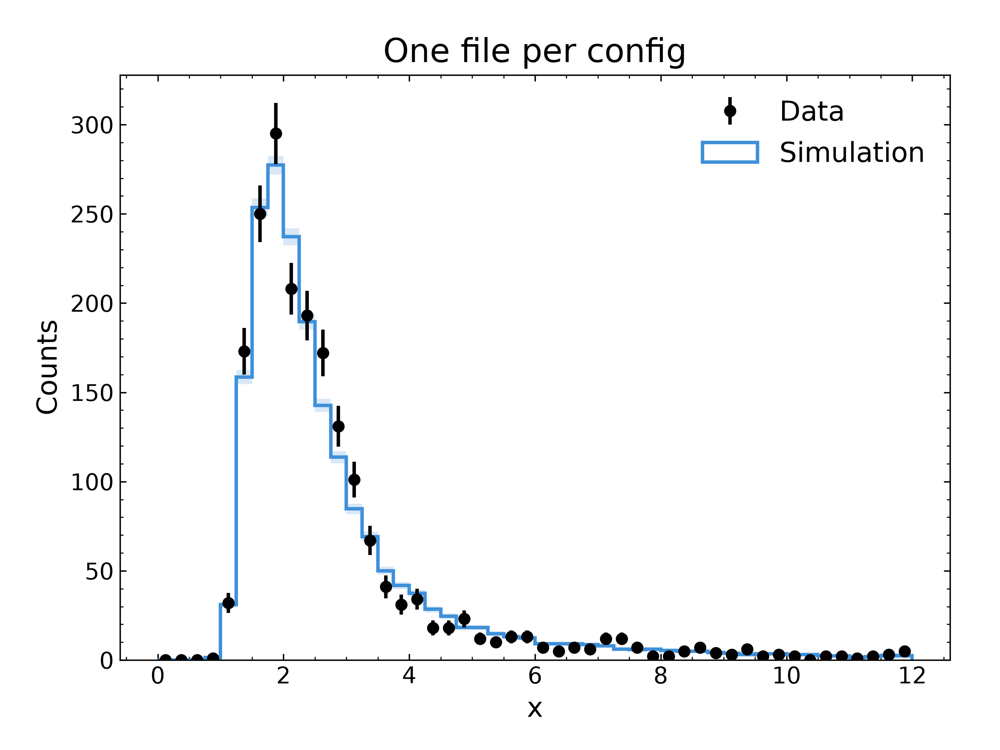

```bash
plotipus line --datafile Histogram --configs data simulation --names landau -x Bin -y Counts --by_config --data_hue data --errory --labelx x --title 'One file per config'
```

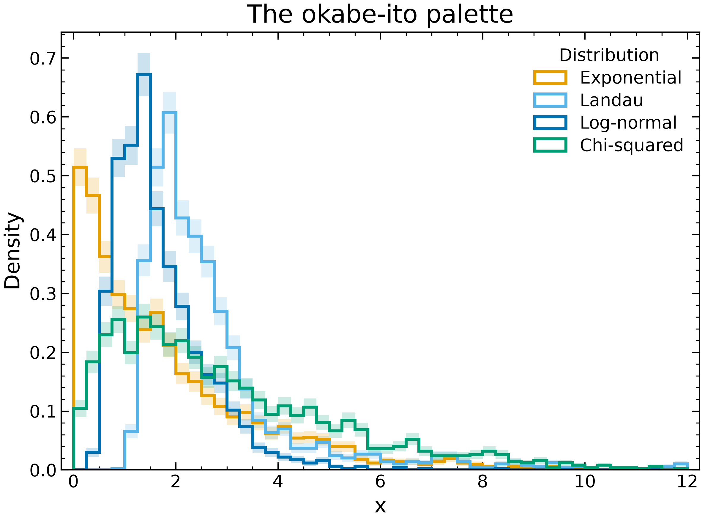

```bash
plotipus line --datafile Distributions -x Bin -y Counts --hue Distribution --select Sample Distribution -s Data Exponential Landau Chi-squared Log-normal --errory --density --palette okabe-ito --labelx x --title 'The okabe-ito palette'
```

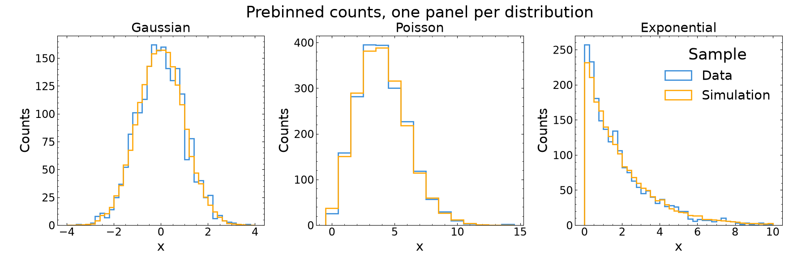

```bash
plotipus line --datafile Distributions -x Bin -y Counts --hue Sample --variable_column Distribution --variables Gaussian Poisson Exponential --data_hue Data --errory --labelx x --title 'Prebinned counts, one panel per distribution'
```

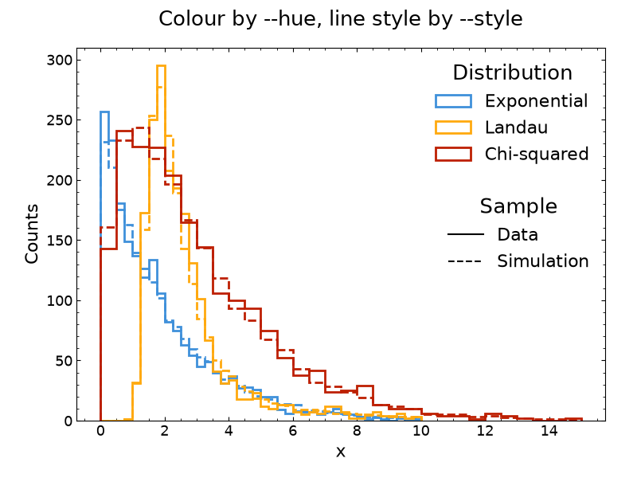

```bash
plotipus line --datafile Distributions -x Bin -y Counts --hue Distribution --style Sample --data_hue Data --select Distribution -s Exponential Landau Chi-squared --errory --density --labelx x --title 'Colour by --hue, data and simulation by --style'
```

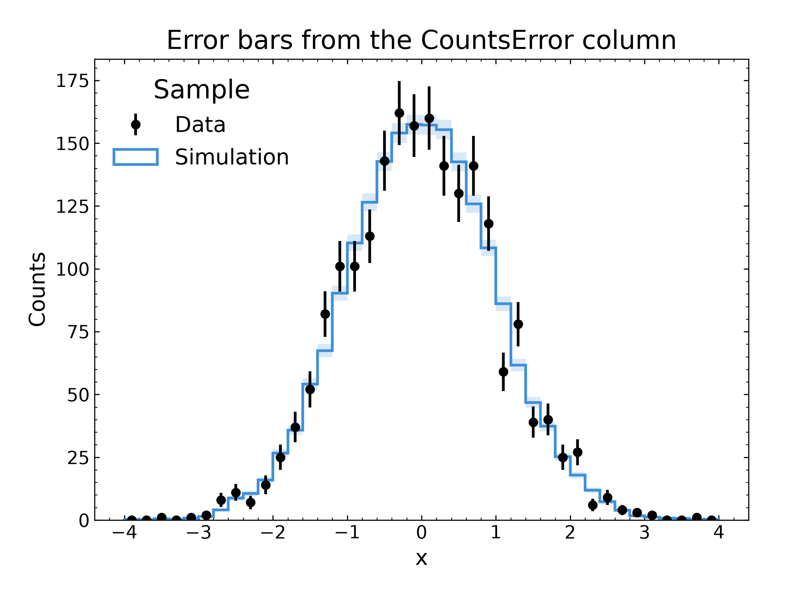

```bash
plotipus line --datafile Distributions -x Bin -y Counts --hue Sample --select Distribution -s Gaussian --data_hue Data --errory --labelx x --title 'Error bars from the CountsError column'
```

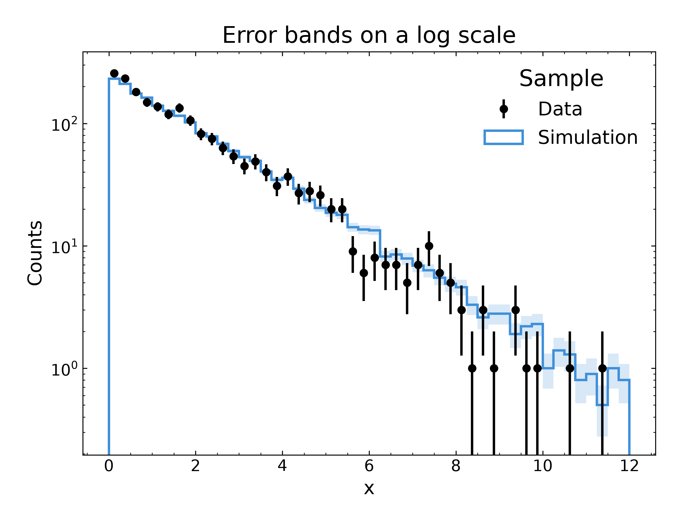

```bash
plotipus line --datafile Distributions -x Bin -y Counts --hue Sample --select Distribution -s Exponential --data_hue Data --errory --errory_type bands --logy --labelx x --title 'Error bands on a log scale'
```

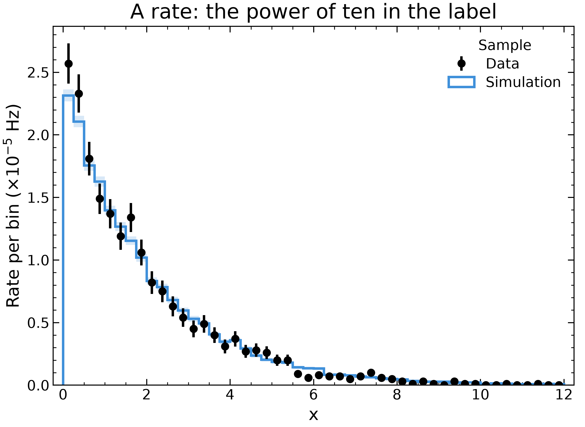

```bash
plotipus line --datafile Distributions -x Bin -y Counts --hue Sample --select Distribution -s Exponential --data_hue Data --errory --multiply 1e-7 --labelx x --labely 'Rate per bin (Hz)' --title 'A rate: the power of ten in the label'
```

`--horizontal_label` (`--vertical_label`) writes a label next to its line:
just above it (else below), at its right end, its left end or along it,
wherever it covers the least data. Labels and `--note` boxes get a
translucent background only where they sit on data.

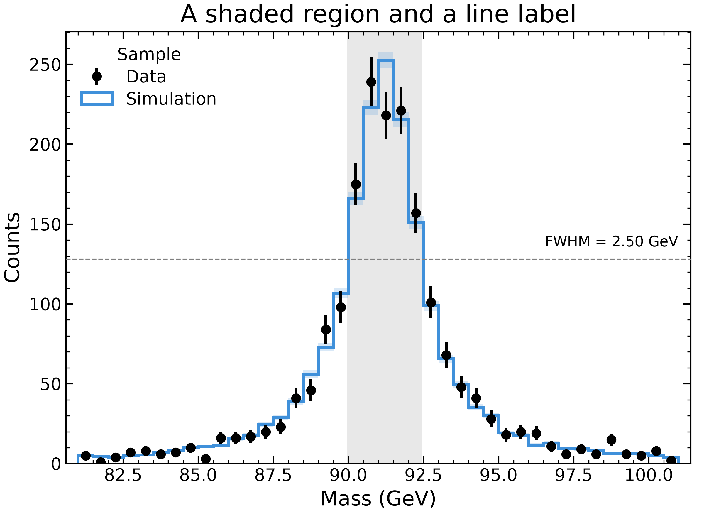

```bash
plotipus line --datafile Distributions -x Bin -y Counts --hue Sample --select Distribution -s Breit-Wigner --data_hue Data --errory --vertical 89.94 92.44 --horizontal 128 --horizontal_label 'FWHM = 2.50 GeV' --labelx 'Mass (GeV)' --title 'Reference lines and a line label'
```

## Histograms

`hist` bins per-event arrays, every hue over the same edges. `--weight COL`
weights the entries (here the simulation down to the data total), `--density`
normalises each histogram to unit area, and `--flow` handles the entries
outside the range: `none` drops them, `hint` marks them beyond the outer
edge, `show` adds them to the first/last bin. Their number is printed in
every mode.

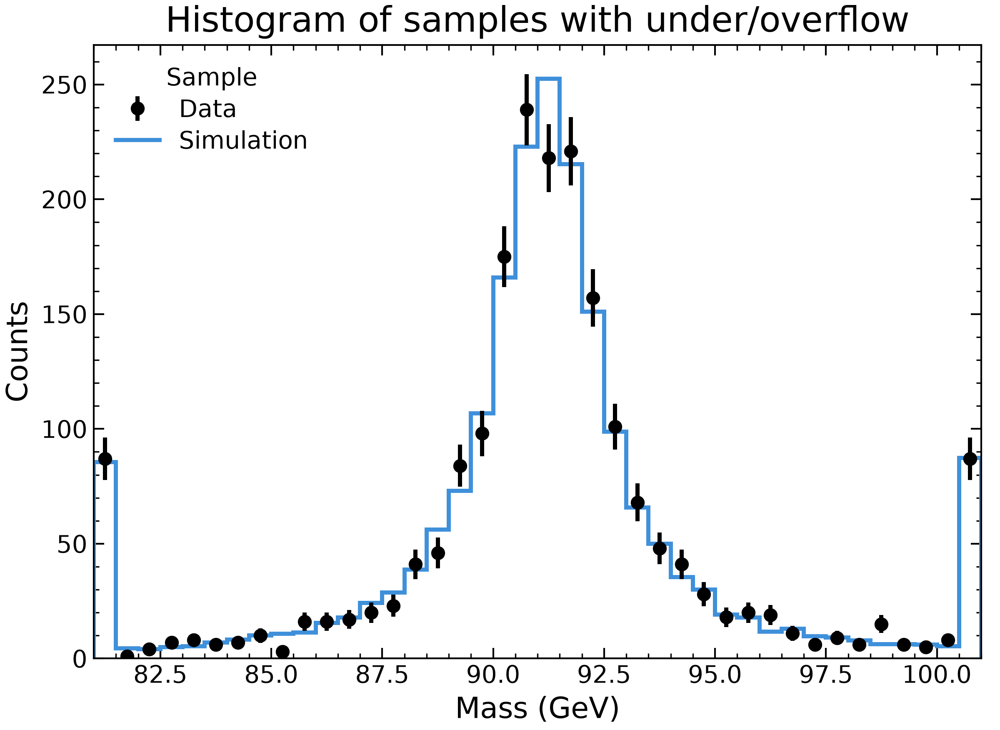

```bash
plotipus hist --datafile Distributions -x Value --hue Sample --weight Weight --select Distribution -s Breit-Wigner --data_hue Data --bins 40 --rangex 81 101 --flow show --labelx 'Mass (GeV)' --title 'Histogram of samples with under/overflow'
```

## Lower panels

A lower panel is the same kind of panel as the upper one; it plots a column
derived from (or stored in) the same DataFrame. Each `--lower` adds one:

```bash
--lower ratio                 # every series / the reference series (--reference, --reference_value):
                              # the reference is a line at 1 in its colour, the others points
--lower relative_difference   # also subtract, asymmetry, excess, excess_probability, sum, mean, rms
--lower group --reference_group S --other_group B1 B2 --group_significance   # S/sqrt(B), points with errors
--lower residual              # (data - fit) / fit of the stored model (with --fit: masked where fit < 1e-3 of its peak)
--lower pull                  # (data - fit) / error, at least +-3 with +-1 and +-2 bands (with --fit)
--lower column:Significance   # a series stored in the pickle (with SignificanceError)
--lower events:OpHit          # event markers read from OpHit* columns
```

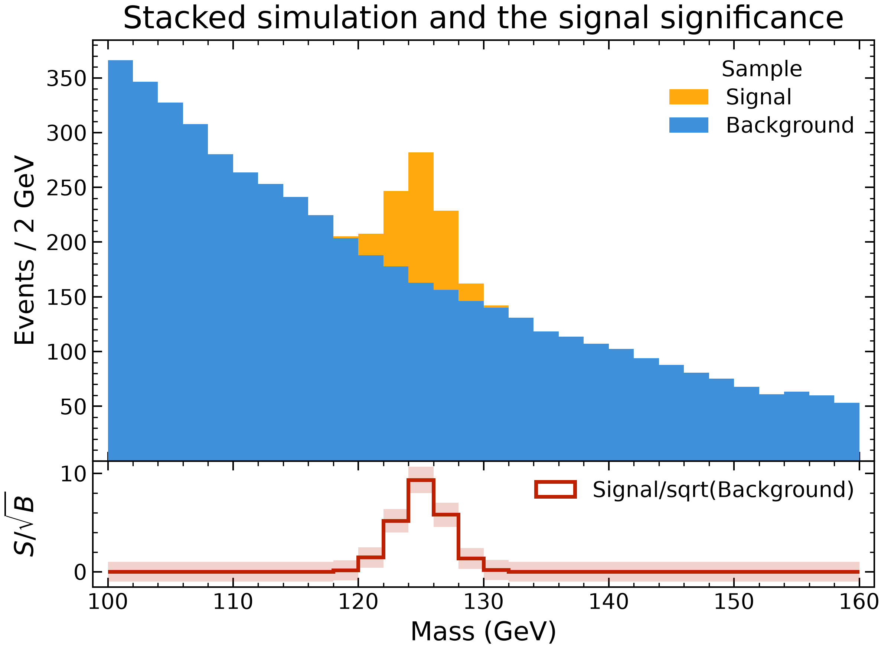

```bash
plotipus line --datafile Distributions -x Bin -y Counts --hue Sample --select Distribution Sample -s Resonance Background Signal --stacked --errory --lower group --reference_group Signal --other_group Background --group_significance --lower_labely '$S/\sqrt{B}$' --labelx 'Mass (GeV)' --labely 'Events / 2 GeV' --title 'Stacked simulation and the signal significance'
```

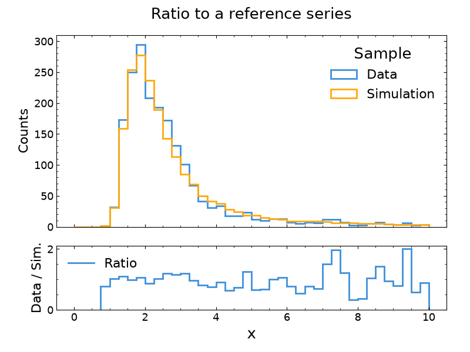

```bash
plotipus line --datafile Distributions -x Bin -y Counts --hue Distribution --select Sample Distribution -s Simulation Exponential Landau Log-normal --peak --lower ratio --reference_value Exponential --labelx x --lower_labely 'Ratio to Exp.' --title 'Ratio to a reference series'
```

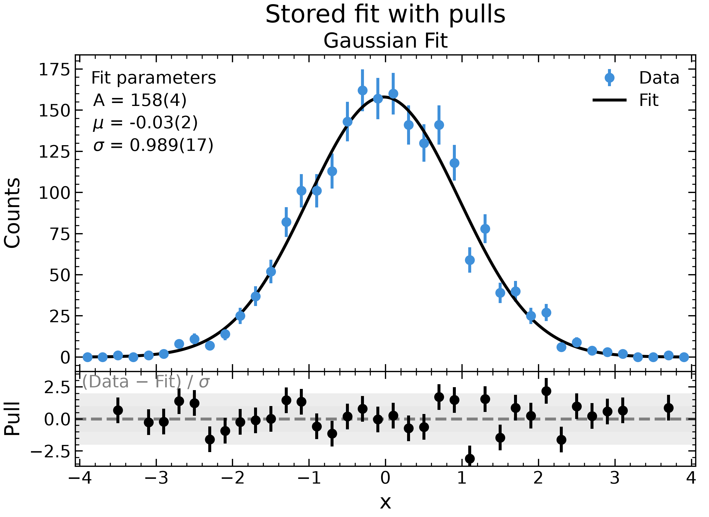

```bash
plotipus line --datafile Distributions -x Bin -y Counts --select Distribution Sample -s Gaussian Data --plot_type errorbar --errory --fit --lower pull --labelx x --title 'Stored fit with pulls'
```

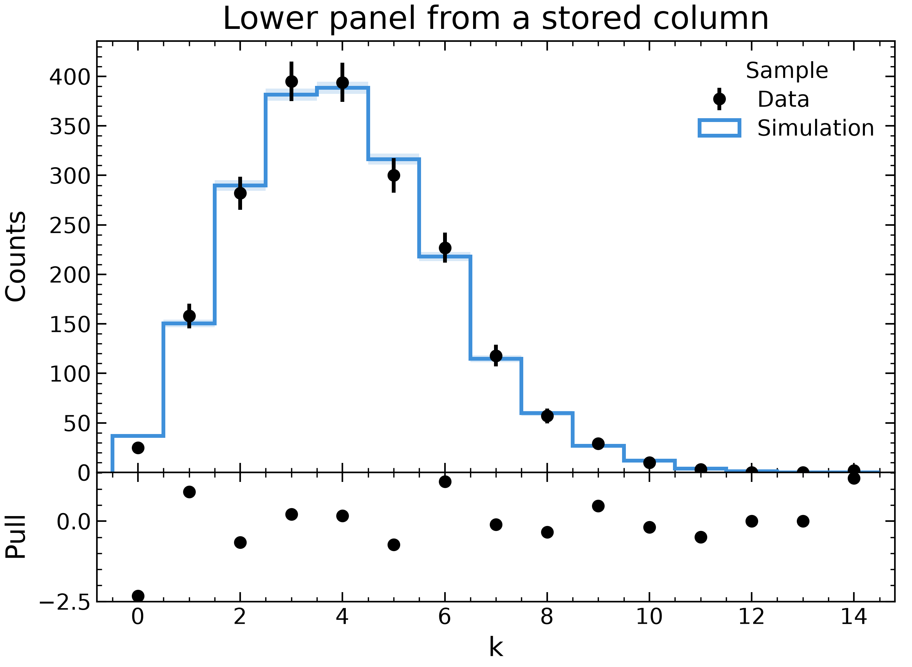

```bash
plotipus line --datafile Distributions -x Bin -y Counts --hue Sample --select Distribution -s Poisson --data_hue Data --errory --lower column:Pull --labelx k --lower_labely Pull --title 'Lower panel from a stored column'
```

The lower panel is styled with the upper-panel options prefixed by `lower_`:
`--lower_plot_type errorbar`, `--lower_labely`, `--lower_rangey`,
`--lower_logy`, `--lower_horizontal`, ... `--lower_zero_line` draws a
dashed y = 0 line in the style's `muted` colour (`--lower_zero_color red`
for the old red line); `--fit_color` sets the fit line (default `ink`).

## Data and simulation

`--data_hue VALUE [VALUE ...]` (alias `--overlay`) draws those hue values as data, the usual
HEP comparison: points with error bars in the style's `ink` colour, first
in the legend and above the rest, never stacked and not taking a palette
colour. The other series are the simulation: steps (filled and stacked
with `--stacked`), with error bands with `--errory`. `--stacked` stacks in
data space, each series from the running total up: filled steps by default,
outlines with `--plot_type step`, filled steps with a darker edge with
`fill`, a stacked area with `line`, bars with `bar` (`--stack_reverse` puts
the first series on top). Stacked, `--errory` with data, or
`--stack_total_error`, draws a hatched band of the total's error (the
stacked errors in quadrature, or a precomputed array column with
`--stack_total_error_column COL`, e.g. with systematics); its label, hatch
and colour come from the style file's `plot_settings.stack_error`, default
`{"label": "Sim. unc.", "hatch": "////", "color": "role:muted"}`. The
legend lists the data first (`--overlay_legend last` moves them to the
end), then the stack from the top down, then the band. With
`--by_config`, the `--data_hue` values name configs, names or hue values.
They may also be values of the `--style` column: with `--hue Distribution
--style Sample --data_hue Data`, each distribution's data are points in its
hue colour and its simulation a solid step, and the style legend shows a
point for the data. A `--lower column:NAME` panel of a data series is drawn
as points. `line --density` normalises every series to unit area (y divided
by the sum of y times the bin width, errors alike), to compare shapes of
samples of different sizes; the y label becomes "Density". `--peak`
divides every series by its maximum instead (y label "Relative to peak"), so
shapes compare at their peaks. `--lower ratio`
(also `subtract`, `relative_difference`) then compares the data with the
total of the simulation: data points with their own errors over a band of
the simulation's error, around a dashed line at 1 (0). Bins where both are
empty (0/0) carry no information and are left out; data over an empty
prediction is an arrow at the top of the panel; no data over a non-empty
prediction is 0 with the upper error of observing nothing (1.84 counts,
Garwood). `--reference_value` or `--reference_sum` restore the
series-by-series comparison.

The `Resonance` rows of the example data are a Higgs-like search: data and
two simulated components, a falling background and a narrow signal at
125 GeV.

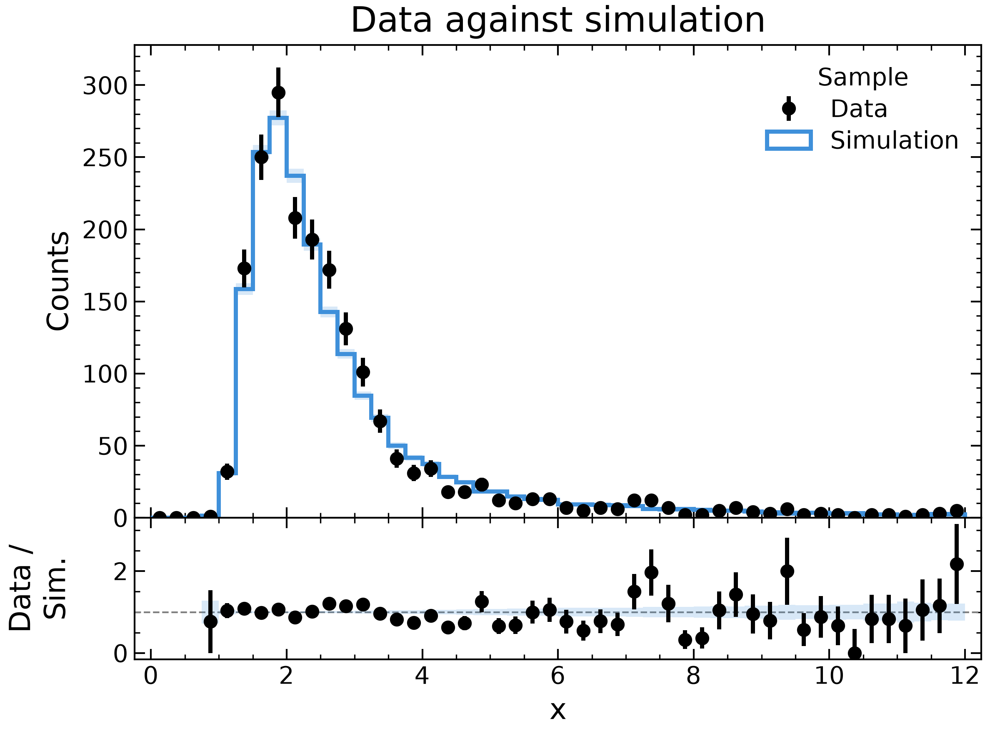

```bash
plotipus line --datafile Distributions -x Bin -y Counts --hue Sample --select Distribution -s Landau --data_hue Data --errory --lower ratio --labelx x --lower_labely 'Data / Sim.' --title 'Data against simulation'
```

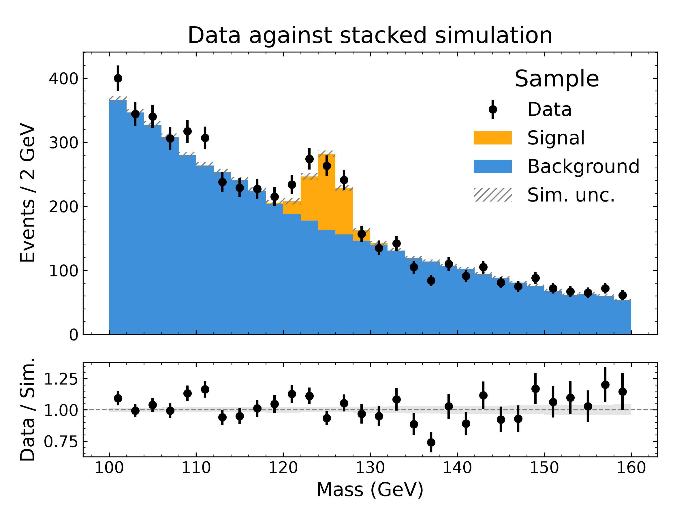

```bash
plotipus line --datafile Distributions -x Bin -y Counts --hue Sample --select Distribution -s Resonance --data_hue Data --stacked --errory --lower ratio --labelx 'Mass (GeV)' --labely 'Events / 2 GeV' --lower_labely 'Data / Sim.' --title 'Data against stacked simulation'
```

## Fits

`line --fit` draws a fit stored in the pickle; plotipus does not fit. A row
holds the data (`-x`/`-y` arrays) and its model: `FitFunction` (a name from
`plotipus.fits` or a registered module, or a callable) or `FitFunctionLabel`,
the fitted `Params` with `ParamsError` and `ParamsLabel`, and optionally
`ParamsUnit`, `ParamsFormat`, `Chi2` and `FitFunctionFormula`.

* The model is drawn as a smooth line over the data. `FitComponents`
  (`{"Signal": ["gaussian", [0, 1, 2]], "Background": ["exponential", [3, 4]]}`:
  each component's model and the indices of its parameters) adds a dashed line
  per component.
* The parameters (`--max_fit_params N` of them, `--chi2` for χ²/ndof) form a
  second legend, placed with the series legend where both cover the least
  data; `--fitlegendposition X Y` pins a text box there instead.
* `--lower residual` shows (data - fit) / fit, `--lower pull`
  (data - fit) / error.
* With `--data_hue`, the data is drawn as in
  [Data and simulation](#data-and-simulation) (ink points with error bars)
  and the fit takes the palette's first colour.

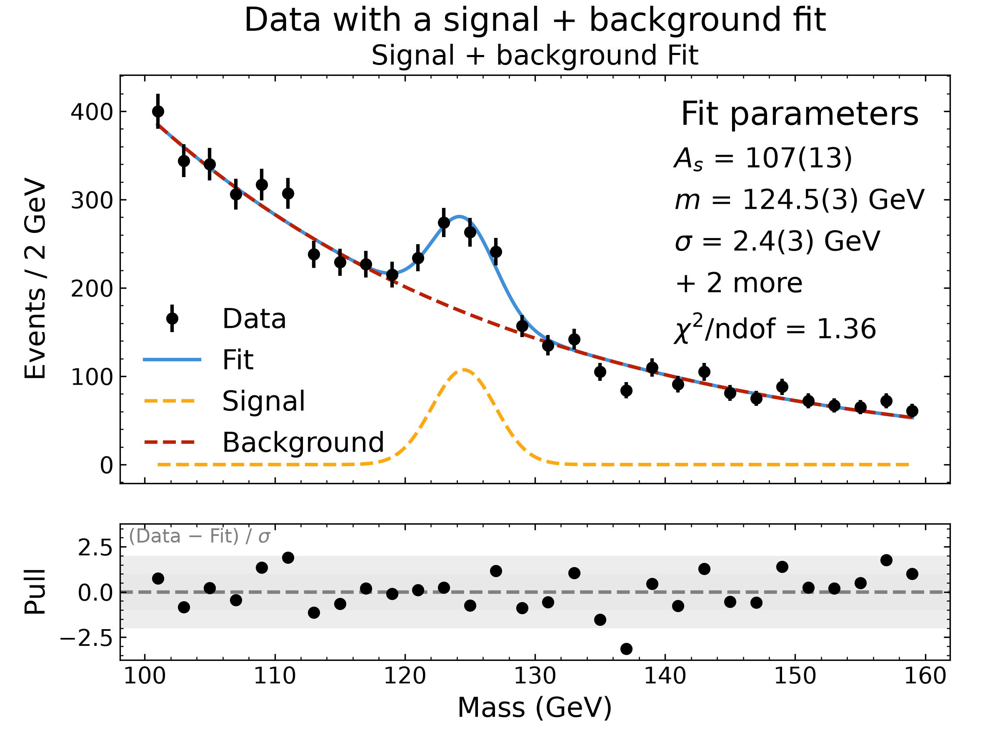

```bash
plotipus line --datafile Distributions -x Bin -y Counts --select Distribution Sample -s Resonance Data --fit --data_hue Data --lower pull --chi2 --max_fit_params 3 --labelx 'Mass (GeV)' --labely 'Events / 2 GeV' --title 'Data with a signal + background fit'
```

## Colorbars

`map` panels showing the same quantity share one colour scale and one
colorbar right of the row (`--colorbar shared`, the default unless `--norm`
normalises each panel); `--colorbar each` draws one per panel. Every bar is
labelled: `--labelz`, else the `--norm` label, else "Counts"/"Density", else
the `-z` column. Empty bins are blank, and with `--logz` the scale starts at
the smallest non-empty bin.

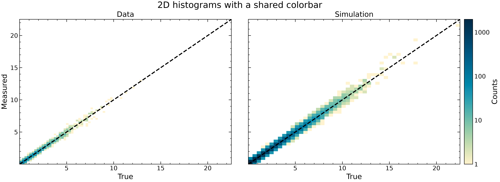

```bash
plotipus map --datafile Distributions -x Value -y Smeared --select Distribution -s Exponential --iterable Sample --diagonal --logz --labelx True --labely Measured --title '2D histograms with a shared colorbar'
```

## Contours

`map --contour -z DCHI2` draws confidence regions of Δχ² maps (or
significance maps with `--contour_level_mode z_values`):

* `--contour_dof 2` (default) puts the 1/2/3σ levels at Δχ² = 2.30, 6.18,
  11.83, the joint region of two parameters; `--contour_dof 1` gives
  Δχ² = 1, 4, 9.
* `--contour_label cl` (default) labels levels "68.3% CL", "95.4% CL",
  "99.7% CL"; `sigma` labels them "1σ" (or "1σ (2 dof)").
* `--fill_contours` fills one hue per map, darkest at the best fit and lighter
  outwards (`--fill_alpha`, `--fill_outer_alpha`). Outlines are solid, dashed
  and dotted (`--contour_linestyles`), and a `+` marks the minimum
  (`--no_best_fit` hides it).
* `--background none` (default); with `all`/`combined`/`first`, a Δχ²
  background is blank beyond the outermost level and its colorbar reads Δχ².
* `--horizontal`, `--vertical`, `--line`, `--square` and `--point` are drawn
  above the contours, in the text colour (white on a background image that
  fills the panel); the grid or `--rangex`/`--rangey` keeps the frame.

Without `-z`, `--contour` draws the sigma regions of sampled points over
their 2D histogram: the smallest regions holding 68.3, 95.4 and 99.7% of
the entries (the content of the two-parameter Δχ² levels; 39.3, 86.5 and
98.9% with `--contour_dof 1`), from the histogram smoothed by
`--contour_smoothing_sigma` bins (default 1).

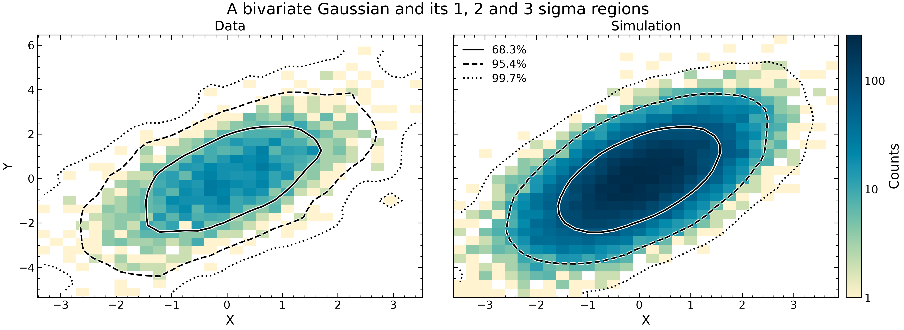

```bash
plotipus map --datafile Distributions -x X -y Y --select Distribution -s 'Bivariate Gaussian' --iterable Sample --contour --bins 30 --logz --title 'A bivariate Gaussian and its 1, 2 and 3 sigma regions'
```

The style file's `contours` section sets the defaults:
`{"dof": 2, "fill_mix": [1.0, 0.55, 0.25], "linestyles": ["-", "--", ":"], "label": "cl", "background": "none"}`.
`--contour_dof 1 --contour_label sigma --background all` restores the
levels, labels and background used before.

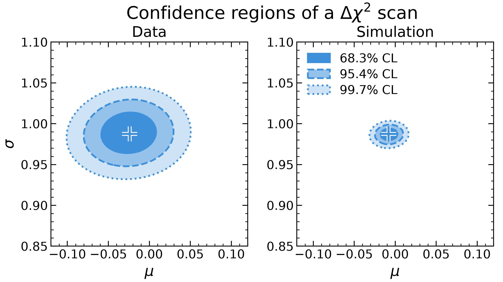

```bash
plotipus map --datafile Distributions -x MeanScan -y SigmaScan -z Chi2Scan --select Distribution -s Gaussian --iterable Sample --contour --fill_contours --labelx '$\mu$' --labely '$\sigma$' --title 'Confidence regions of a $\Delta\chi^2$ scan'
```

## Binned estimators

`line --binned` bins raw per-event x/y arrays and draws `--estimator` of y
per x bin, as error bars on markers (not joined) unless `--plot_type` says
otherwise; with `--data_hue`, the data are ink points and the other samples
open steps with error bands:

* **Errors** (`--estimator_error`): `sem` (default) is the standard error
  of the statistic: mean σ/√n, median 1.2533·σ/√n, std σ/√(2(n−1)), rms by
  the delta method, sum √Σy² (√n for counts, √Σw² for weights), none for
  max/min (σ is the bin's sample standard deviation). With `--errory`, the
  stored per-event errors are propagated instead (mean √Σe²/n, sum √Σe²,
  median 1.2533·√Σe²/n, std/rms to first order, max/min the selected
  event's error). `std` draws the bin's spread σ; `none` the bare values.
* **Small bins**: bins with fewer than `--min_count` entries (default 5)
  are dropped, with a note; `--min_count 1` keeps every non-empty bin.
* **Label**: the y label gets the error's name, e.g. "(mean ± s.e.m.)",
  unless `--note` is given or `--no_error_label` is passed.
* **Bins**: every hue of a panel is binned over the same edges, spanning
  `--rangex` or else the range of all the hues' x values.
* **Box plots** (`--plot_type box`): one box per bin (per category for a
  non-numeric x), the hues side by side within the bin, in their colours
  with one legend entry each. Numeric bins keep a plain numeric axis
  over the bin edges; `--box_tick_labels centres` puts a tick at each bin
  centre and `--box_tick_labels ranges` labels the bins "[a, b)". `--whis` sets the
  whisker reach (default 1.5 IQR, or two percentiles such as `5 95`) and
  `--no_fliers` hides the points past the whiskers.

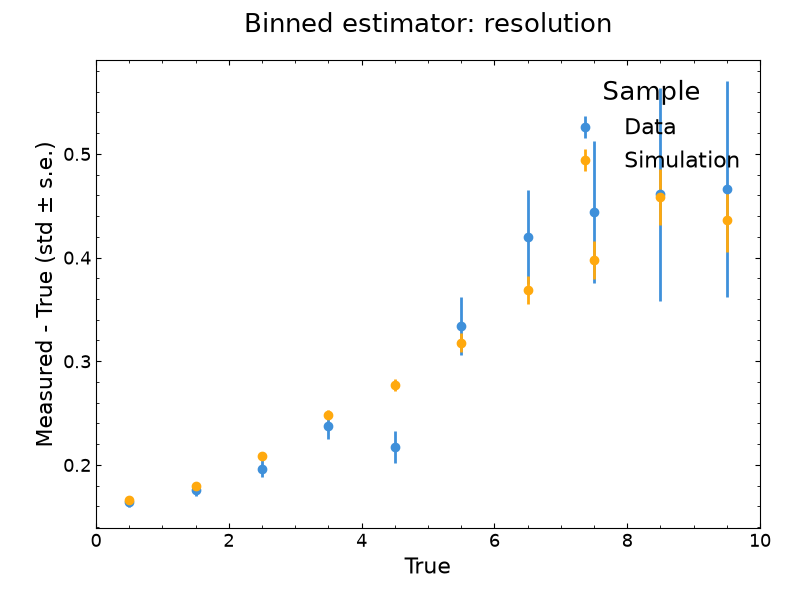

```bash
plotipus line --datafile Distributions -x Value -y Residual --binned --estimator std --hue Sample --data_hue Data --select Distribution -s Exponential --bins 11 --rangex 0 10 --labelx True --labely 'Measured - True' --title 'Binned estimator: resolution'
```

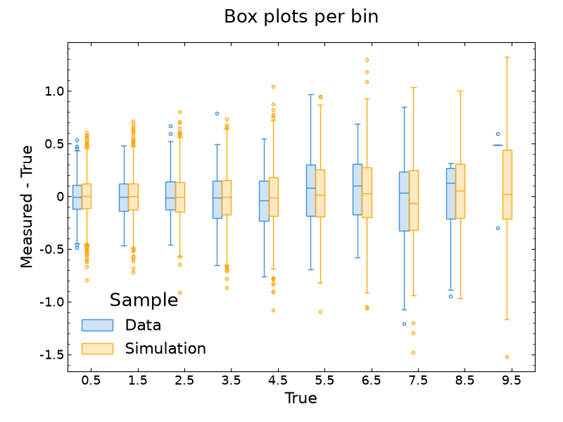

```bash
plotipus line --datafile Distributions -x Value -y Residual --binned --plot_type box --hue Sample --select Distribution -s Exponential --bins 11 --rangex 0 10 --labelx True --labely 'Measured - True' --title 'Box plots per bin'
```

## Categories and scatter

`cat` draws one value per category: the sum of each row's `-y` array over its
bins, or with `--integrate_over COL` the integral Σ y·Δx over that column
(for densities), by `-x` category and `--hue`; a scalar `-y` cell is one
value already. Category labels are rotated only when they would overlap
(`--xtick_rotation DEG` forces an angle). `--data_hue VALUE...` draws
those hue values as data: ink points with their errors at the category
centre, first in the legend, over the bars (or lines) of the others.
`scatter` draws one point per
entry of the array cells, with colour (`--colorby`), size (`--sizeby`) and
marker (`--markerby`) encodings; only the drawn columns are exploded into
points. A `--colorby` column of both signs takes the style's diverging map
(`plot_settings.diverging_cmap`), centred at 0; others the sequential
`image.cmap` (viridis; cividis with `--experiment dune`).

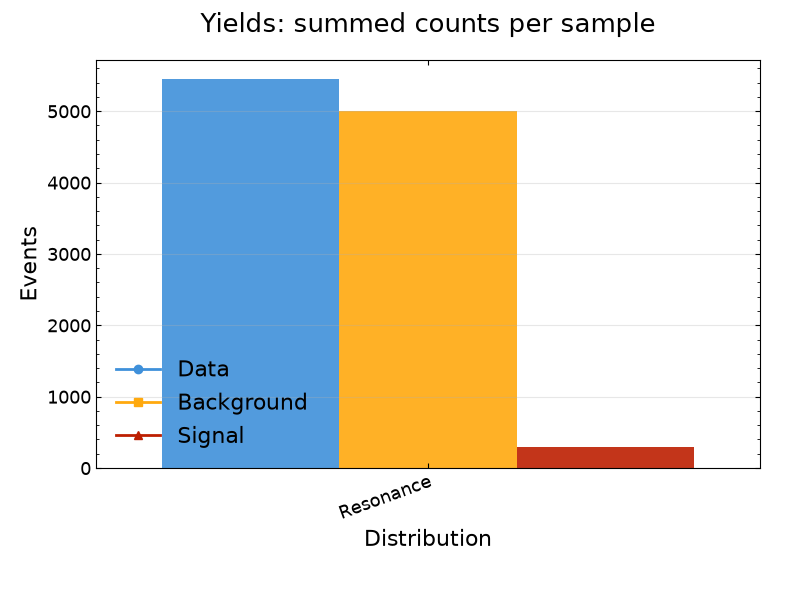

```bash
plotipus cat --datafile Distributions -x Distribution --hue Sample -y Counts --errory --select Distribution -s Gaussian Poisson Binomial Exponential Landau Breit-Wigner --kind bar --data_hue Data --labely Events --title 'Yields: summed counts per sample'
```

A `-y` column with one scalar per row (here the standard deviation of each
sample, with its error) is drawn as it is. Seven categories would overlap
side by side, so their labels are rotated, and the layout makes room for them:

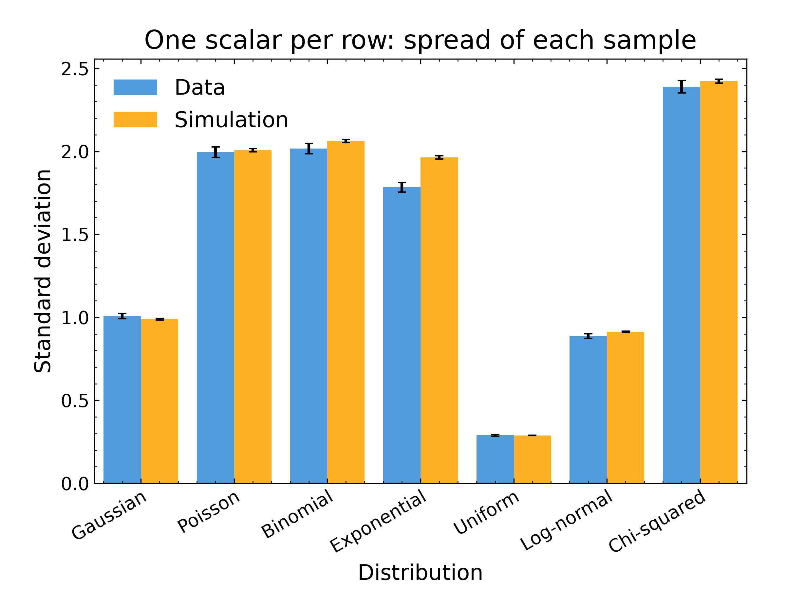

```bash
plotipus cat --datafile Moments -x Config --hue Sample -y Value --errory --select Variable Config Config Config Config Config Config Config -s Std Gaussian Poisson Binomial Exponential Uniform Log-normal Chi-squared --kind bar --data_hue Data --labelx Distribution --labely 'Standard deviation' --title 'One scalar per row: spread of each sample'
```

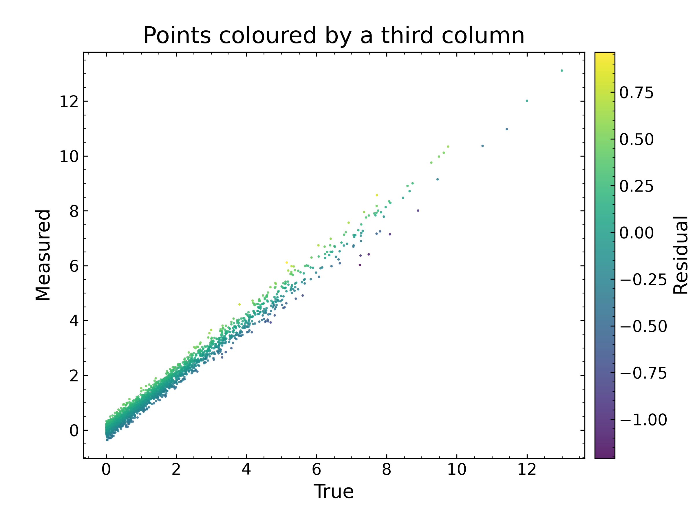

```bash
plotipus scatter --datafile Distributions -x Value -y Smeared --colorby Residual --select Distribution Sample -s Exponential Data --marker_size 4 --labelx True --labely Measured --title 'Points coloured by a third column'
```

`--hue` gives each row its own colour and legend entry. Here the rows are
three distributions picked with `--select` (values of one key are OR-ed):

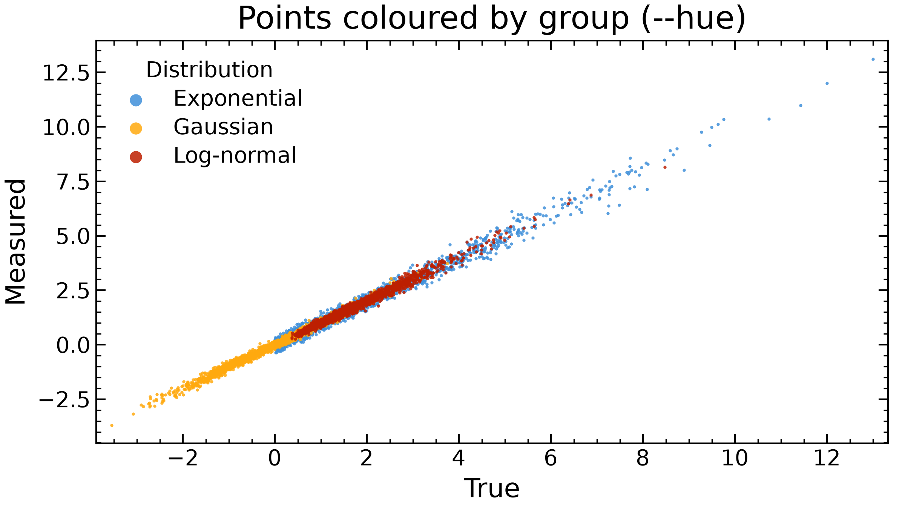

```bash
plotipus scatter --datafile Distributions -x Value -y Smeared --hue Distribution --select Sample Distribution Distribution Distribution -s Data Gaussian Exponential Log-normal --marker_size 4 --labelx True --labely Measured --title 'Points coloured by group (--hue)'
```
