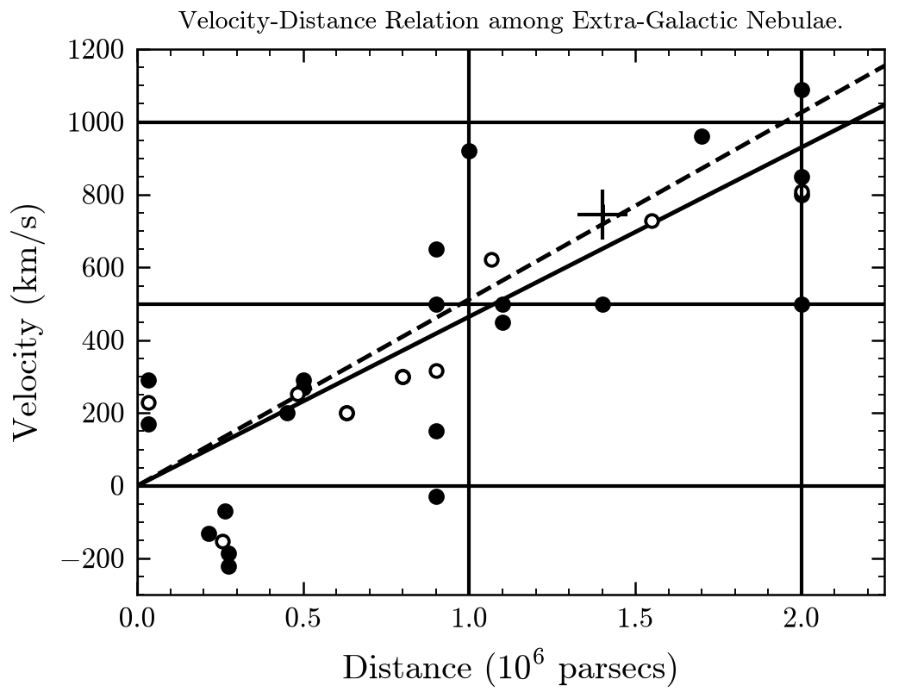
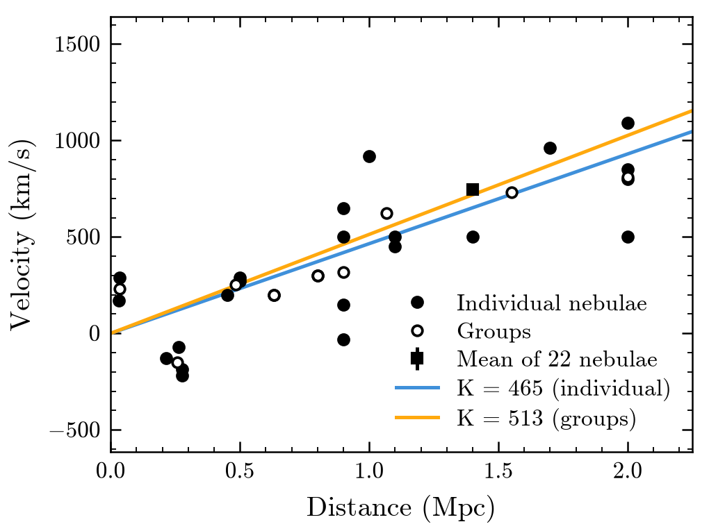
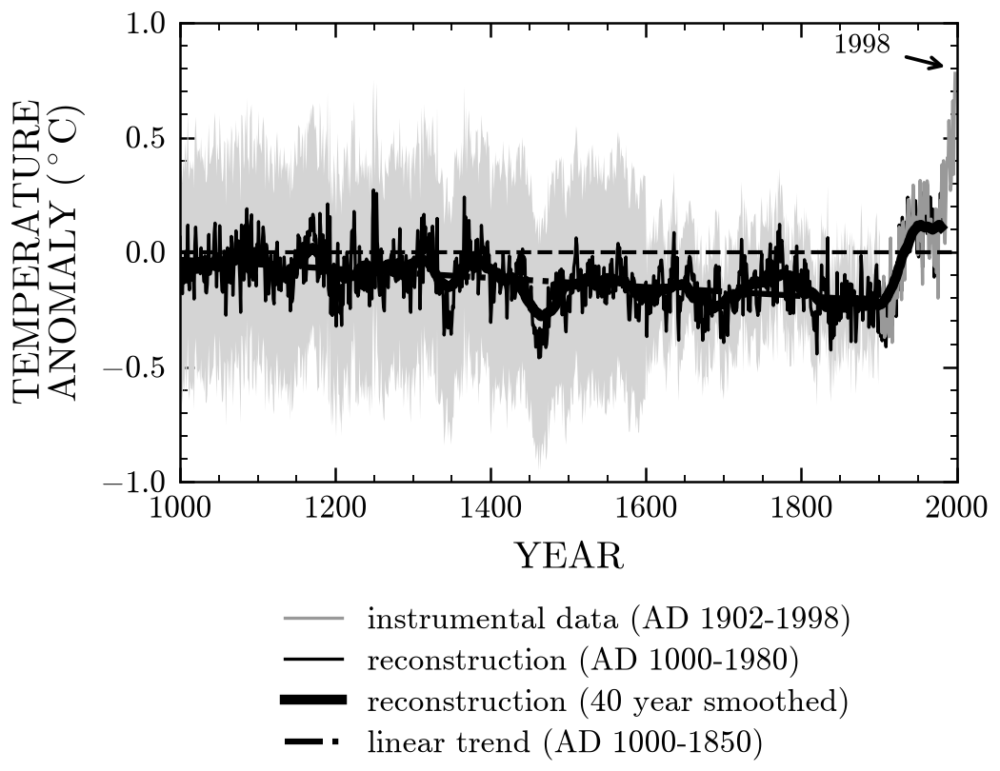
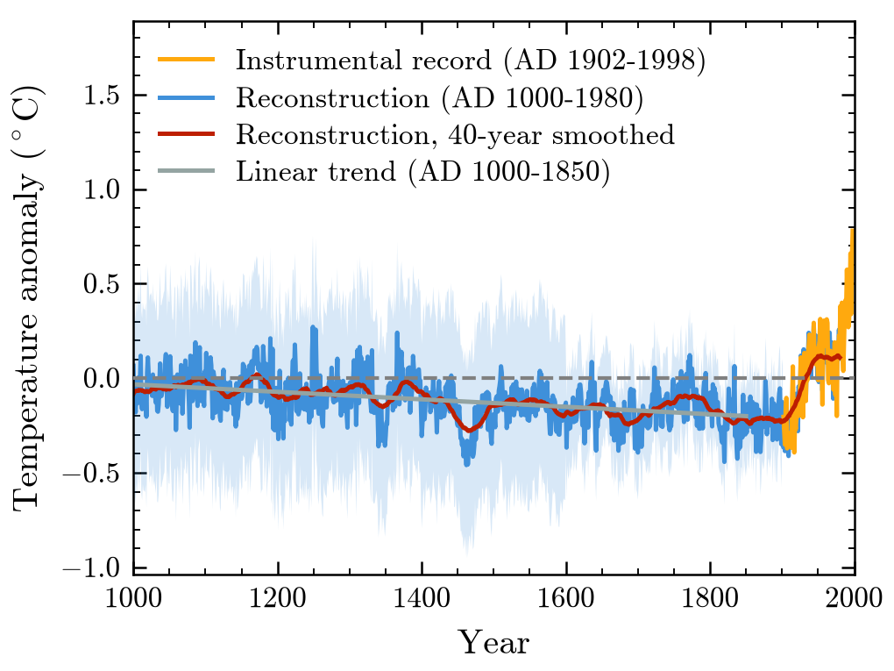
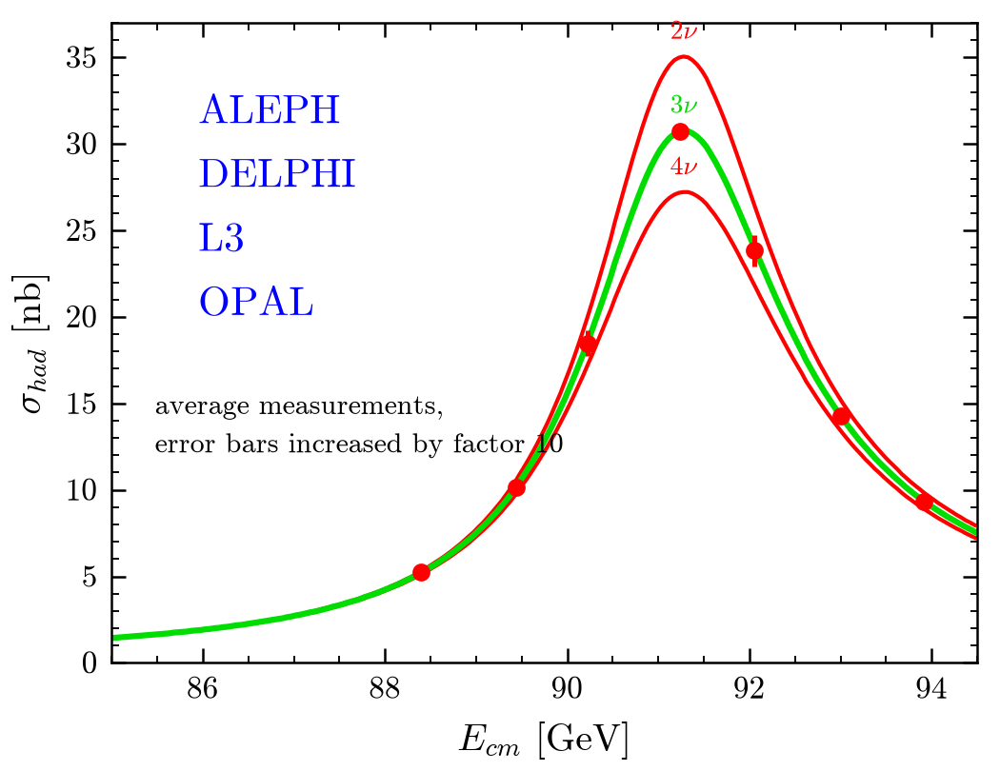
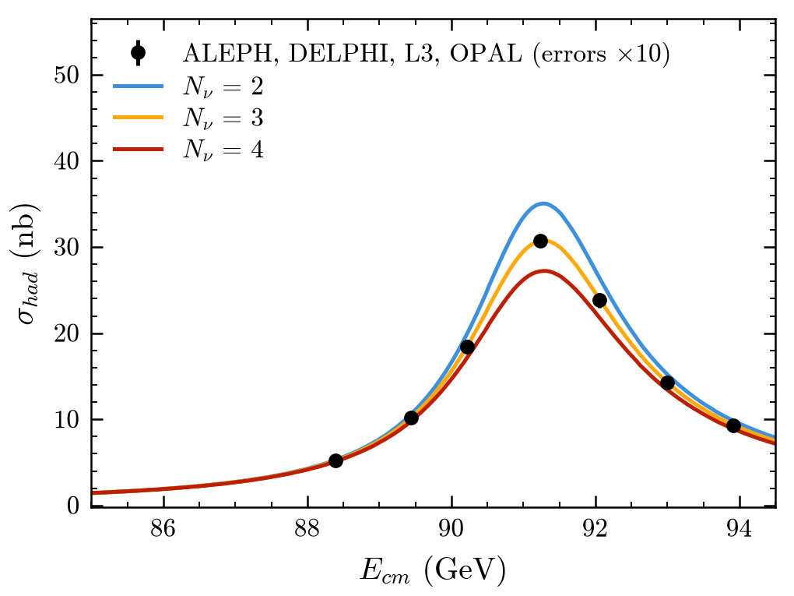
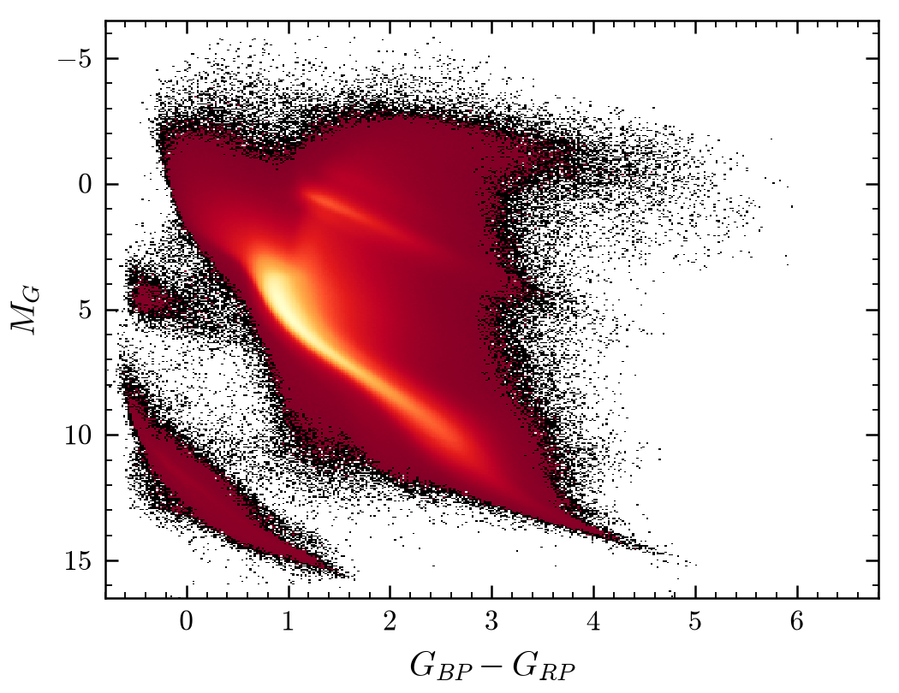
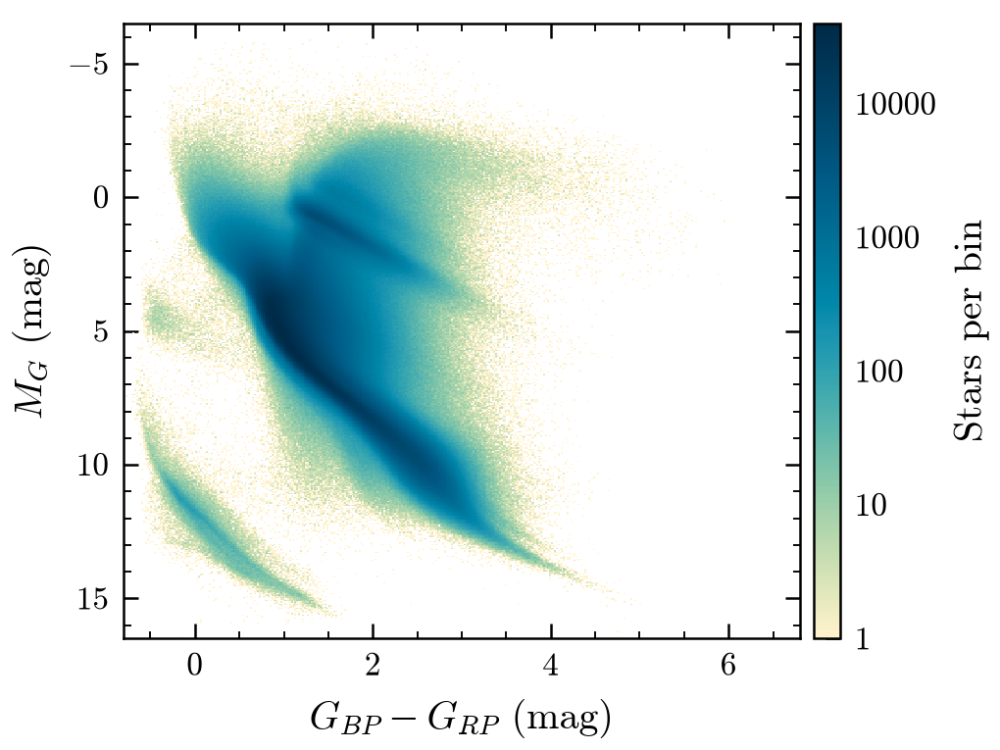
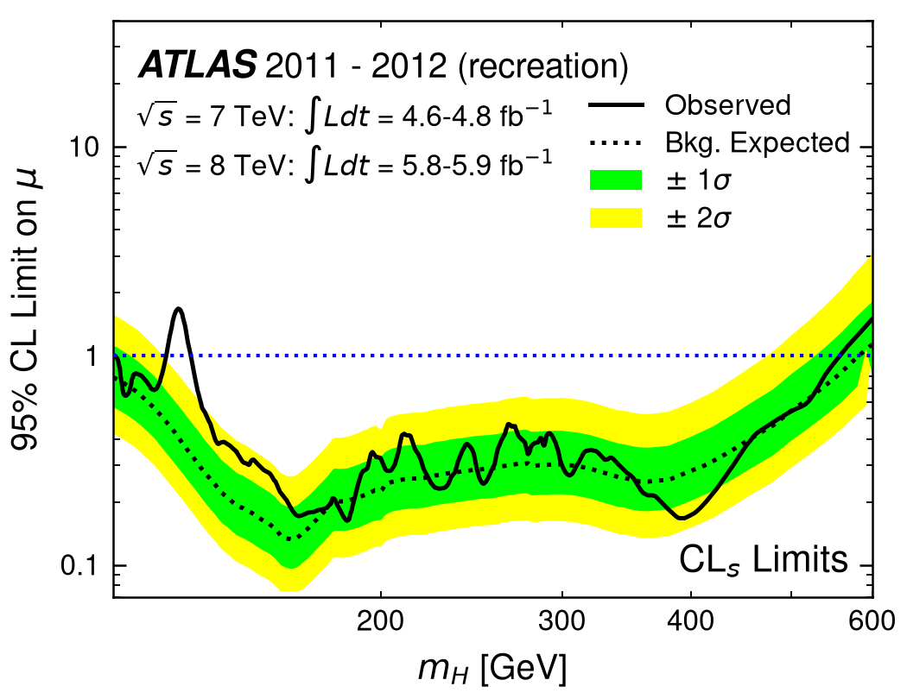
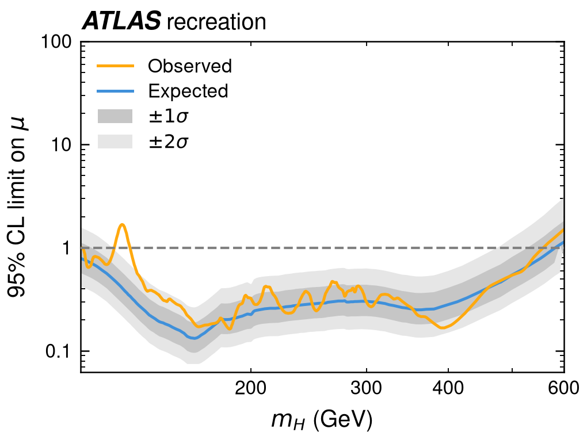

# plotipus style guide

The conventions every plotipus figure and table should follow. plotipus
applies them by default, so the shortest command gives the standard plot;
an option is needed only to depart from them. Users should respect the
rules plotipus cannot check (units in labels, the meaning of a column).
Contributors should keep new options and kinds inside them.

Each rule has an id (`U3`) to cite in issues and reviews, and a status:

- ✅ plotipus does this by default.
- ◐ partly, or only with an option.
- ✗ not yet: a gap, listed in [What plotipus does not do yet](#what-plotipus-does-not-do-yet).

The visual values (fonts, sizes, colours) and the research behind them are
in [design/style_spec.md](design/style_spec.md); this guide is the short,
enforceable version. Where the two differ, this guide is the target.

## Principles

1. **The kind of a series decides how it is drawn.** Data, simulation, fits
   and theory each have one look, the same in every plot (D1–D6).
2. **A figure has a fixed printed size per medium.** Text is never scaled to
   fit; layouts add or share space instead (L1–L6).
3. **Every number carries its uncertainty**, computed by the method that
   suits the quantity, and says which method it is (U1–U10).
4. **No silent guesses.** When plotipus fills in something the data did not
   give (an error, a colour past the palette, a dropped point), it prints a
   warning that names what it did and how to change it.
5. **Conventions live in the data.** A dataframe that follows the column
   conventions (F1–F5) needs no options to be drawn right.
6. **One command list, every medium.** Slides, paper and web differ in
   size, type and colour only; a category keeps its colour and a series its
   look across them.

## D. What a series is decides how it is drawn

| id | series | drawn as | status |
|---|---|---|---|
| D1 | **Data** (measured counts or values; `--data_hue`/`--overlay`) | markers in the ink colour with error bars, never joined by lines, never stacked, first in the legend | ✅ |
| D2 | **Simulation / prediction over bins** (MC, templates) | step outline over the bin edges; its uncertainty as a band | ✅ (steps are the default for compared binned series) |
| D3 | **Stacked simulation** | filled steps, bottom to top from the largest background to the signal, with a hatched band for the uncertainty of the total; data drawn over it | ✅ with `--stacked --stack_total_error` |
| D4 | **Fit** (stored `FitFunction`, `--fit`) | a smooth line, sampled densely (1000 points) over the fitted range, in the fit colour, on top of the data it fits; parameters in a box | ✅ |
| D5 | **Theory / model curve** (exact or with a stored band) | a smooth line; its uncertainty as a band of the same colour behind it | ✅ (`--series_type`, `--errory_type bands`) |
| D6 | **Unbinned measurements with errors** (one value per point) | markers with error bars, not joined unless `--connect` | ✅ |

- **D7.** A single plot mixes types per series, not per plot:
  `--series_type data=errorbar` gives points over model lines. Never draw
  data as a line to make it "look like" the simulation.
- **D8.** Lines join only things that vary continuously (functions, curves,
  ROC, scans). Bins are steps; independent measurements are points.
- **D9.** Shapes compared from samples of different size are normalised
  (`--density`) on one binning, and the y label says so ("Normalised
  entries", "Density").

## L. Size and layout

- **L1. Fixed size per medium.** ✅
  - Slides: 8 in wide at aspect 0.73.
  - Paper: one journal column, 3.4 in.
  - A figure is drawn at its printed size and never rescaled afterwards
    (no `bbox_inches="tight"`, no `\includegraphics[width=...]` resizing).
  - Choose another size with `--width single|onehalf|double|nature|slide|half-slide`.
- **L2. A lower panel takes its height from the plot.** ◐
  - Adding a ratio, pull or residual panel keeps the figure size; the upper
    panel gets shorter (height ratio 3:1, or 3:1:1 for two lower panels).
  - Status: done in slides (`lower_panels: share`). In paper, a lower panel
    still adds 30% of the height.
- **L3. Side-by-side panels look like single plots.** ✗
  - Each panel of a row keeps the proportions of a single plot, so the data
    and the text have the same size ratio. The figure gets wider, N plots
    wide for N panels.
  - When a row would be wider than the medium allows, panels wrap into more
    rows instead of shrinking: at most 2 columns on paper (2 × single =
    double column) and on slides.
  - Status: on main, panels share one figure width and get narrower.
    `--single_panel_size` draws the whole grid at one plot's size. The
    unmerged round-4 feedback adds `--layout facets`, which widens by 0.6
    of a plot per facet; this rule asks for 1.0.
- **L4. Lower panels are part of the plot.** ✅
  - They share x with no gap, and hide the upper x tick labels.
  - Each has a dashed reference line: 1 for a ratio, 0 for a difference or
    pull.
  - Their colours match the upper panel's.
  - Pull panels show ±1σ and ±2σ bands.
- **L5. Facets of one quantity share their axes and colour scale** when
  they are compared. ✅ `map` shares one colour scale and colorbar; compact
  `line` grids share y along each row and x down each column, with tick
  and axis labels on the outer panels only (`--sharex`/`--sharey`, grids
  from `--facet_row`/`--facet_col` or `--panel_grid`).
- **L6. Titles.** ✅
  - Slides carry a title, given with `--title`.
  - Paper drops titles and fit subtitles, because the caption is the title;
    `--keep_title` keeps them.
  - plotipus never invents a title from the command (`auto_title: false`).

## U. Uncertainties

- **U1. Every plotted value carries an uncertainty.** ✅
  - If the dataframe has an error column, it is drawn (F2).
  - If not, plotipus computes the standard interval for the quantity (U3)
    and prints a warning naming it, for example: *"Counts has no error
    column; drawing Garwood (Poisson) 68% intervals."*
  - If no standard interval applies, it draws the values without errors and
    warns that they have none.
  - Exact quantities (a model curve, a fit, a theory line) are exempt and
    print no warning: `--exact VALUE...` names them (`--exact` alone: every
    series), and closed shapes (`--plot_type fill`) are exempt.
  - Status: `line` and `cat` draw the stored errors without `--errory`
    (still accepted; it only names the file). Without an error column,
    integer counts get Garwood intervals and `--count_column` efficiencies
    Clopper–Pearson, each with a warning; other series warn that they have
    none. `--no_error` draws no errors and silences the warnings. `hist`
    draws data with Garwood intervals; simulation histograms carry no band,
    and `scatter` shows single observations without errors.
- **U2. 68.3% (one σ) unless stated.** ✅ `--confidence_level` changes it,
  and the label then says so.
- **U3. The interval suits the quantity**:

  | quantity | interval | why not the simple one | plotipus |
  |---|---|---|---|
  | unweighted counts n | Garwood (exact Poisson), asymmetric | √n is 0 at n = 0, and goes below 0 for small n | ✅ the default for counts without an error column (`line`, `cat`, `hist` data, tables); `--errory_type poisson` forces it |
  | weighted counts | √Σw² | — | ✅ `hist --weight`, stack totals |
  | efficiency k/N | Clopper–Pearson, asymmetric, inside [0, 1] | the binomial √(ε(1−ε)/N) is 0 at ε = 0 and 1, and leaves [0, 1] | ✅ plots: `--count_column N` (forced by `--errory_type clopper_pearson`); tables: `Passed`/`Total` columns, or `--clopper_pearson` |
  | binned mean / median | standard error of the statistic | the spread (std) is not the uncertainty of the mean | ✅ `--binned --estimator mean` |
  | stack total | the stacked errors in quadrature, or a stored total (with systematics) | — | ✅ `--stack_total_error[_column]` |
  | 2D confidence region | Δχ² for 2 degrees of freedom: 2.30, 6.18, 11.83 | the 1-dof values (1, 4, 9) undercover | ✅ `--contour_sigmas` |

- **U4. Intervals respect physical bounds.** ✅ Computed intervals do:
  Garwood never goes below 0, and Clopper–Pearson stays inside [0, 1].
  Stored errors that cross a bound are drawn as given, with one warning per
  series naming the bound: below 0 when every value is non-negative, above
  1 (or `--efficiency_scale`) for an efficiency (`--count_column`, or every
  value between 0 and 1). Tables warn the same way, per variable.
- **U5. Ratios handle empty bins physically.** ✅
  - 0 / 0 (nothing seen, nothing expected) is an open marker at the
    reference: the bin agrees and carries no information.
  - n / 0 is an arrow at the top of the panel, never a point at infinity.
  - 0 / d is 0, with the upper Garwood error of observing nothing (1.84 / d).
  - The data error goes on the points and the prediction's error is a band
    around 1, so neither is counted twice.
- **U6. The interval is named.** ✅
  - Slides add it to the y label, e.g. "68% CL (Poisson)" (`--error_label`).
  - On paper it goes in the caption.
- **U7. Bands for curves, bars for points.** ✅ Lines and steps show their
  uncertainty as a band at 20% opacity behind the line; points show bars
  without caps.
- **U8. Magnified errors say so.** ✅ `--error_scale K` adds "(errors ×K)"
  to the legend label.
- **U9. Statistical and systematic uncertainties are labelled apart** when
  both are drawn ("stat.", "stat. ⊕ syst."). ◐ plotipus draws one band
  for the stack total, labelled by the style's `stack_error.label` ("Sim.
  unc." by default); set it to say what the band contains. A series can
  carry both as nested bands: `--errory_column Stat StatSyst --band_labels
  'stat.' 'stat. ⊕ syst.'`.
- **U10. Tables compute intervals the same way plots do.** ✅
  - A table that derives a number computes its error with the same method
    as the plot of that number: Clopper–Pearson for efficiencies, Garwood
    for small counts.
  - It prints asymmetric intervals as $x^{+a}_{-b}$.
  - It never falls back to a symmetric standard deviation that crosses a
    bound: no "0.98 ± 0.05" for an efficiency.
  - Status: without an error column, `Passed`/`Total` frames get
    Clopper–Pearson and integer counts Garwood, with a warning naming the
    interval; `--poisson COLUMN` and `--clopper_pearson PASS [TOTAL]` ask
    for them; `--error_mode std|sem` on counts warns.

## N. Numbers and text

- **N1. Axis labels name the quantity and its unit**: "Energy (GeV)",
  sentence case. HEP brackets "[GeV]" are fine, but use one style per
  project. Dimensionless quantities have no unit.
- **N2. Binned counts state the bin width**: "Events / 2 GeV", or
  "Entries / bin" for variable bins.
- **N3. No e-notation and no offset text.** ✅
  - Plain numbers between 10⁻³ and 10⁵.
  - Past that, a common power of ten goes into the axis label.
  - Log axes label decades (10ⁿ), or plain numbers inside one decade (`--log_labels`).
- **N4. Values are rounded to their error** (PDG rule): the error has 2
  significant figures if its leading digit is 1, otherwise 1, and the value
  is rounded to the same decimal place. ✅ in tables.
- **N5. Math goes through mathtext**, never Unicode symbols: `$\times$`,
  `$\sigma$`, `$-$`. The paper fonts lack many Unicode glyphs, and mathtext
  draws them in every font. ✅ for plotipus's own labels.
- **N6. Labels are for readers, not columns.** Rename values and columns
  with mappings (`--hue_mapping`, `--variable_label_map`; `--variable_mapping`
  in tables) instead of showing
  `pi_plus_v2`.

## C. Colour

- **C1. A colour belongs to a category.** ◐
  - The same hue value keeps its colour across panels, lower panels and
    files.
  - Pin colours per project with a mapping (`iterable_color_mapping`).
    Without one, colours follow the order of the values.
- **C2. Palette.** ✅
  - Petroff-10 (colour-vision tested), the same order in every medium and
    theme.
  - Past 10 categories, colours repeat with a warning.
  - Ordered categories (runs, energies) should take a colour map with a
    colorbar instead: `--hue_cmap viridis` (`line`, `hist`) colours them by
    value or order and draws the colorbar in place of the colour legend.
- **C3. Data are ink.** ✅ Data points are black (white on dark), so they
  never compete with the simulation's colours.
- **C4. Colour maps.** ✅
  - Sequential, monotonic in lightness: `plotipus` by default; `cividis`
    when fine detail must survive colour-vision deficiency.
  - Diverging (`RdBu_r`, centred) only for signed quantities with a
    meaningful zero: pulls, differences, correlations.
  - Never jet, rainbow or turbo for ordered data.
  - Counts spanning more than 2 decades use a log scale. Empty bins are
    transparent.
- **C5. One encoding per channel.** ✅ `--hue` sets colour and `--style`
  sets line style or marker, never the other way round.

## A. Axes

- **A1. Physics frame.** ✅ Four spines; ticks inside and mirrored, with
  minor ticks; no grid.
- **A2. Histograms touch the frame**, with no x margin; points and lines
  get 2%, so no marker is cut by the frame. ✅
- **A3. Counts and bars start at zero** on a linear axis. Use a log axis
  when the range spans more than about 3 decades, or when tails matter.
- **A4. Reversed axes come from the range** (`--rangey 17 10`, for
  magnitudes), and overlays keep the direction. ✅
- **A5. Ratio panels** have a range symmetric around the reference and 3–4
  ticks. ✅

## G. Legends and annotations

- **G1. Legends never cover data.** ✅
  - plotipus places them in measured empty space, or above the axes with
    room reserved.
  - Pin a position with `--legend_loc`; `--legend_inside` keeps them inside.
- **G2. Legend order follows the plot.** ✅
  - Data first (`--overlay_legend last` for the other convention).
  - Then the stack from top to bottom.
  - Then the uncertainty band.
- **G3. No legend for one unnamed series.** ✅ A lower panel whose colours
  repeat the upper panel's has no legend either.
- **G4. Frameless legends.** ✅ A legend title only when the column name
  adds information.
- **G5. Experiment and status labels** use the built-in header (`--label`,
  `--experiment`, `--label_status`, `--watermark`), never free `--text`.
  Unapproved results carry their status. ✅

## O. Output

- **O1. Formats.** ✅ Slides: PNG at 300 dpi. Paper: PDF, vector, at the
  printed size (`--format pdf`).
- **O2. Every figure is reproducible** from a line of a command list
  (`<list>_scripts.txt`) and the project's `plotipus.toml`. No figure is
  edited after it is drawn.
- **O3. One command list, every medium.** ✅ `--medium all` (or
  `[project] media`) writes the slide and paper versions side by side.
- **O4. File names come from the options.** ✅ They are deterministic, so
  re-running a list overwrites the same files.

## F. Data conventions

The rules above work without options only when the dataframe follows these
conventions.

- **F1.** One row per series (sample, config, variable). Binned quantities
  are arrays in the cells: bin centres in x, values in y.
- **F2.** Errors in columns named after the value: `{y}Error` (symmetric),
  or `{y}Error+` and `{y}Error-` (asymmetric, as sizes). Use
  `--errory_column` for other names.
- **F3.** Counts are stored as counts, not as rates or normalised values,
  so that the Poisson intervals and the `--density` normalisation stay
  right. Normalise when drawing.
- **F4.** Efficiencies are stored together with their trials (`Passed` and
  `Total` columns, or a count column), so that Clopper–Pearson can be
  computed.
- **F5.** Fits are stored as `FitFunction`, `Params`, `ParamsError` and
  `ParamsLabel`, so the fit line and the parameter box come from the same
  numbers as the table.
- **F6.** One value per row (scalars instead of arrays) works too, e.g.
  for `cat` and `table`; `hist` takes the raw per-event values as arrays.
  The pickle may hold anything `pd.DataFrame` accepts: a list of row dicts,
  a dict of columns, or a dict of DataFrames, which are concatenated with a
  `Source` column. Files of one analysis are told apart by prefixes:
  `--configs A --names B --datafile Spectrum` loads `A_B_Spectrum.pkl`.

## Before and after: famous figures

The famous figures of [examples/famous](../examples/famous/README.md) are
drawn twice. On the left, the command that reproduces the published look
(the README gallery); on the right, the same data with plotipus's defaults,
giving only columns, selections, ranges and labels
([restyled_scripts.txt](../examples/famous/restyled/plots/restyled_scripts.txt)).
Each change cites the rule it applies. The originals were good figures for
their time and medium; these pairs show what the rules change, not what
the authors got wrong. Both sides are recreations, not official results.
`make -C examples famous` redraws them.

**Hubble 1929, Fig. 1**

| before (faithful) | after (plotipus defaults) |
|---|---|
|  |  |
| Grid lines through the data, every series black with no legend, a bold title above the frame. | No grid (A1); the data in ink with a legend that names each series (C3, G1); the two fits in palette colours (C2); the title left to the caption (L6); the unit as Mpc (N1). |

**Mann, Bradley & Hughes 1999, Fig. 3(a)**

| before (faithful) | after (plotipus defaults) |
|---|---|
|  |  |
| Upper-case axis labels, the legend under the axes, a grey band that belongs to no line. | Sentence-case labels with units (N1); the band in its line's colour, behind it (U7); palette colours (C2); the legend in the empty space of the axes (G1). |

**LEP Z lineshape, Phys. Rept. 427, Fig. 1.13**

| before (faithful) | after (plotipus defaults) |
|---|---|
|  |  |
| Red data on red curves, labels in bold blue, the ×10 error bars explained in free text. | The data in ink (C3); the curves in palette colours with a legend (C2, G1); the magnified errors said in the legend label (U8); units in parentheses (N1). |

**Gaia DR2 HR diagram, A&A 616, A10, Fig. 1**

| before (faithful) | after (plotipus defaults) |
|---|---|
|  |  |
| A red-to-yellow square-root scale with black for the sparsest bins and no colorbar: the counts cannot be read. | plotipus's lightness-monotonic map on a log scale, for counts that span four decades, with a labelled colorbar (C4); magnitudes with their unit (N1). |

**ATLAS 2012, Fig. 7(a)**

| before (faithful) | after (plotipus defaults) |
|---|---|
|  |  |
| Green and yellow bands, which red-green colour-vision deficiencies cannot tell apart, a blue dotted reference line and a free-text label. | Graded bands, lighter for 2σ (C4); the reference line dashed in the muted colour; the status in the experiment header (G5). |

## For contributors: keeping plotipus inside the guide

- A new option defaults to the guide's behaviour; departing from it is the
  explicit option, never the reverse.
- When plotipus fills in or drops something, it warns with
  `rprint("[yellow]Warning:[/yellow] ...")`: what happened, and the option
  that changes it.
- Each rule that plotipus enforces has a test that names it: write the
  rule id in the test's docstring.
- Each feature has a gallery entry (`examples/gallery`) that renders it in
  slides and paper, and the reviewer looks at both.
- When the guide and the code disagree, fix the code or change the guide
  in the same pull request.

## What plotipus does not do yet

| rule | gap | proposed change |
|---|---|---|
| U1 | `hist` draws simulation without its statistical error | A √Σw² band (Garwood for unweighted counts) by default, `--no_error` to drop it |
| L2 | Paper adds 30% height for a lower panel | `lower_panels: share` in `paper.json` too |
| L3 | Each facet widens the figure by 0.6 of a single plot (`facet_width`), so facets are narrower than single plots | Facet width 1.0 × a single plot, wrapping at 2 columns on paper and slides |
| C1 | Colours follow value order unless a mapping pins them | A project-level colour registry that stores each new category's colour on first use |
