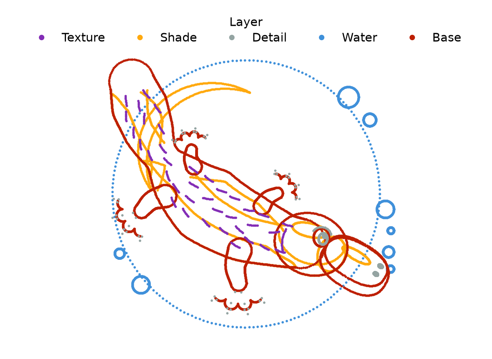
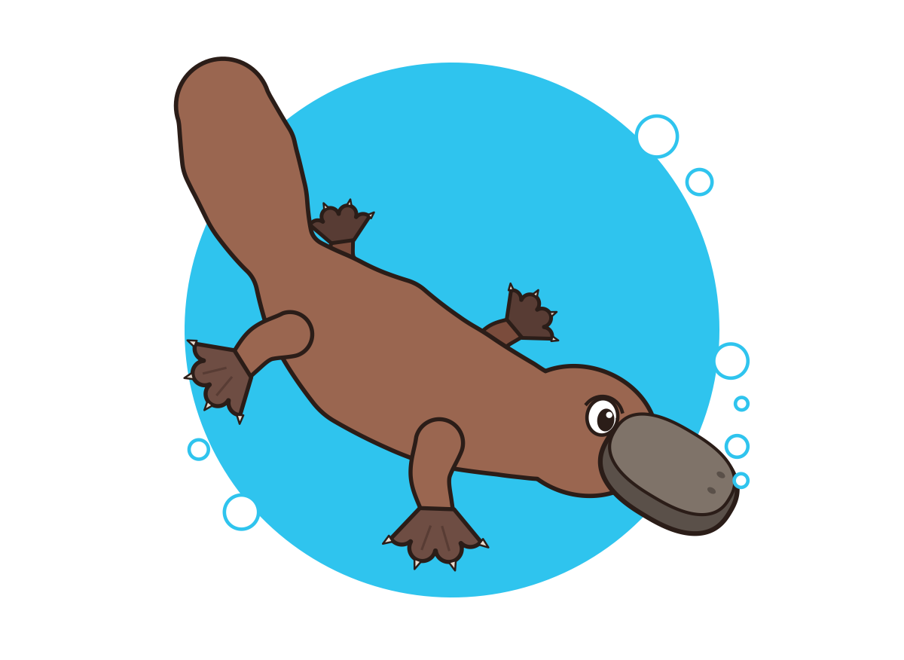
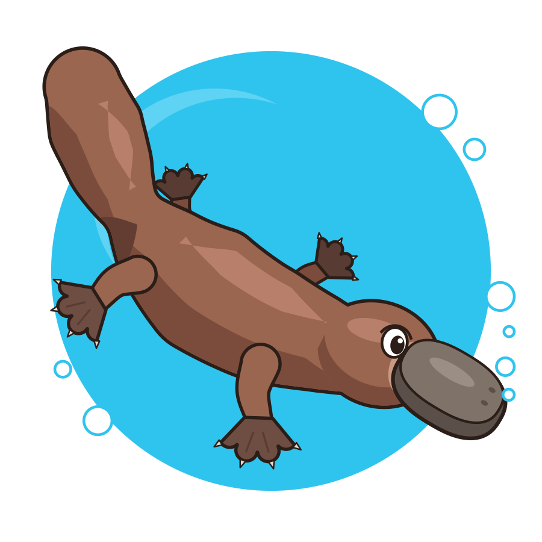

# Tutorial: draw the mascot

plotipus draws pandas DataFrames. In this tutorial the DataFrame is the
plotipus mascot, a platypus diving through a water disc, and you draw it in
five steps:
1. its raw points;
2. a colouring-book outline;
3. flat colours;
4. light and shade;
5. the finished mascot.

Every step reads the same file, and only the command changes. Along the way
you meet the ideas behind every plotipus figure:
- one row per series;
- `--hue`;
- selecting rows;
- taking styles from the data.

## The data

From the repository root:

```bash
cd examples/mascot
python make_mascot.py        # writes input/data/Mascot.pkl
```

`make_mascot.py` builds the platypus out of simple curves and writes one row
per shape, 97 in all, in the order they are drawn:

| column | holds |
|---|---|
| `X`, `Y` | the shape's outline (arrays) |
| `Part` | a unique name: `water`, `body`, `bill_top`, `eye_white`, `fur12`, … |
| `Layer` | `water`, `silhouette`, `base`, `shade`, `texture` or `detail` |
| `Mode` | `fill` for a closed shape, `line` for a stroke |
| `Face` | fill colour (for a stroke, its colour) |
| `Edge`, `Width` | edge colour (`none` for no edge) and width in points |

The folder is a small plotipus project: `plotipus.toml` points at the data
and at `style.json`, which sets a square 6-inch figure. The five commands
below are in `input/plots/mascot_scripts.txt`, so `plotipus run mascot` draws
them all into `output/plots`. Some of them are long, because a drawing needs
more options than a plot. Every option is explained where it first appears.

## 1. The points

```bash
plotipus line --datafile Mascot -x X -y Y --hue Layer \
    --select Layer Layer Layer Layer Layer -s water base shade texture detail \
    --capitalize_legend --legend_loc 'upper center' --legend_ncol 5 \
    --axis equal off --rangex -6.1 6.1 --rangey -5.6 6.6 --title None
```



- **`line` draws y against x.** With no `--plot_type`, each series is drawn
  as markers, so you see every point of every outline.
- **`--hue Layer`** gives one series, and one colour, per value of the
  `Layer` column. All rows with the same value form one series. The legend
  names the values. The colours are the default Petroff-10 palette.
- **`--select Layer … -s …`** keeps only the listed layers. `--select` pairs
  each column with one value, and values of the same column are OR-ed, so
  the column is repeated. The `silhouette` layer is left out: it repeats the
  body and head outlines point for point.
- **`--axis equal off`** makes one unit as long on x as on y (a circle stays
  round) and hides the frame. `--rangex`/`--rangey` frame the drawing and
  leave room for the legend.

## 2. A colouring-book page

```bash
plotipus line --datafile Mascot -x X -y Y --hue Part \
    --select Layer Layer Layer -s water base detail \
    --plot_type fill --plot_type_column Mode \
    --facecolor role:paper --edgecolor role:ink \
    --no_legend --axis equal off --rangex -5.6 5.6 --rangey -5.6 5.6 --title None
```


- **`--hue Part`** makes every shape its own series. Shapes are drawn in row
  order, so later shapes sit on top.
- **`--plot_type fill`** draws each series as a closed, filled shape.
  **`--plot_type_column Mode`** takes the plot type of each series from the
  data, so the strokes (claws, webbing, eyelid) stay lines.
- **`--facecolor` and `--edgecolor`** set one colour for every face and every
  edge or stroke.
  - `role:paper` and `role:ink` are the style's background and text colours,
    so the page follows a dark theme too.
  - Because every face is filled, each shape hides the lines of the shapes
    behind it. Nothing has to be erased.

## 3. Flat colours

```bash
plotipus line --datafile Mascot -x X -y Y --hue Part \
    --select Layer Layer Layer Layer -s water silhouette base detail \
    --plot_type fill --plot_type_column Mode \
    --color_column Face --edgecolor_column Edge --linewidth_column Width \
    --no_legend --axis equal off --rangex -5.6 5.6 --rangey -5.6 5.6 --title None
```



The colours now come from the data:
- `--color_column Face` gives each shape its fill (a stroke its colour).
- `--edgecolor_column Edge` and `--linewidth_column Width` give its edge.

The `silhouette` layer is back. It holds ink copies of the body and head with
a thick edge, drawn under their fills, so the animal gets one bold outline
where the parts meet.

Colours stored in the data win over the palette. To recolour a part
without touching the data, add a mapping, which wins over the data. A
mapping is a named dictionary in `style.json` that maps hue values to
colours:

```json
{"mappings": {"mascot": {"water": "#1f6fb2"}}}
```

Pass it with `--iterable_color_mapping mascot`, and the water turns deep
blue. Projects use mappings the same way, to pin the colour of each sample
in every figure.

## 4. Light and shade

Add the `shade` layer to the selection:

```bash
    --select Layer Layer Layer Layer Layer -s water silhouette base shade detail
```



The shade layer gives the platypus volume:
- a lit band along the back;
- a darker underside, and deeper shade under the tail;
- a lighter muzzle;
- a highlight on the bill;
- a lighter arc on the water disc.

## 5. The mascot

Drop `--select` to draw every layer. The `texture` layer adds the fur
strokes:

```bash
plotipus line --datafile Mascot -x X -y Y --hue Part \
    --plot_type fill --plot_type_column Mode \
    --color_column Face --edgecolor_column Edge --linewidth_column Width \
    --no_legend --axis equal off --rangex -5.6 5.6 --rangey -5.6 5.6 --title None
```


The README shows the same command on a black background in dark mode. That
version is in `examples/mascot/dark`, a two-file project that reads the same
data and adds a style overlay, `dark.json`. The overlay sets the figure and
axes background (`figure.facecolor`, `axes.facecolor`, `savefig.facecolor`)
and the `ink` and `paper` colour roles. The data and the command are
unchanged.

## What you used

| idea | options |
|---|---|
| one series per value of a column, drawn in data order | `--hue` |
| keep some rows | `--select COL … -s VALUE …` |
| how series are drawn | `--plot_type`, or per series `--plot_type_column` |
| styles stored in the data | `--color_column`, `--edgecolor_column`, `--linewidth_column` |
| one colour for everything | `--facecolor`, `--edgecolor` (colours, `rgb(...)` or `role:NAME`) |
| figure framing | `--axis equal off`, `--rangex`, `--rangey`, `--title None`, `--no_legend` |
| run a list of commands | `plotipus run mascot` (`input/plots/mascot_scripts.txt`) |

The same options draw any figure made of shapes: detector geometries,
regions of a parameter space, annotated diagrams. For plots of measured
data, continue with the example project in the [README](../README.md#quick-start)
and the [options](options.md).
